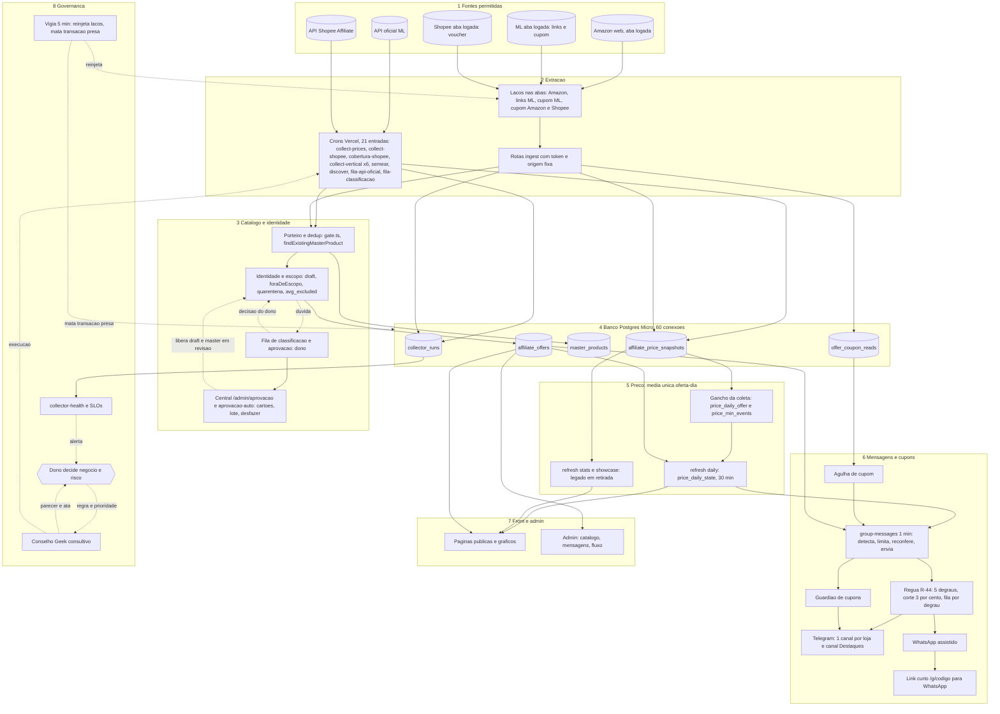

# Fluxo Mestre do Espaço Geek 86

**Lei de convivência dos processos.** Este documento liga, num único fluxo, tudo o que o projeto faz: do dado bruto da página da loja até o front e as mensagens automáticas. Ele é a regra imperativa de como os processos convivem (memória do projeto: `fluxo-mestre-regra-imperativa`). Quem muda um nó, uma fila, uma cadência ou uma regra muda este documento no mesmo commit.

- **Versão:** 1.1, 2026-11-12 (atualização da noite; a 1.0 é da manhã). Consolida os seis capítulos de `docs/fluxo-mestre/` (01 extração, 02 catálogo e banco, 03 preço, 04 mensagens e cupons, 05 front e admin, 06 orquestração e governança).
- **Para quem:** o dono (visão geral, seção 1; decisões pendentes, seção 9) e os agentes (todas as seções; o que fazer em cada disputa, seções 4 a 7).
- **Fila viva de execução:** `docs/fila-de-execucao.md`. As pontas soltas deste documento (seção 10) apontam para os números dessa fila.
- **Ata da consolidação:** `docs/conselho/atas/2026-11-12-fluxo-mestre.md` (pareceres independentes de 8 membros já incorporados; divergências registradas na ata e na seção 9).
- **Ata da atualização 1.1:** `docs/conselho/atas/2026-11-12-atualizacao-guia-mestre.md`. Entrou na 1.1, conferido contra o código: Central de Aprovação (N60) e aprovação contínua (N61); cobertura Shopee (N62); link curto `/g/<código>` (N63) e canal Destaques (N64); loop de promoções da Amazon (N65, em construção); regras R-44 a R-46; incidentes do dia (seção 7); fila #34 a #37; execução da autorização do dono sobre a seção 9 (seção 9.1).

## Como ler as marcas de confiança
| Marca | Significado |
|---|---|
| MEDIDO | lido no banco ou no código na data do capítulo de origem (2026-11-12, ~11:50 UTC); os números envelhecem, o que vale é o método |
| CÓDIGO | confirmado em arquivo |
| DECISÃO | decisão registrada do dono (memória, ata ou ADR) |
| NÃO VERIFICADO | ninguém confirmou; não tratar como fato. Cada item está também na seção 11 |

Dado real, hipótese e recomendação aparecem separados. Nada aqui foi preenchido por estimativa disfarçada de medida.

---

## 1. Visão geral ponta a ponta

Uma frase: **três famílias de extração** (API oficial no servidor, abas logadas do dono, derivação interna) gravam **cotações reais** no banco; o **porteiro e a identidade** decidem o que é produto válido; o **motor de preço** calcula UMA média por produto (cada oferta vale 1 por dia) e registra cada mudança do menor preço; o **motor de mensagens** só envia o que passa pela régua, pela reconferência e pelo frescor; o **front** lê o mesmo dado com cache; a **governança** (cadência, prioridades, vigia, alarmes) impede que os processos se atropelem.

Leitura do diagrama: as setas cheias são dado; as pontilhadas são decisão, alarme ou correção. O banco é o único ponto de encontro de todos os processos, por isso é o recurso mais disputado (seção 5).

---

## 2. Tabela mestre de nós

Tipos: **E** extração, **C** catálogo/identidade, **P** preço, **M** mensagem/cupom, **F** front/admin, **G** governança, **R** recurso compartilhado. Cadências vêm do `vercel.json` (21 entradas, CÓDIGO, conferido em 2026-11-12 à noite; eram 19 de manhã, entraram `cobertura-shopee` e `aprovacao-auto`) ou, para os laços de aba, das medições do capítulo 1. "Fila" refere-se ao catálogo da seção 3.

| Id | Nome | Tipo | Dono (agente) | Entrada | Saída | Cadência | Fila | Regra principal |
|---|---|---|---|---|---|---|---|---|
| N01 | `collect-prices` (ML games) | E | engenheiro-coleta | API oficial ML `/products/{id}/items` | `affiliate_offers`, `affiliate_price_snapshots`, `affiliate_sellers`, `collector_runs` | `*/5` (200 s); até 500 ofertas por execução | Q01 | sem preço lido, sem snapshot (R-01); 3 faltas expiram a oferta; não freia no 1º 429 (FM-12) |
| N02 | `collect-shopee` | E | engenheiro-coleta | API Shopee GraphQL | ofertas, snapshots, variação | `*/5` (300 s; 240 s de orçamento) | Q02 | erro 10030 dobra o espaçamento; Shopee entra em quarentena de preço |
| N03 | `collect-vertical` x6 (tecnologia, eletrodomésticos, eletroeletrônicos, esporte, livros, impressão 3D) | E | engenheiro-coleta | API oficial ML (não usa multiget) | ofertas, snapshots, `sold_quantity` (coluna ainda não existe) | `1-59/15`, `3`, `6`, `8`, `11`, `13` (15 min cada) | Q03 | 1º 429 para a execução inteira; sem reconfirmação por 12 h expira (só se o atraso não é nosso) |
| N04 | `semear-vertical` | E | engenheiro-coleta | API oficial ML `/products/*` | `master_products` em `review`, oferta-placeholder, cursores | `7-57/20` | Q04 | 120 chamadas por fatia, teto 12.000/dia; 1º 429 recua 15/30/60/120 min |
| N05 | `discover-products` (ML) | E | engenheiro-coleta | busca/catálogo ML | masters `review`, ofertas | `17 * * * *` (medido: roda também nos minutos 0 e 30, FM-05) | Q05 | teto 10 masters novos; dedup obrigatório (R-14) |
| N06 | Webhook ML | E | integrador-apis | notificação Prices/Items | ofertas, snapshots | evento | n/a | responde 200 em menos de 500 ms; URL no painel NÃO VERIFICADO |
| N07 | `fila-api-oficial` | E | guardiao-catalogo | `GET /items/{id}` | evidência em `identity_review_items` | `8,28,48` (10 itens) | Q16 | teto 1.200 chamadas/24 h; para no 1º 429 por 60 min |
| N08 | `fila-classificacao` | C | guardiao-catalogo | banco | itens da fila de identidade | `13,43` | Q16 | 1 item por oferta+eixo, idempotente |
| N09 | Laço Amazon assistida (`amazon-assistida.js`) e vitrine | E | engenheiro-coleta; operador das abas | busca logada da Amazon (aba do dono) | `/api/ingest/amazon-assistida` -> ofertas, snapshots (`source='scrape'`, FM-27), `identity_review_items` | contínuo; 375 itens por ciclo; ~400 itens/h medido | Q10, Q11 | dúvida nasce `draft`; captcha/login/403/429 viram pausa com recuo; carimbo de hora é do servidor (R-04) |
| N10 | Laço links ML (`ml-links-ui.js`) | E | engenheiro-coleta | Gerador de links do programa na aba | `/api/ingest/ml-links` -> `affiliate_url` meli.la | contínuo; lote 25; ~461 links/h | Q08 | ML só sai em mensagem com link `https://meli.la/` (R-27); fila Plus antes de games |
| N11 | Laço cupom ML (`ml-cupons-item.js`) | E | agente-cupons | página do anúncio na aba | `/api/ingest/cupons-item` -> `offer_coupon_reads` | contínuo; ~530 leituras/h | Q09 | cupom só com leitura na fonte (R-30) |
| N12 | Laços de cupom Amazon e Shopee (`cupons-24h.js`) | E | agente-cupons | página do item na aba | `cupons-revalidar`, `cupons-heartbeat` | contínuo; Shopee parado desde 02:17 UTC (FM-11) | Q09 | batimento por ciclo; servidor avisa após 60 min sem batimento |
| N13 | Laço de promoções da Amazon (`amazon-promocoes.js`) | E | agente-cupons | páginas `/promotion/psp/<ID>` na aba (iframe oculto) | `amazon-promocoes` (-> `coupon_items` escopo produto + `offer_coupon_reads` source `amazon-promocoes`), `cupons-heartbeat?rede=amazon` | contínuo, ~30 min entre varreduras (injeção do operador; simulação primeiro) | Q09 | batimento por varredura (compartilha a rede `amazon` com N12); validade lida ou nada |
| N13 | Rotas `/api/ingest/*` | E | seguranca-db | POST das abas | banco | por requisição | n/a | token dedicado + origem fixa; sem token = 503 (kill-switch) |
| N14 | Porteiro e dedup (`gate.ts`, `dedup.ts`) | C | guardiao-catalogo | oferta bruta | master `approved`/`review`/`rejected`, reuso do master existente | por entrada de dado | Q14 | só original, novo e em linha; um jogo, um master; nunca `unknown` por padrão (R-10 a R-14) |
| N15 | Identidade e escopo (`offer-identity.ts`, `escopo-compra.ts`) | C | guardiao-catalogo | oferta + master | `draft`, `foraDeEscopo`, `quarantined_at`, `avg_excluded_at` | por entrada de dado | Q12 | região, cross-gen e edição limitada separam; cor junta; Open Box fora (R-12) |
| N16 | Fila de classificação do dono | C | dono (humano) | `identity_review_items` | decisão `resolved`, regra aprendida | sob demanda | Q12 | "não sei" adia 7 dias; sem SLA formal (FM-25) |
| N17 | Aprovação de masters | C | dono; guardiao-catalogo | masters `review` | `approved`/`rejected` | rodada manual com backup | Q13 | aprovação em bloco só com backup e log (R-33) |
| N18 | Gancho `shadowAfterSnapshot` | P | cientista-precos | snapshot novo | `price_daily_offer` (hoje), `price_min_events` | a cada cotação | n/a | melhor esforço; falha é reparada pelo ciclo de 30 min; só com `PRICE_DAILY_SHADOW=1` |
| N19 | `refresh-snapshots?part=daily` | P | cientista-precos | `price_daily_offer`, ofertas | `price_daily_state` (média, mediana, mínimo, `members`) | `9-59/30` (minutos 9 e 39) | Q18 | média só com 3 ofertas frescas e plausíveis; dia fechado não se reescreve (FM-03, FM-23) |
| N20 | `refresh-snapshots?part=stats` (legado) | P | cientista-precos | snapshots | `product_price_stats` (só games, por cotação) | `*/30` | Q19 | **base legada em retirada** (FM-01); não é a média oficial |
| Q20 | Cobertura Shopee por categoria | `cobertura-shopee` | cursor circular por categoria | ~90 chamadas/h (45 por execução, 2 execuções); teto da rota 800/h | página lida e gravada; o cursor só avança em página completa | 10030 pausa 45 min |
| N21 | `refresh-snapshots?part=showcase` | P | engenheiro-backend | estatísticas prontas | `showcase_snapshot` | `4-59/15` | Q19 | se mais de 30 min sem refresh, a página cai em cálculo ao vivo |
| N22 | `refresh-snapshots?part=inventory` | F | engenheiro-backend | banco | `catalog_inventory_snapshots` | `41 * * * *` | n/a | 1 linha por loja por dia |
| N23 | `group-messages` (detecção, plano, reconferência, envio) | M | engenheiro-backend | média única, ofertas frescas, agulha | `group_messages`, Telegram | `* * * * *` (60 s; envio até 38 s) | Q06, Q07 | régua (10% por padrão; 3% nas lojas de `GROUP_REGUA_LOJAS`, R-44), frescor 30/40 min, reconferência ao vivo, barreira de texto (R-20 a R-29), fila justa (R-46) |
| N24 | Agulha de cupom (`evaluateAgulha`) | M | agente-cupons | `offer_coupon_reads`, `coupon_items` | cupom válido ou motivo da barragem | dentro do N23 | Q09 | seguir loja, público restrito, preço final menor, validade futura (R-30) |
| N25 | Guardião / `agente-cupons` | M | agente-cupons | `coupon_announcements`, leituras | aviso "CUPOM ENCERRADO", baixa | dentro do N23 (12 s) e registro próprio | Q09 | só roda se a execução do N23 ainda está abaixo de 35 s |
| N26 | Telegram (bot, 1 canal por loja) | M | integrador-apis | linha `enviando` | mensagem + botão + cartão | por volta do N23 | Q06 | sem grupo da loja = `expirada`, nunca cai no grupo de games |
| N27 | WhatsApp assistido | M | engenheiro-backend | linha `wa` | admin cola e marca enviada | manual | Q15 | não envia sozinho (FM-42) |
| N28 | Páginas públicas | F | engenheiro-frontend | `price_daily_state`, `product_price_stats`, `showcase_snapshot` | HTML (todo dinâmico, SWR 60 s a 30 min) | por requisição | n/a | uma média (R-17); sem dado fake (R-01); uma imagem, um lugar (R-35) |
| N29 | Admin (catálogo, mensagens, cupons, ofertas) | F | engenheiro-frontend | banco | telas | por requisição | n/a | `requireAdmin` na página, não só no layout (FM-21) |
| N30 | `collector-health` | G | engenheiro-infra-sre | `collector_runs` | alerta Telegram se `COLLECTOR_ALERTS=1` | `*/30` | n/a | alarme sem destinatário comprovado não conta (FM-02) |
| N31 | Vigia de 5 min | G | operador (geek-lead) | batimentos, `pg_stat_activity` | reinjeção de laço, kill de transação > 120 s | 5 min (na sessão do operador, FM-07) | n/a | aba fechada = abrir de novo; nenhum laço para (R-37) |
| N32 | Banco Postgres (Supabase Micro) | R | dba-postgres | tudo | tudo | contínuo | n/a | 60 conexões; transação curta; `idle_in_transaction_session_timeout=0` hoje (FM-07) |
| N33 | `/admin/fluxo` (fluxo ao vivo) | F | engenheiro-frontend + arquiteto-next | `collector_runs`, filas, esta fila | tela admin | 30 s | n/a | implementado em 2026-11-12 (`/admin/fluxo` + `GET /api/admin/fluxo`, fila #4); falta alinhar os nomes dos nós com este documento |
| N34 | `notify-price-drops` | M | engenheiro-backend | banco | notificações | `0 11 * * *` | n/a | empilha no minuto 0 (colisão C5, baixa) |
| N60 | `/admin/aprovacao` (central de aprovação do dono) | F/G | engenheiro-backend + engenheiro-frontend | `identity_review_items` pendentes + rascunhos Amazon sem item (`affiliate_offers.status='draft'`) | `identity_decisions` (aprovar, recusar, pular, desfazer), `affiliate_offers.status` (`draft` para `active`), `master_products.attributes.catalogGate`/`aprovacaoHumana` | sob demanda (dono clica) | S01 e Q12 (fila de classificação) | R-43: draft só sai por aprovação humana; lote só dos óbvios, com prévia; 1 transação curta por decisão |
| N61 | `aprovacao-auto` (aprovação contínua) | C | engenheiro-backend | cartões da Amazon (produto novo, rascunho, cobertura, fronteira) | `affiliate_offers.status` `draft` para `active`, masters aprovados, `identity_decisions`, `collector_runs` job `aprovacao-auto` | `12-52/10` (minutos 12, 22, 32, 42, 52), lote 60 (`?lote=`, 1 a 100), `maxDuration` 200 s | Q12 | R-43 e R-45b; `guardaAuto` + guardas de `decidir()`; `APROVACAO_AUTO=off` desliga; reverte por `desfazer` |
| N62 | `cobertura-shopee` | E | engenheiro-coleta + integrador-apis | API Shopee por categoria (`pages=3 maxCalls=45 maxDuvidas=15 maxMasters=12`) | ofertas, masters novos (chave forte nasce `approved`, `approvedBy auto:shopee-cobertura`), dúvidas na fila | `22,52` | Q20 | R-45c; pausa de 45 min após 10030 (`cobertura_shopee_pausa_ate`); cursor não avança em página interrompida; colide com o N61 nos minutos 22 e 52 (FM-50) |
| N63 | Link curto `/g/<código>` | F | engenheiro-backend | `group_messages.short_code` (migration 0050) | 302 para `/go/<slug>?s=wa&m=<messageKey>` | por requisição | n/a | R-44f: código aleatório, 404 sem corpo e sem cache, destino só do banco |
| N64 | Canal Destaques | M | integrador-apis | candidatas de degrau 4 e 5 | segundo `sendMessage` isolado em `TELEGRAM_DESTAQUES_CHAT_ID`, resultado em `candidate.destaques` | dentro do N23 | Q06 | R-44e; desligado sem a variável; **criar o canal e pôr o bot é pendência do dono** |
| N65 | Laço de promoções da Amazon (`amazon-promocoes.js`) | E | agente-cupons | páginas `/promotion/psp/<ID>` lidas na aba logada (iframe oculto de mesma origem) | `POST /api/ingest/amazon-promocoes` -> `coupon_items` (escopo `produto`), `asins_novos` em `collector_runs.meta`, batimento `cupons-heartbeat?rede=amazon` | contínuo; `cicloMin` 20 (padrão do script) | Q09 | R-02, R-30, R-37; sem validade lida nada é gravado; Prime, quantidade e seguir a loja não geram cupom. **Estado verificado no repositório em 2026-11-12: arquivos ainda não commitados (agente finalizando); NÃO está no ar** |

Rotas agendáveis **fora** do `vercel.json` (`ampliar-amostra-shopee`, `discover-shopee-esporte`, `import-shopee-conversions`, `loja-teste`): sem agendador conhecido e sem dono; decisão do dono pendente (FM-31, seção 9 item 10). Enquanto isso valem como manuais. A `cobertura-shopee` saiu dessa lista em 905e499 (N62).

---

## 3. Catálogo de filas e pilhas

**Fila** = trabalho ordenado por prioridade e idade, que sai quando o critério de saída é cumprido. **Pilha** = acúmulo sem ordem de consumo que espera uma decisão (humana ou de reversão); só cresce se ninguém decidir. Tamanhos são MEDIDOS em 2026-11-12 (~11:50 UTC) e servem de referência, não de contrato.

### 3.1 Filas

| Id | Fila | Quem monta | Prioridade (do 1º ao último) | Tamanho de referência | Regra de saída | Erro / 429 |
|---|---|---|---|---|---|---|
| Q01 | Devidas `collect-prices` | `dueWhere` | mais antiga (`last_checked_at`); devida após 15 min (5 min se produto vigiado) | ~6.335 devidas por execução | preço gravado, ou 3 faltas = `expired` | conta o erro e segue (FM-12) |
| Q02 | Devidas `collect-shopee` | `shopeeDueWhere` | mais antiga; ativa 30 min, falta pendente 1 h, expirada 24 h | ~3.224 devidas; orçamento esgotado em 283/287 execuções | preço válido, ou 3 respostas sem preço = `expired` | 10030 dobra o ritmo |
| Q03 | Devidas `collect-vertical` por loja | `queue.ts` | mais antiga; camada vitrine antes da revisão (60 a 120 min) | livros 2.388 (a mais velha 7,5 h), esporte 1.044, impressão 3D 1.081, eletroeletrônicos 614, eletrodomésticos 497, tecnologia 175 | preço confirmado; 12 h sem reconfirmar = `expired` | 1º 429 para a execução |
| Q04 | Semeadura (cursor por segmento) | `seed-slice.ts` | ordem de `seedOrder()` | 504 de 12.000 chamadas/dia | fatia termina por 120 chamadas, 48 s ou 429 | recuo 15/30/60/120 min |
| Q05 | Descoberta (cursor de termos) | `discover-products.ts` | cursor circular | último ciclo: 800 achados, 0 criados | teto 10 masters novos | 1 retry, depois para |
| Q06 | Mensagens a enviar (`proposta_auto`, `aprovada`) | `persistProposals` | classe: alerta > resumo > cupom > insight > radar > plataforma; dentro da classe, degrau da régua mais alto primeiro e degrau 1 limitado a 1/3 da hora só quando há degrau 2 a 5 esperando (R-44d); janela de leitura justa por gatilho e departamento (R-46); desempate: Achado depois de comparação real, tipo menos enviado, maior movimento, % abaixo da média | 416 em `proposta_auto` (Achado 313) | enviada, ou expira (6 h; aprovada 12 h) | 3ª falha = `erro`; 401/403 = automação vai a `off` |
| Q07 | Reconferência pós-envio | `runRechecks` | `recheck_due_at` | até 20 por ciclo | registra, nunca apaga | n/a |
| Q08 | Links meli.la | `listarFilaLinks` | Plus antes de games; oferta mais barata do produto; ticket alto (piso R$ 1.500); falha recente fora | 17.068 ofertas ML ativas sem meli.la (games 8.486, Plus 8.582) | link meli.la gravado, ou falha registrada | 3 falhas de interface não viram falha; servidor 429/5xx recua 1/2/5/10/20 min |
| Q09 | Revalidação de cupom (ML, Amazon, Shopee) | `listarFilaRevalidacao` | 0 divulgado, 1 mensagem pronta, 2 cupom em 24 h, 3 na fila, 4 cupom de categoria, 5 enviado em 3 h, 6 resto; leitura mais velha primeiro | janela de 60 por rede | lida (meta 45 min nas prioridades 0 a 3) | recua até 30 min e repete o item |
| Q10 | Amazon `refresh` | `amazonRefreshQueue` | quentes (candidato de mensagem em 6 h) primeiro, depois `amz_checked` mais antigo; rodízio ponderado por departamento (games 110, tecnologia 25, eletrodomésticos 25, livros 20, eletroeletrônicos 15, esporte 15, impressão 3D 10) | 240 por ciclo | lida e gravada | pausa com recuo (teto 30 min) |
| Q11 | Amazon `discover` | `amazonDiscoverQueue` | masters sem oferta Amazon, `scan_at` mais antigo, cooldown 72 h | 135 por ciclo (mínimo garantido 60) | busca feita | idem |
| Q12 | Fila de identidade (dono) | `fila-classificacao`, `fila-api-oficial`, Amazon | `ORDER BY (source='preco') DESC, created_at` | 999 pendentes (games 418); 0 decisões humanas ainda | dono escolhe, ou prova da API/regra aprendida | adiar = 7 dias |
| Q13 | Masters em revisão (aprovação) | porteiro, semeadura, descoberta | por vertical e ticket | games 504, Plus 132 | dono aprova com backup, ou rejeita | n/a |
| Q14 | Revisão do porteiro (`catalogGate.verdict=review`) | `gate.ts` | n/a | incluído em Q13 | override `manual` do dono | override nunca libera não-original |
| Q15 | WhatsApp assistido | N23 | n/a | 545 `proposta`, 557 `expirada` em 24 h | admin cola e marca | n/a |
| Q16 | `fila-api-oficial` / `fila-classificacao` (geração) | crons | 10 itens por execução | 36 execuções em 24 h (esperado 72) | evidência gravada | para no 1º 429 por 60 min |
| Q17 | Eventos do menor preço | `syncMinEvent` | por cotação; lock advisory por produto | 15.492 eventos | gravado | quem não pega o lock pula |
| Q18 | Recálculo do estado diário | job `daily` | hoje aberto > fechamento do dia anterior > catch-up (máx. 7 dias) > fallback de evento | ~5.000 produtos por ciclo, lotes de 250 | `closed=true` no fechamento | lote falho deixa linha aberta (FM-03) |
| Q19 | Estatística legada e vitrine | `part=stats`, `part=showcase` | `computed_at` mais antigo; mínimo 10 min entre recálculos | 73 linhas com mais de 2 h | recalculada | cai para cálculo ao vivo se estiver velha |

### 3.2 Pilhas (acúmulos que esperam decisão)

| Id | Pilha | Conteúdo | Quem desempilha | Regra de saída | Tamanho de referência |
|---|---|---|---|---|---|
| S01 | Rascunhos de oferta (`draft`) | Medição da manhã: Amazon 154 (na fila Q12), Shopee 18 e ML 10 **sem item na fila**. Medição da fila #34 (tarde): 961 rascunhos da Amazon (528 de masters em revisão, 264 sem item, 119+49+17 com item) | dono pela `/admin/aprovacao` (N60) ou aprovação contínua (N61, só Amazon) | "sim" ativa; sem decisão nada acontece (FM-25) | 182 (manhã); 961 só Amazon (tarde); os números envelhecem |
| S02 | Retidas e propostas de mensagem | 48 retidas (> 45% da média ou fora de 0,35x a 3x), 77 `proposta` | dono (clique em `/admin/mensagens`) | aprovada ou expira em 24 h/6 h (FM-42) | 125 |
| S03 | Quarentena e `avg_excluded` | 488 ofertas em quarentena, 20 fora da média | script/fila (desfazer) | reversível por script com backup | 508 |
| S04 | Ofertas `expired` | 8.650, 1.672 há mais de 90 dias | coleta reativa se o vendedor volta; arquivar exige política (FM-24) | `archived` com backup (proposto) | 8.650 |
| S05 | Pilha de reversão | `docs/backups/*.ndjson` e log JSON de cada aplicação em lote | operador (LIFO real: desfaz a mais recente primeiro) | rollback por script com `--rollback` | contínua |
| S06 | Dias fechados com regra velha | dias `closed=true` calculados antes de mudança de regra | script manual com backup, aprovado pelo dono | reprocesso registrado em ata (FM-23) | n/d |

---

## 4. Hierarquia, regras de decisão e prioridades entre frentes

### 4.1 Hierarquia

**Dono (Renato) > Conselho Geek > agentes operacionais > automações.**

- O **dono** decide negócio, risco, fonte de dado, gasto novo, o que o público vê como verdade e qualquer exceção às regras inegociáveis. Nunca há autorização implícita.
- O **Conselho** é consultivo (presidente `geek-lead`; mesa fixa `estrategista-mercado`, `especialista-precos`, `gamer-veterano`, `qa-verificador`; membros por tema). Registra divergência na ata, não a esconde. Veto técnico só em violação de regra inegociável (dado fake, duplicata de produto/imagem, scraping, operação destrutiva sem autorização, segredo exposto); o veto bloqueia a execução até o dono decidir.
- Os **agentes operacionais** executam dentro da decisão registrada; antes de concluir passam pelo `qa-verificador`.
- As **automações** (crons, laços, vigia) obedecem às regras e sinalizam exceção para cima; nunca decidem regra.

### 4.2 Quem decide o quê

| Decisão | Decide | Opina | Registro |
|---|---|---|---|
| Regra de negócio, média pública, selo, exclusão de ofertas, janela de dados, loja nova, gasto, rotação de segredo que derruba canal | dono | Conselho | ata + ADR |
| Mudança de cron, orçamento de cota, flag de produção, deploy com risco (porte grande) | dono, com recomendação do Conselho | infra-sre, dba, backend, qa, seguranca-db | ata |
| Ajuste leve | geek-lead com 1 a 3 membros | membros do tema | ata de uma linha |
| Execução técnica dentro de decisão registrada | agente operacional | n/a | commit + backup em `docs/backups/` |
| Pausar ou religar uma classe degradada (reversível) | operador/infra-sre, sem acordar o dono | Conselho depois | log da pausa e motivo |
| Aprovar em lote o que é reversível | dono já deu aprovação ampla com backup e log | n/a | `docs/backups/*.ndjson` + log |

### 4.3 Escalonamento

| Nível | Gatilho | Ação | Prazo |
|---|---|---|---|
| N0 | job parcial/erro isolado | o próximo ciclo repete; nada a fazer | automático |
| N1 | mesmo job falha 3 ciclos seguidos, ou 429 do ML >= 2% na hora, ou conexões > 80% de 60 | degradar pela escada (4.5); infra-sre registra | 15 min |
| N2 | transação presa > 120 s sem o vigia resolver, `group-messages` >= 45 s por 3 execuções, ou envio parado | pausar frentes de prioridade 4 a 6; incidente na ata do dia | 30 min |
| N3 | dado público possivelmente errado, segredo exposto, perda de dado, `vercel.json` quebrado em produção | reverter (seção 7), avisar o dono, incidente com lição | imediato |

### 4.4 Prioridade entre frentes (quando disputam banco, cota e tempo)

| Prio | Frente | Por quê |
|---|---|---|
| 1 | Envio de mensagens e confirmação de preço de oferta com gatilho | entrega a promessa ao público; falha é visível |
| 2 | Cupons (leitura na fonte e validade) | perecem em horas |
| 3 | Refresh de ofertas já vistas (collect-prices, collect-shopee, verticais) | mantém o preço real |
| 4 | Descoberta e semeadura (discover, semear, fila-api-oficial) | pode esperar folga de cota |
| 5 | Médias/estado diário, inventário, snapshots | derivado; recalcula depois |
| 6 | Relatórios, coberturas amplas, classificação em massa, notify-price-drops | pode atrasar horas |

Dentro da frente 1, a ordem de classe é alerta (queda) > resumo > cupom > insight (inclui o Achado, só depois de qualquer insight com comparação real) > radar > plataforma. A Black Friday não é um gatilho e não ganha nem perde prioridade (muda só os horários do resumo e o texto de contagem).

### 4.5 Escada de degradação (pausar a classe que estourou, nunca a frente inteira)

| Sintoma | 1º a pausar | 2º | 3º (último recurso) | Nunca pausar |
|---|---|---|---|---|
| 429 do ML >= 2% | semear-vertical, discover, fila-api-oficial (`limit` menor) | leitura de página/cupom de item; recuo por classe | collect-prices só dos itens com gatilho | envio de mensagens; confirmação de preço de quem tem gatilho |
| banco lento / `group-messages` >= 45 s / transação presa | inventory e daily; cobertura Shopee; fila de classificação | collect-vertical das lojas Plus, uma por vez; showcase | collect-shopee/collect-prices com `limit` reduzido | `group-messages` (reduzir o que ele lê, não o job) |
| erro de ingestão em laço de aba | recuo comum por origem; a aba segue | vigia reinjeta | vigia reabre a aba | os demais laços |
| cota de IO do Supabase | desligar frentes 5 e 6 por kill switch | espaçar verticais de 15 para 30 min (commit no `vercel.json`, por script) | upgrade de plano (decisão do dono) | n/a |

Pausa é recuo com retomada automática, não parada (R-37). **Atenção (parecer do SRE):** não existe flag por cron; só `VERTICAL_<LOJA>_ENABLED` e os kill switches da seção 7 são mecanismos reais. Cada passo da escada que não tiver mecanismo executável é tarefa explícita (FM-14); até lá o único caminho para pausar um cron é editar o `vercel.json` por script (R-41), e a promessa de agir em 15 min não vale para ele.

### 4.6 Regras de decisão por situação

| Situação | Decisão |
|---|---|
| 1º 429 de job Plus | para a execução, grava `http_429`, sem chamada nova |
| 1º 429 da semeadura | recuo 15/30/60/120 min |
| Oferta ML games sem vendedor 3 vezes | expira |
| Oferta Plus sem reconfirmação por 12 h | expira, só se o atraso não foi nosso (backlog) |
| Oferta Shopee sem preço em 3 respostas válidas em horas diferentes | expira; volta se a API devolver preço |
| Preço fora de 0,35x a 3x da referência | quarentena ou descarte; em mensagem vira "retido" |
| Desconto ou queda > 30% | mensagem exige aprovação humana; > 45% fica retida |
| Orçamento de tempo/chamadas esgotado | o resto fica para o próximo tick; registra `budget_exhausted` |
| Página de aba sem layout reconhecível | não envia; pausa e repete |
| Rota de ingestão sem token | 503 |
| Loja Plus sem kill-switch `VERTICAL_<NOME>_ENABLED` | `{skipped:'disabled'}` |
| Leitura de cupom ambígua | não envia; o item volta à fila |
| Dúvida de identidade | fica FORA (master `review`, oferta `draft`) até decisão |
| Loja da oferta mais barata cai | o mínimo passa à próxima viva no ciclo seguinte, com evento registrado |
| Menos de 3 ofertas frescas | sem média (NULL); mostra mínimo e mediana; lacuna fica lacuna |
| Falha de leitura no front | "indisponível/em montagem", nunca zero (R-39) |

---

## 5. Matriz de precedência (quando recursos disputam)

Regra geral: **mensagens primeiro; cupom perecível depois; refresh do que já se vê antes de descobrir; derivado por último.** Nunca se resolve disputa preenchendo dado; resolve-se atrasando a frente de menor prioridade.

| Recurso | Quem usa | Ordem de precedência (vence primeiro) | Mecanismo hoje | O que falta |
|---|---|---|---|---|
| **Banco (60 conexões, pool `live` 3 e `bg` 3 por instância)** | todos | 1. `group-messages` (envio); 2. leituras do front (`live`); 3. coletores; 4. derivação (`daily`, `stats`, `showcase`, `inventory`); 5. fila de classificação, aprovações, scripts em massa | pools separados `live`/`bg`; transação curta; nunca transação aberta durante chamada externa; `FOR UPDATE SKIP LOCKED` no claim de envio; lock advisory por produto; vigia mata `idle in transaction` > 120 s | trava no servidor (`idle_in_transaction_session_timeout`, `lock_timeout`, FM-07); vigia fora da sessão do operador |
| **Cota ML (um Client ID)** | collect-prices, collect-vertical x6, semear, discover, fila-api-oficial, live-recheck, webhook, resolver URL de cupom | 1. reconferência do envio (`live-recheck`) e preço de oferta com gatilho; 2. collect-prices e collect-vertical (reconfirmação); 3. semear (usa metade do espaço horário, `hourlyShare` 0,5); 4. discover; 5. fila-api-oficial (1.200/24 h) | tetos próprios por job; freio comum só entre collect-vertical e semear | contador único que some tudo (hoje só `collect-vertical:%` e `semear-vertical:%`, FM-19); `resolverUrlsLeitura` sem teto |
| **Aba logada Amazon** | laço de coleta (refresh, discover, vitrine) e laço de cupom Amazon | 1. refresh quente (candidato de mensagem em 6 h); 2. refresh por antiguidade; 3. cupom Amazon (batimento); 4. discover (mínimo garantido de 60 do ciclo); 5. vitrine (opt-in, teto 60 buscas/ciclo) | orçamento de 375 itens por ciclo; pausa de 4 a 9 s; recuo até 30 min | se os dois laços compartilham a MESMA aba: NÃO VERIFICADO; recomendação (por analogia com a regra do ML) é uma aba por laço; segunda aba para a Amazon se o frescor de 40 min não fechar (FM-18) |
| **Aba logada ML** | laço de links e laço de cupom ML | 1. cupom prioridades 0 a 3 (perecem); 2. links Plus; 3. links games; 4. cupom prioridades 4 a 6 | abas separadas recomendadas no cabeçalho dos scripts | verificar na prática; mesma sessão logada do dono |
| **60 s do `group-messages`** (`maxDuration`) | rota, expiração, detecção, laço de envio, rechecks, guardião de cupons | 1. autorização, `expireStale`; 2. envio (até 60 voltas ou 38 s); 3. rechecks (até 20); 4. guardião de cupons (12 s, só se a execução está abaixo de 35 s) | `SEND_BUDGET_MS` 38 s; 14 execuções acima de 55 s e 1 de 98 s medidas (FM-13) | prazo (`AbortSignal`) nas chamadas de rede; alarme em 40 s |
| **`main` (repositório)** | todos os agentes e o operador | 1. correção de produção (revert); 2. mudança com ata e QA; 3. documentação e métodos | push direto em `main` pelo operador; cada agente commita só os próprios arquivos (`git add` por caminho; nunca `git add -A`) | CI/pre-push (FM-15); `.gitignore` para builds e logs (FM-47) |
| **Deploy da Vercel (`vercel.json`)** | cron | uma mudança por vez, por script com `JSON.parse`/`JSON.stringify`; conferir `vercel ls` Ready | commit 815534e corrigiu JSON inválido de 7e177ac | trava automática (FM-15) |
| **Minuto 0 e 30 do relógio** | collect-prices, collect-shopee, refresh stats, collector-health | proposta do cap. 6 §1.4: stats em 2,32; health em 12,42; collect-shopee em `2-59/5`; fila-api-oficial em 12,32,52; fila-classificacao em 14,44; inventory em 42 | nenhuma (proposta) | aprovação do dono e ata (FM-04). Antes de reescalonar, resolver o disparador duplicado (FM-05) |
| **Fila de links x cupom (mesma conta do dono)** | N10 e N11 | cupom perecível primeiro | abas separadas | n/a |

---

## 6. Regras imperativas (R-01 a R-46)

Numeradas, sem contradição entre si. Quando dois capítulos divergiam, a regra abaixo é a que prevalece; a origem das divergências está na seção 8. "Estado" diz se o código já cumpre (CÓDIGO), se há violação medida (VIOLADA) ou se depende de decisão.

### 6.1 Dado e fonte
| Id | Regra | Estado |
|---|---|---|
| R-01 | **Nenhum dado fake, sintético, interpolado ou preenchido.** Sem preço lido, sem oferta; sem resposta válida, sem snapshot nem carimbo. Sob pressão mostra-se o buraco, nunca se preenche. Falha de leitura vira "indisponível", nunca zero. | CÓDIGO; VIOLADA em `/inteligencia-gamer` (FM-10) |
| R-02 | **Coleta só por API oficial.** Única exceção: coleta assistida autorizada pelo dono (aba logada do próprio dono, fila curta, sem raspagem em massa, sem contornar captcha, login ou 429). Scraping é proibido; o código antigo que o usa é dívida a revisar. | CÓDIGO |
| R-03 | **Segredos**: token só em memória, nunca em arquivo, log, ata ou resposta; rota de ingestão sem token = 503; cron só com Bearer (o `?key=` na URL é violação a remover; comparação em tempo constante). Toda rota operacional nova (ex.: limpeza de transações) nasce só com Bearer, restrita ao papel da aplicação e com dry-run por padrão. | VIOLADA parcialmente (FM-06) |
| R-04 | **O horário da leitura é carimbado pelo servidor** (`now()`); o cliente não manda carimbo. | CÓDIGO |
| R-05 | Toda gravação em massa é **reversível**: backup NDJSON e log em `docs/backups/` antes de aplicar; link antigo guardado em `collector_runs.meta`. | CÓDIGO |

### 6.2 Catálogo e identidade
| Id | Regra | Estado |
|---|---|---|
| R-10 | **Só produto NOVO e EM LINHA.** Retrô, usado, recondicionado, Open Box e fora de linha (Xbox One e Xbox 360 incluídos) ficam fora. Exceção do dono (2026-11-12): hardware de estilo retrô mas NOVO de Hyperkin, Analogue, Retro-Bit e 8BitDo. | CÓDIGO (commit fe5d67f) |
| R-11 | **Dúvida de identidade fica FORA**: master novo nasce `review`; oferta em dúvida nasce `draft`; nenhum entra em média, selo, menor preço ou vitrine até o dono decidir. | CÓDIGO |
| R-12 | **Região, cross-gen e edição limitada separam; cor junta; Open Box fica fora da média.** | CÓDIGO |
| R-13 | **Um jogo, um master, uma média.** Toda rotina que cadastra master chama `findExistingMasterProduct` (título + plataforma normalizados) antes de inserir; checar só o ID do catálogo do marketplace não basta. | CÓDIGO; 2 grupos duplicados medidos (FM-39) |
| R-14 | **Nunca `platform = 'unknown'` por padrão**; derivar do título antes de desistir. | VIOLADA em dados antigos (FM-09) |
| R-15 | Porteiro: só original (sem pirata, réplica, ISO, "N em 1"); preço nunca rejeita sozinho, só prioriza revisão; override manual nunca libera não-original. | CÓDIGO |
| R-16 | Reputação baixa do vendedor (`1_red`, `2_orange`) fica fora de links, mensagens e aprovação de impressão 3D. Estender à média e à coleta é **decisão pendente do dono** (FM-08); até lá vale o que está no código. | decisão pendente |

### 6.3 Preço, média e indicadores
| Id | Regra | Estado |
|---|---|---|
| R-17 | **Uma média por produto.** É a média oferta-dia (ADR 0004; Amazon dentro, ADR 0010): cada oferta vale 1 por dia (mediana das cotações dela no dia); a média do período é a soma dos preços oferta-dia sobre o número de oferta-dias. Selo, gráfico, cabeçalho, listas, Black Friday e mensagens usam a MESMA. A base legada por cotação (`product_price_stats`) não é média oficial e sai de circulação. O preço de uma oferta é sempre comparado com essa média única. | VIOLADA (FM-01) |
| R-17b | **Nenhum selo, "%" ou "queda real" sai de base que não seja o `price_daily_state`** (parecer de especialista-precos e estatistico-senior). Enquanto FM-01 estiver aberta, a `/black-friday` e as listas não podem prometer "queda real" apoiadas na base legada; o que a página mostra nesse intervalo é decisão do dono (seção 9, item 2). | VIOLADA (FM-01) |
| R-18 | Toda mudança do **menor preço do momento** é registrada e apresentada (`price_min_events`: horário, valor, oferta, loja). Concorrência real: se a mais barata sai (inativa, sem estoque, velha, fora da faixa), vale a próxima viva. | CÓDIGO |
| R-19 | **Escada de amostra** (não é contradição, é gradação): 3 ofertas frescas e plausíveis para existir média; 5 ofertas para texto com "%" ou "abaixo da média" (cartão, mensagem, Black Friday); 3 ofertas distintas, 5 oferta-dias e 14 dias para veredito. Abaixo disso, mostra-se mínimo, mediana ou o preço, sem juízo. Lojas Plus: sem média pública até 27/11; fase de formação até 2026-11-30. Observação do estatístico (FM-48): o estado diário só existe desde 2026-10-31, então a janela de 30 dias da Black Friday é de ~27 dias e já inclui o pré-evento; a âncora "antes de promover" do cap. 3 §6 é recomendação, não regra, até a ata definir a linha de base. | CÓDIGO; Black Friday só na ata (FM-01); escada em revisão metodológica (FM-48) |
| R-20 | **Faixa plausível**: preço > 35% e <= 3x a mediana das ofertas frescas (com 3 ou mais ofertas); fora da faixa vira outlier, não entra na média. Dia fechado nunca é reescrito sozinho; mudança de regra exige reprocesso com backup e ata. | CÓDIGO; reprocesso pendente (FM-23) |

### 6.4 Frescor
| Id | Regra | Estado |
|---|---|---|
| R-21 | **Frescor em camadas, cada uma na sua função.** (a) Média e menor preço: oferta com cotação de até 48 h; Amazon até 24 h desde a confirmação. (b) Mensagem: ML e Shopee confirmam em até 30 min no envio (detecção 180 min); Amazon 40 min no envio e 60 min na detecção. (c) Meta de leitura da Amazon quente: menos de 40 min. Para Amazon a regra (b) prevalece sobre (a) em qualquer texto enviado; o front mostra "confirmado há X" quando a média incluir Amazon. Mudar o teto de 24 h exige decisão do dono. | CÓDIGO; cumprimento 43% (FM-18) |
| R-22 | Mensagem só sai após **reconferência ao vivo** (API oficial para ML e Shopee; a Amazon segue o frescor da coleta assistida) e nova detecção; preço vivo fora de 2% do detectado expira. Nunca se afrouxa o frescor para aumentar o envio. | CÓDIGO |

### 6.5 Mensagens e cupons
| Id | Regra | Estado |
|---|---|---|
| R-23 | **Régua**: mensagem de preço só com preço >= 10% abaixo da média única; sem média, bloqueia. Exceção: fase de formação das lojas fora de games até 2026-11-30 (preço <= média simples com 2 lojas), quando a régua cheia entra sozinha. Qualquer texto com "%" segue R-19 (5 ofertas), inclusive na formação: nessa fase a mensagem não leva "%". | CÓDIGO **Emenda de 2026-11-12 (régua de destaque, R-44): nas lojas liberadas por `GROUP_REGUA_LOJAS` o corte é `GROUP_REGUA_PCT_MIN` (3%); as demais seguem 10%. Emenda R-44h: o preço no menor já registrado também é elegível (união; chave `GROUP_REGUA_ELEGIVEL_MIN`).** |
| R-24 | **Barreira de texto**: sem "afiliado", "% OFF", "de/por", urgência artificial, previsão, "menor preço da internet/história". Sem "amostra", "(Brasília)" nem "Cupom do anúncio" (ordem do dono, 2026-11-12). Toda proibição do dono entra em `BANNED` e em teste. | VIOLADA: três proibições sem trava (FM-16) |
| R-25 | **Cartão obrigatório** nas mensagens que o dono definiu com cartão; falha de render não pode cair em texto sem registro do motivo. Cantos retos. | VIOLADA: Achado 10% e Cupom 22% com cartão (FM-17) |
| R-26 | **Um canal por loja**; loja sem grupo = `expirada`, nunca cai no grupo de games. Tag `#publicidade` e rodapé "Espaço Geek 86". | CÓDIGO |
| R-27 | **Link oficial**: ML só sai com `https://meli.la/...`. | CÓDIGO |
| R-28 | Faixas de risco: queda > 30% exige aprovação humana; > 45% ou fora de 0,35x a 3x fica retida e só o clique do dono libera. | CÓDIGO |
| R-29 | Mensagem enviada nunca é apagada pelo recheck; só se registra a divergência. Um envio em `enviando` por mais de 10 min vira `erro` e nunca volta à fila (não duplicar). | CÓDIGO; perda possível (FM-13) |
| R-30 | **Cupom só com leitura na fonte e validade futura**; preço com cupom menor que o atual; "seguir a loja", público restrito e conta não elegível são barrados; "sem cupom" só quando a página provou ser o anúncio certo. Nome do cupom quando lido; sem nome, passo a passo. Divulgação de cupom é acompanhada até o fim e o grupo é avisado. | CÓDIGO; Shopee sem leitura (FM-11) |

### 6.6 Front
| Id | Regra | Estado |
|---|---|---|
| R-35 | **Uma imagem, um lugar** em `public/images/` (`grep` pelo nome antes de reutilizar). | CÓDIGO (uso repetido só em metadado) |
| R-36 | Sem a palavra "afiliado" na interface do cliente; aviso de comissão só com `CommissionNotice` aprovado. Lojas Plus aparecem como "Espaço Geek Plus", sem selo nem média até 27/11. Cantos retos. | VIOLADA em `/entrar` (FM-22) |
| R-39 | Todo dado mostrado informa de quando é; falha de leitura é "indisponível", nunca `0`. | parcial |
| R-40 | Toda página admin chama `await requireAdmin()` na própria página, não só no layout. | VIOLADA em 6 páginas (FM-21) |

### 6.7 Operação e governança
| Id | Regra | Estado |
|---|---|---|
| R-37 | **Nenhum laço para.** Erro, rede, 429, 5xx, login e captcha viram pausa com recuo e retomada; só `stop()` do operador encerra. Aba fechada ou recarregada = o vigia abre de novo e reinjeta, sem esperar o dono. Rotas de cron sempre voltam no próximo ciclo; estados de recuo expiram sozinhos. | VIOLADA em `ml-links-ui.js` e no legado `cupons-leitura-loop.js` (FM-30) |
| R-38 | **Banco**: escrever só mudança real, em lote, em transação curta; nunca manter transação aberta durante chamada externa; teto de linhas por execução; minutos fixos por cron; migrations com `SET LOCAL lock_timeout='5s'` e `statement_timeout='60s'`. | CÓDIGO; sem trava no servidor (FM-07) |
| R-41 | **Mudança de cadência, cota, flag de produção ou `vercel.json`**: porte médio no mínimo, ata, script com `JSON.parse`/`JSON.stringify`, validação antes do push, `vercel ls` Ready depois. Carga nova entra com orçamento e medida antes e depois. | CÓDIGO (processo) |
| R-42 | **Concluído só com verificação**: `qa-verificador` e `checklist-publicacao`; critério de pronto verificável na fila de execução; cada agente commita só os próprios arquivos. Todo novo capítulo, nó ou fila altera este documento no mesmo commit. | processo |
| R-43 | **A oferta `draft` só sai pela `/admin/aprovacao` (humana) ou pela aprovação contínua automática da R-45** (cartão, lote de óbvios com prévia, desfazer). A ação reutiliza `applyInTx`/`undoInTx` (decisão em `identity_decisions` com o estado anterior); rascunho da Amazon sem item de fila ganha o item (`enfileirarDuvidaAmazon`) e recebe 'sim' na mesma transação; master em revisão é aprovado junto, com o gate anterior em `attributes.aprovacaoHumana`; guardas antes de liberar: só novo, sem 2 gerações, com preço, sem quarentena, sem duplicata (`findExistingMasterProduct`). Nada é aprovado em nome do dono. | CÓDIGO (2026-11-12) |
| R-44 | **Régua de destaque por tamanho da queda (dono, 2026-11-12; ata `2026-11-12-regua-mensagens`).** Módulo único `src/lib/messaging/regua.ts` (Telegram, WhatsApp, cartão e front). (a) **Corte** 3% abaixo da média única, por loja, só onde `GROUP_REGUA_PCT_MIN` > 0 e a loja está em `GROUP_REGUA_LOJAS` (início: `eletrodomesticos`, `esporte`; depois ampliado às 7 lojas por ordem do dono no mesmo dia, informação do operador; o valor atual na Vercel NÃO foi lido e consta na seção 11; loja fora da lista segue 10%); o produto da loja liberada que tem média única oferta-dia sai da fase de formação, o que não tem continua nela. (b) **Degraus** pelo percentual exibido (1 casa): 1 de 3 a <6 azul "Bom preço" ▼; 2 de 6 a <12 verde "Boa compra" ▼▼; 3 de 12 a <20 amarelo "Ótima compra" ▼▼▼ (negrito e maiúsculas); 4 de 20 a 30 laranja "Compre agora" com 🔥 ▼▼▼▼; 5 acima de 30 vermelho "Confira antes de comprar" com ⚠️ e aviso para confirmar o anúncio ▼▼▼▼▼. A cor nunca fica sozinha: percentual (quando permitido), veredito em texto e marcas ▼. (c) **Veredito** só de indicador real: queda sobre a média, mínima do histórico (`price_daily_state`/série) e número de ofertas. "Compre agora" exige degrau 4, >= 5 ofertas, >= 14 dias de histórico (`GROUP_REGUA_MIN_DIAS`) e preço na mínima ou até 3% acima; senão vira "Ótima compra". Sem histórico (mínima nula) = aviso "Confira antes de comprar" em texto, sem trocar a cor nem o rótulo do degrau (QA: cor e rótulo não se contradizem). Menos de 5 ofertas = sem percentual, sem "abaixo da média", nunca "amostra pequena". A janela escrita é `min(90, dias medidos)`. "Espere" só no site, nunca no grupo. (d) **Fila**: o degrau mais alto sai primeiro dentro da classe; o degrau 1 ocupa no máximo 1/3 das mensagens da hora por grupo (`GROUP_REGUA_D1_SHARE_PCT`, padrão 33,33; a primeira da hora sempre passa; o excedente adia) **SÓ quando há oferta dos degraus 2 a 5 elegível esperando no mesmo grupo; sem ela o degrau 1 sai sem teto (ordem do dono, 2026-11-12). Achado (AC) até `GROUP_AC_POR_HORA` por hora e grupo (padrão 6; a cota diária acompanha o teto horário), repetição de 24 h e espaçamento por chat mantidos; texto "Novo no monitoramento", sem comparação nem veredito.** (e) **Canal Destaques**: degraus 4 e 5 também vão ao chat `TELEGRAM_DESTAQUES_CHAT_ID` (desligado se ausente), segundo envio isolado depois do envio da loja, resultado em `candidate.destaques`. (f) **Link curto do WhatsApp**: `https://www.egeek86.com/g/<5 base62>` resolve em 302 para o MESMO `/go/<slug>?s=wa&m=<messageKey>`; código aleatório (nunca derivado do messageKey), coluna `group_messages.short_code` (migration 0050) única parcial, 404 sem corpo e sem cache, destino só do banco. (g) Amazon não muda (40 min de frescor, texto próprio). Reverter = zerar/apagar `GROUP_REGUA_PCT_MIN` (ou esvaziar `GROUP_REGUA_LOJAS`) e redeploy. **(h) Emenda do dono, 2026-11-12 (ata `2026-11-12-regua-flexivel-min-max`): o corte de % deixa de ser o único portão.** A BASE (datalake: coleta, ofertas, cotações, aprovação) segue recebendo qualquer preço, sem filtro de preço. Para MENSAGEM, é elegível também (UNIÃO, não substituição) o preço que está **no menor já registrado do produto** (preço <= menor preço diário dos dias anteriores, série ML/Shopee de `price_daily_offer`, >= 6 dias de série, `GROUP_REGUA_ELEGIVEL_MIN_DIAS`; e variação real: o maior menor-preço-do-dia da série precisa ser >= 5% acima do mínimo, `GROUP_REGUA_ELEGIVEL_MIN_AMPL_PCT`, porque série plana tem "preço <= mínimo" verdadeiro todo dia e não informa nada), chave `GROUP_REGUA_ELEGIVEL_MIN=on` (ausente/`off` = comportamento anterior byte a byte). Vale em todas as lojas (gatilho `detectMovement` ganha o T2 com `nearPct 0`, "no menor registrado", quando o preço fica a menos de 5% do mínimo; abaixo disso segue o OK1) e em `finish` (portão de %). Veredito honesto: sem queda de 3% sobre a média entra no **degrau 1 "Bom preço" neutro** (sem percentual, sem "abaixo da média", sem "% OFF", sem "de/por"; linha "Menor preço dos últimos N dias", N = dias medidos); nas lojas sem a régua vale o texto de sempre ("Está no menor preço que registramos desde dd/mm"). Continuam valendo: >= 3 ofertas e >= 3 lojas (R-19 e MIN_STORES), porteiro, frescor, reconferência, retenção por risco (R-28), cota, fila justa e terço do degrau 1. Rollout/volume medido em `scripts/medir-volume-minimo.ts`. **Linha de mínimo e máximo (R-44h2):** toda mensagem da régua (Telegram, WhatsApp e o cartão de imagem) traz `Mínimo R$ X · Máximo R$ Y (últimos N dias)` com dado real (mínimo = menor preço diário da série; máximo = maior MEDIANA diária entre as ofertas, `price_daily_state.median_offer_day_cents`, medida robusta a variante cara e outlier — o `max_cents` bruto passava de 1,5x essa mediana em 207 de 1.642 produtos; o preço de agora entra), janela = intervalo de calendário do primeiro dia medido até hoje (no máximo 90), **só com >= 7 dias medidos** (`GROUP_REGUA_MINMAX_DIAS`) e amplitude real (mínimo < máximo); senão a linha é omitida. `GROUP_REGUA_MINMAX=off` remove a linha. As mensagens de formato antigo (lojas fora da régua) já traziam "mínimo ..., máximo ..." no tópico Histórico, agora com o máximo real. Front: o cartão mostra "Maior já visto" ao lado de "Menor já visto" e a régua mínimo/agora/média ganha o marcador do maior (`OfferListingMetrics.highestPriceCents`, só com histórico elegível). | CÓDIGO (2026-11-12) |
| R-45 | **Produto único é bem-vindo; aprovação contínua; descoberta Shopee (dono, 2026-11-12; ata `2026-11-12-ingestao-maxima`).** (a) Nenhum mínimo de ofertas ou vendedores por produto barra cadastro, aprovação ou vitrine (R3 do escopo de compra aposentada; sobram piso de preço R2 e anomalia R5); o veredito de queda segue exigindo 5 ofertas (R-19). (b) `/api/cron/aprovacao-auto` (`12-52/10`, lote 60, uma transação curta por cartão via `decidir()`) libera sozinho SÓ rascunho/produto novo/cobertura/fronteira da Amazon, depois de `guardaAuto` (preço lido, jogo com plataforma, retrô só Hyperkin/Analogue/Retro-Bit/8BitDo, preço dentro de 0,35x a 3x com 3+ referências) e das guardas de `decidir()`; mídia, modelo, armazenamento e preço são respostas do dono; desligar com `APROVACAO_AUTO=off`; reverter por `desfazer` no histórico (decisionIds em `collector_runs.meta`). (c) `/api/cron/cobertura-shopee?apply=1` (`22,52`, `pages=3 maxCalls=45 maxDuvidas=15 maxMasters=12`) traz produto novo da Shopee por categoria; master novo de chave forte e porteiro aprovável nasce APROVADO mesmo com 1 oferta (`approvedBy auto:shopee-cobertura`), chave fraca vai à fila; pausa de 45 min após 10030 (`cobertura_shopee_pausa_ate`); `collect-shopee` passa a monitorar o preço. Migration 0048 aplicada (`SHOPEE_VARIANTE_COLUNAS=1`). | CÓDIGO (2026-11-12) |
| R-46 | **Promoções da Amazon são cupom lido (dono, 2026-11-12; ata `2026-11-12-cupons-promocoes-amazon`).** (a) Fonte: `/promotion/psp/<ID>` pela aba logada, só leitura; título = regra, validade LIDA (banner/termos; sem hora = 00:00 BRT do último dia; sem validade = nada gravado), preço final derivado do percentual (a loja não o mostra). (b) Só promoção para todos vira cupom (por ASIN que já é oferta, escopo `produto`, verificado em 2 leituras separadas por 30 min, vale 120 min); Prime, compre N (N >= 2) e seguir a loja são lidos e barrados. (c) Mensagem: nome = título da promoção, 'só pelo app' quando for, sem código, sempre a condição 'vendido pela Amazon.com.br'; Amazon entra no gatilho CUPOM (`GROUP_CUPOM_AMAZON=off` reverte). (d) A leitura 'sem cupom' do item e a da promoção são famílias separadas (lookup, pool, guardião, fila). (e) Fim da promoção/regra alterada ou prazo vencido fecha o cupom e o guardião avisa. | CÓDIGO (2026-11-12); laço NÃO injetado (aguarda o operador) |
| R-46 | **A detecção nunca impede o envio; a fila de envio é justa (incidente de 2026-11-12, fila #33).** (a) A detecção tem orçamento próprio de 22 s; falha ou estouro não aborta o ciclo, que segue em modo degradado e envia da fila já gravada (`collector_runs.meta.degraded`); o laço de envio tem janela mínima de 14 s depois da detecção (teto 46 s) e a cronometragem por fase vai em `meta.timing`. (b) `listPendingForSend` lê a janela de 300 por rodízio de gatilho e departamento e pré-filtra em SQL o que o plano com certeza barra (produto já enviado na janela do próprio gatilho); nenhum gatilho enche a janela sozinho. (c) O pick faz UMA varredura `live` (CTE materializada) para o pool principal, o Achado e o Cupom, com cache de 75 s e reaproveitamento da última leitura boa por até 10 min. (d) Persistência de propostas em lote (2 leituras, não ~900 INSERT em série) e dias do período numa consulta (`loadPeriodDaysMany`). Carga nova na detecção entra com orçamento e medida (R-41). | CÓDIGO (d63cf1f, e500e95, 423f42b, 94a64b5); índice parcial em `affiliate_offers(last_price_confirmed_at)` NÃO criado, aguarda o dono |

---

## 7. Automações e recuperação

| Mecanismo | O que faz | Falha e recuperação | Reversão |
|---|---|---|---|
| Vercel Cron (21 entradas) | dispara os jobs da seção 2 | próximo ciclo repete; execução cortada por timeout deixa linha `running` órfã (FM-20) | reverter `vercel.json` por git; só muda com deploy |
| `collector_runs` | registro de cada execução (duração, selecionadas, checadas, 429, motivo de parada, devidas, idade da mais velha) | só grava com `COLLECTOR_RUNS=1` (valor em produção NÃO VERIFICADO) | desligar flag |
| `collector-health` | avalia saúde e alerta | alerta só com `COLLECTOR_ALERTS=1` + destino; sem isso é dry-run | n/a |
| Laços de aba | recuo, retomada, batimento | recarregar a aba mata o laço; o vigia reinjeta (até 5 min de lacuna) | `stop()` do operador ou versão anterior de `/loops/*.js` |
| Vigia de 5 min | reinjeta laço, reabre aba, encerra transação presa > 120 s | roda na sessão do operador (FM-07); servidor só avisa | n/a |
| Idempotência | `identity_review_items` único por (oferta, eixo); `ml-links` só atualiza oferta ativa sem meli.la; `ON CONFLICT (dedup_key, channel) DO NOTHING` nas mensagens; lock advisory por produto nos eventos | reenvio seguro | n/a |
| Recuperação de semeadura | estado e cursor em `system_config`; cache de 404 por 7 dias | retoma de onde parou | n/a |
| Kill switches | `GROUP_ACHADO=off`, `GROUP_CUPOM=off`, `FILA_AUTO_OBVIO=off`, `AVG_EXCLUDED_DISABLED=1` (muda dado público; só com o dono), `PLUS_APROVACAO_RELAXADA=0`, `AMAZON_ID_FLEX=off`, `PLUS_ESCOPO_VITRINE=0`, `PLUS_CADENCIA_CAMADAS=0`, `VERTICAL_<LOJA>_ENABLED`, `AMAZON_VITRINE_CAP`, `APROVACAO_AUTO=off` (aprovação contínua), `GROUP_REGUA_PCT_MIN` zerado ou `GROUP_REGUA_LOJAS` vazio (volta ao corte de 10%), `GROUP_AC_POR_HORA`, `GROUP_REGUA_D1_SHARE_PCT`, `TELEGRAM_DESTAQUES_CHAT_ID` ausente (Destaques desligado), `SHOPEE_VARIANTE_COLUNAS` | valor digitado errado deixa o recurso ligado (falha para o lado ativo); mudar variável exige redeploy (NÃO VERIFICADO se as rotas releem) | voltar o valor anterior e conferir selo e média |
| Reversão de código | `git revert`, push em `main`, `vercel ls` Ready, site 200 | validar `vercel.json` antes do push | n/a |
| Reversão de dado | `docs/backups/*.ndjson` + `--rollback` por script | só com backup anterior | pilha S05 |
| Reversão de migration | `.rollback.sql` ao lado de cada migration | só com backup e decisão registrada | n/a |

Incidentes que originaram regras: duplicatas de master (2026-07-29, 176 casos), imagem repetida (2026-07-29), `vercel.json` inválido (7e177ac, corrigido em 815534e), sobrecarga do banco com coletas Plus a cada 10 min (cbdca7c, aliviado em 7e177ac e f27a8a0), transações presas e laços parados (recorrentes). Lição comum: carga nova entra por ata com orçamento; configuração se edita por script com validação.

**Incidentes de 2026-11-12 (conferidos nas atas, na fila #33 e nos commits):**
1. **Envio parado de ~11:00 a ~13:40 UTC** (de 75 a 120 mensagens por hora para ~0). Causa medida: a detecção passou dos 38 s do orçamento do ciclo e o laço de envio nunca rodava; jobs de 41 a 43 s e 'Failed query' por SOCKET_TIMEOUT de 30 s do pool `live` sob contenção. Correção: d63cf1f e e500e95 (persistência em lote, dias em uma consulta, janela mínima de envio, cronometragem por fase). Os horários exatos vêm do relato do operador; a fila #33 registra "~11h UTC".
2. **Starvation da fila (2ª rodada, 423f42b e 94a64b5)**: com ~1.359 propostas e `sentCount=0`, a leitura das 300 mais antigas por `created_at` só trazia Achado (AC) barrada pelo teto de 2/h e pelo "produto já enviado em 24 h", e as G2/CUPOM/P* mais novas ficavam fora da janela. Virou a regra R-46.
3. **`vercel.json` inválido em 7e177ac**, corrigido em 815534e: toda mudança do arquivo é por `JSON.parse` e `JSON.stringify`, com validação antes do push e `vercel ls` Ready depois (R-41). Esta atualização NÃO tocou o arquivo.

---

## 8. Divergências entre capítulos e a que prevalece

| Id | Divergência | Prevalece | Motivo |
|---|---|---|---|
| D-01 | **Duas médias**: cap. 3 e 5 mostram listas, tabela, home e `/black-friday` lendo a base legada por cotação (`product_price_stats`), enquanto cabeçalho/gráfico V2 e mensagens leem `price_daily_state` | **oferta-dia (`price_daily_state`), R-17** | `AGENTS.md` e ADR 0004: "selo, gráfico e cabeçalho usam a MESMA média". A base legada é dívida (FM-01) e nenhum texto de "queda real" pode sair dela |
| D-02 | **Frescor Amazon**: 24 h na média (cap. 3) contra 40 min no envio e 60 min na detecção (cap. 4) contra meta de leitura de 40 min (cap. 1) | **camadas (R-21)**: 24 h só define a média; 40/60 min definem o que se envia e a meta da coleta | funções diferentes; o mais estrito vale para qualquer texto enviado |
| D-03 | **Cartão obrigatório**: o dono manda; o código (cap. 4) falha em silêncio e o cartão sai em 98% do G2, 22% do Cupom e 10% do Achado | **regra do dono (R-25)** | o código é que está em dívida (FM-17) |
| D-04 | **Cadência de stats/daily**: comentário do cron diz 15 min; `vercel.json` diz 30 (cap. 1, 3, 4, 6) | **`vercel.json`** | é o que a Vercel executa; comentário a corrigir |
| D-05 | **Cadência da Amazon**: cap. 5 estima "2 h"; cap. 1 mediu laço contínuo de ~400 itens/h | **cap. 1 (medido)** | medição contra estimativa |
| D-06 | **Migration 0049**: cap. 4 diz NÃO VERIFICADO; cap. 2 mediu as colunas `coupon_name` e `coupon_code` (aplicada) | **cap. 2 (medido)**; 0046 também aplicada; 0045 e 0048 NÃO aplicadas | SELECT no banco vence dúvida |
| D-07 | **"Links pendentes"**: 933 (flag `affiliate_link_pending`), 905 de 17.153 (cap. 4), 8.917 (elegíveis na fila), 17.068 (ML ativas sem meli.la) | **três indicadores nomeados**: L1 "ativa sem meli.la" (17.068) mede a lacuna do envio; L2 "placeholder" (flag, ~900) mede links não clicáveis; L3 "elegíveis na fila" (8.917) mede o trabalho do laço. Painel mostra os três (FM-36) | medem coisas diferentes e em horas diferentes |
| D-08 | **Limites de amostra** (3, 5, 14 dias) parecem contraditórios entre capítulos | **escada R-19** | cada limite governa um uso; Black Friday exige 5 na ata e a página ainda não (FM-01) |
| D-09 | **Reputação baixa**: regra ativa em links, mensagens e impressão 3D, ausente da média e da coleta (512 ofertas contam) | **R-16 como está no código**, até decisão do dono | afeta o que o público vê como verdade (4.2) |
| D-10 | **Prioridade de cupom**: cap. 6 põe cupom em 2º entre frentes; cap. 4 põe cupom em 3º entre classes de mensagem | **ambas**, em escopos diferentes (4.4: entre frentes; classe de mensagem: alerta > resumo > cupom) | sem conflito |
| D-11 | **Mudanças locais não commitadas** (`gate.ts` e outros, cap. 2 G-16) | **resolvida**: o commit fe5d67f levou a exceção do retrô novo; `git status` limpo para `src/` e `scripts/` em 2026-11-12 | conferido ao gravar este documento |
| D-12 | **Disparos reais de `collect-prices`**: 12 por hora no `vercel.json`, 24 medidos (cap. 1) | **medido (24) é o fato; a origem é NÃO VERIFICADA** | FM-05 |
| D-13 | **Vigia**: cap. 1 diz "reinjeção manual pelo operador"; cap. 6 diz vigia de 5 min | **vigia de 5 min na sessão do operador (R-37)**; manual é o procedimento quando a sessão está fechada | consistente com a memória do dono |
| D-14 | **Corte da régua**: R-23, N23 e o cap. 4 falam em 10%; R-44 fala em 3% por loja | **R-44 nas lojas de `GROUP_REGUA_LOJAS`; 10% nas demais** | decisão do dono em 2026-11-12 (ata `regua-mensagens`) |
| D-15 | **Contagem de crons**: o cap. 6 §1.1 e a versão 1.0 diziam 19; o `vercel.json` tem 21 | **`vercel.json` (21)** | `cobertura-shopee` (22,52) e `aprovacao-auto` (12-52/10) entraram em 905e499; os capítulos têm adendo |
| D-16 | **Migrations 0048 e 0050**: D-06 e FM-32 diziam 0048 não aplicada | **aplicadas** (0048 com retrato em `docs/backups/migration-0048-esquema-antes-*.json`; 0050 com `docs/backups/short-code-apply-2026-11-12T17-07-20-731Z.json`); 0045 segue NÃO verificada | atas `ingestao-maxima` e `regua-mensagens` |

---

## 9. Decisões que dependem do dono

Uma pergunta por vez, na ordem de impacto. Recomendação do geek-lead entre parênteses, quando houver.

1. **Reputação baixa na média e na coleta** (FM-08, fila #21): vale só para vitrine/links/mensagens ou também para a média pública? (Recomendação: estender à média, com flag e backfill; 512 ofertas hoje distorcem selos.)
2. **`/inteligencia-gamer`** (FM-10, fila #23) e a **`/black-friday` até FM-01 fechar** (parecer de especialista-precos: mostrar só preço, mínimo e data, sem selo): tirar do menu até haver conteúdo real com fonte, ou trocar por artigos reais? (Recomendação: tirar do menu agora.)
3. **Reescalonar os minutos 0/30 e o disparador duplicado** (FM-04, FM-05, filas #17 e #18): aprovar a proposta do cap. 6 §1.4 depois de inventariar o disparador extra.
4. **Travas do banco** (FM-07, fila #16): aprovar, em etapas e só depois de #17, `idle_in_transaction_session_timeout` de 60 s (medir) e depois 30 s, e `lock_timeout` de 10 s só depois de medir o job `daily` (DBA e SRE); reversão por `RESET`; mais a limpeza de transações presas em cron do servidor (só Bearer, dry-run por padrão).
5. **Backlog de coleta** (FM-12, fila #20): aceitar frescor de 60 min na Shopee, reduzir o conjunto ativo, ou pedir aumento de cota ao ML.
6. **Botão "Afiliado" em `/entrar`** (FM-22): renomear para "Divulgador".
7. **Fila do dono** (FM-25, filas #11 e #30): 999 itens de identidade, 132 masters Plus em revisão, 28 rascunhos sem saída; definir meta de esvaziamento.
8. **Retidas e propostas que expiram** (FM-42): quem dá o clique e quando; rejeitar em lote as acima de 45%?
9. **Cupom repetido 1 por hora** (63 mensagens para 11 ofertas): subir o intervalo para 3 a 6 h (gamer-veterano: 4 a 6 h, salvo mudança real de preço ou condição)? **Cartão**: sem cartão, adiar uma vez e depois expirar, ou enviar em texto como hoje? **Achado** com latência de 2,2 h: descartar o que passa de 3 h?
10. **Shopee fora de games** (FM-31): agendar `cobertura`/`ampliar`/`discover-esporte` ou aposentar. Agendar `import-shopee-conversions` já, para ter conversão por loja (parecer do estrategista).
11. **Ordem da fila de links meli.la até 27/11** (FM-35): hoje Plus antes de games (decisão de 2026-11-12). O estrategista propõe inverter, porque as lojas Plus não têm média pública nem selo até 27/11 e games é o que gera comissão agora (hipótese dele, sem dado de comissão). Manter ou inverter?
12. **Black Friday e o dono P0**: o estrategista recomenda congelar o escopo até 27/11 e empurrar CI completo (#24), retenção (#29), `/admin/fluxo` (#4), PDF (#3) e higiene (#31) para depois de 30/11. #3 e #4 são pedidos P0 do dono; manter ou adiar? (O núcleo do pre-push, JSON.parse e numeração, é barato e fica adiantado.)
13. **Metodologia** (FM-48): o estatístico propõe exigir 5 ofertas também para veredito e rotular o carry-forward; mudar a escada R-19 altera o que o público vê como verdade.
14. **Resumo diário acima de cupom e insight** (gamer-veterano discorda da ordem de classe): manter alerta > resumo > cupom ou rebaixar o resumo?

### 9.1 Execução da autorização do dono (2026-11-12, "aprovo o que tiver ainda de aprovar")

O dono mandou adotar a opção recomendada de cada decisão, **só se reversível, sem parar laços nem mudar cadência ou cota de forma arriscada**. Resultado, conferido no código e no `vercel.json` (que NÃO foi alterado):

| # | Decisão | Opção recomendada | Estado | Motivo e reversão |
|---|---|---|---|---|
| 1 | Reputação baixa na média | estender à média, com flag e backfill | **PENDENTE** | muda o dado público e exige backfill; não é só reversível por flag; dono decide com o dry-run de `eligibleOfferSql` (fila #21) |
| 2 | `/inteligencia-gamer` | tirar do menu agora | **EXECUTADA em parte** | item "Observatório Gamer" removido do menu desktop (`app-header.tsx`) e do menu móvel (`mobile-nav-drawer.tsx`); reverter = `git revert`. **Resta** o botão "Acessar Portal Inteligência" na home e a rota no ar (FM-51, fila #23); `/black-friday` sem mudança |
| 3 | Reescalonar minutos 0/30 e disparador duplicado | aprovar a proposta do cap. 6 §1.4 depois de inventariar o disparador | **PENDENTE** | muda cadência de produção; primeiro o inventário do disparador extra (fila #17) |
| 4 | Travas do banco | `idle_in_transaction_session_timeout` 60 s e depois 30 s, só depois de #17 | **PENDENTE** | `ALTER ROLE` em produção; depende de #17 e de medida |
| 5 | Backlog de coleta | aceitar 60 min na Shopee, reduzir o conjunto ativo ou pedir cota | **PENDENTE** | decisão de negócio e de cota |
| 6 | Botão "Afiliado" em `/entrar` | renomear para "Divulgador" | **JÁ FEITA** (8238927) | a interface mostra "Divulgador (gerar links e acompanhar cliques)"; o valor interno `afiliado` fica; FM-22 resolvida |
| 7 | Fila do dono | definir meta de esvaziamento | **PENDENTE** | a meta é do dono. Ferramentas prontas: `/admin/aprovacao` (N60), aprovação contínua da Amazon (N61) e `scripts/aprovacao-liberar-tudo.ts` (dry-run por padrão; `--apply` só com ordem do dono dada por ele mesmo; não foi rodado por esta tarefa) |
| 8 | Retidas e propostas que expiram | quem clica e quando; rejeitar em lote as acima de 45% | **PENDENTE** | rejeitar em lote é decisão de negócio |
| 9 | Cupom repetido, cartão e Achado | intervalo de 3 a 6 h; política do cartão; descartar Achado acima de 3 h | **PENDENTE** | muda a cadência das mensagens; o Achado já mudou por ordem do dono (até 6/h, "Novo no monitoramento", R-44d) |
| 10 | Shopee fora de games | agendar `cobertura`/`ampliar`/`discover-esporte`; agendar `import-shopee-conversions` já | **EM PARTE: cobertura agendada** (905e499, `22,52`). **PENDENTES**: `ampliar-amostra-shopee`, `discover-shopee-esporte` e `import-shopee-conversions` | a rota de conversões diz no próprio código que só se agenda depois de validar credenciais e a migration 0021, o que ninguém verificou; a cobertura ainda está sob medida de 10030 por 7 dias (fila #36); cron novo exige ata e `JSON.parse` (R-41) |
| 11 | Ordem da fila de links até 27/11 | (sem recomendação do geek-lead; o estrategista propõe inverter, hipótese sem dado de comissão) | **MANTIDA** (Plus antes de games) | nada muda; sem dado de comissão não se inverte |
| 12 | Black Friday x pedidos P0 do dono | congelar escopo até 27/11 e empurrar CI completo, retenção e higiene; o núcleo do pre-push fica adiantado | **ADOTADA** | #3 (PDF) e #4 (`/admin/fluxo`) já estão prontos; CI completo (#24), retenção (#29) e higiene (#31) seguem depois de 30/11, com o núcleo do pre-push adiantado |
| 13 | Metodologia (FM-48) | exigir 5 ofertas também para veredito e rotular o carry-forward | **PENDENTE** | muda o que o público vê como verdade; reprocesso exige ata (R-20) |
| 14 | Resumo diário x cupom e insight | manter alerta > resumo > cupom | **MANTIDA** | sem mudança de código |

Saldo: 5 adotadas ou já feitas (2 em parte, 6, 11, 12, 14), 9 pendentes do dono (1, 3, 4, 5, 7, 8, 9, 10 e 13; o 10 tem a cobertura já agendada). Tarefa derivada: fila #37.

---

## 10. Registro de pontas soltas

Consolidado dos seis capítulos e deduplicado (a mesma falha citada em vários capítulos aparece uma vez, com todas as origens). Severidade: **Alta** = dado errado ao público, perda contínua ou violação de regra inegociável; **Média** = risco concreto ou lacuna operacional; **Baixa** = higiene. "Fila" = número da tarefa em `docs/fila-de-execucao.md`. Origem usa `cN-Pk` (capítulo N, ponta k) ou `cN-Gk`/`cN-7.k` conforme a numeração do capítulo.

### 10.1 Altas

| Id | Ponta solta | Origem | Dono | Correção | Fila | Estado |
|---|---|---|---|---|---|---|
| FM-01 | Duas médias no site (listas, tabela, home e `/black-friday` na base legada; produto na V2 por flag); Black Friday sem o piso de 5 ofertas; tendência sem dono | c3-P1, c3-P5, c3-P6, c5-P2 | cientista-precos + engenheiro-backend | derivar tudo do `price_daily_state`; teste de paridade em sombra (`comparar-metricas-sombra.ts`); página com `distinctOffers >= 5` | #14 (depende de #13); tendência em #10 | aberta |
| FM-02 | Flags de produção não confirmadas: `PRICE_METRICS_V2`, `PRODUCT_CARD_V1`, `PRICE_AMAZON_MODE` (app), `COLLECTOR_RUNS`, `COLLECTOR_ALERTS`+destino, `SEMEADURA_LOJAS`, tetos Plus; alarme possivelmente mudo | c1-P6, c3-P2, c5-P3, c5-P8, c6-P2 | engenheiro-infra-sre | ler os valores na Vercel, registrar na seção 11 e no `.env.example`; alerta de prova; alerta de divergência de modo | #13 | aberta |
| FM-03 | 99 linhas de `price_daily_state` abertas com data passada (05 a 11/11): o job só olha dias depois do último fechado | c3-P3 | engenheiro-backend + dba-postgres | fechar por produto (`closed=false AND day < hoje`), alerta se > 0 após a meia-noite | #15 | aberta |
| FM-04 | Colisão de cron nos minutos 0 e 30 (collect-prices, collect-shopee, stats, health); colisões 8/28/48, 13/43, 41 | c6-C1..C8, c6-P11 | engenheiro-infra-sre | proposta do cap. 6 §1.4 por ata, após FM-05 | #18 | aberta (precisa do dono) |
| FM-05 | Disparos fora do `vercel.json`: `collect-prices` 24x/h contra 12 esperados, `discover` nos minutos 0/17/30, `refresh` em dobro; rotas sem agendador conhecido; possível job pg_net legado | c1-P3, c6-P10, c6-P8 | engenheiro-infra-sre | listar agendadores reais (Vercel, Supabase, PC); remover o duplicado; documentar o resto | #17 | aberta; origem NÃO VERIFICADA |
| FM-07 | Sem trava de servidor para transação presa: `idle_in_transaction_session_timeout=0`, `lock_timeout=0`; vigia e limpeza só na sessão do operador | c2-G-04, c6-P1 | dba-postgres + engenheiro-infra-sre | `ALTER ROLE ... SET` 30 s e 10 s (aprovação do dono, reversível); limpeza em cron do servidor | #16 | aberta (precisa do dono) |
| FM-08 | Reputação baixa não barrada na média nem na coleta: 612 ofertas ativas de vendedor vermelho/laranja, 512 contam em master aprovado | c2-G-01 | guardiao-catalogo + cientista-precos | decisão do dono; se for à média, predicado em `eligibleOfferSql` com flag e backfill no padrão da 0044 | #21 | aguardando o dono |
| FM-09 | Plataforma `unknown` residual: 599 jogos, 35 consoles, 716 acessórios; 1.131 jogos com formato `unknown` | c2-G-02 | guardiao-catalogo | reexecutar derivação por título em dry-run; o que não derivar vai à fila `modelo`/`midia` | #22 | aberta |
| FM-10 | `/inteligencia-gamer` publica estudos escritos à mão, com autores e datas, sem fonte (viola R-01) | c5-P1 | editor-noticias + dono | tirar do menu ou trocar por artigos reais | #23 | parcial (2026-11-12): item removido do menu; botão da home e rota continuam; aguardando o dono |
| FM-11 | Laço de cupom da Shopee parado desde 02:17 UTC (0 leituras `shopee-pagina`); fila Shopee sem consumo; Amazon 177 leituras, 0 cupom (seletores NÃO VERIFICADOS) | c1-P1, c4-7.7, c4-7.10 | agente-cupons + operador | reinjetar `cupons-24h.js` (começar `enviar:false`); vigia reinjeta após 60 min sem batimento; validar seletores da Amazon em simulação | #7 | aberta |
| FM-12 | Backlog crônico de coleta (Shopee esgota o orçamento em 283/287 execuções; livros 7,5 h de atraso) e `collect-prices` sem freio no 1º 429 | c1-P2, c1-P14 | engenheiro-coleta + dono | medir e decidir (seção 9, item 5); freio de 429 no coletor gamer depois de FM-05 | #20 | aberta |
| FM-13 | Mensagens: `enviando` preso vira `erro` sem `message_id` (10 em 24 h); 25 execuções com erro de consulta; 14 execuções acima de 55 s (limite 60 s); 359 expirações "já não vale" sem motivo separado | c4-7.1, c4-7.2, c4-7.3 | engenheiro-backend | `AbortSignal` e orçamento menor; repetir consulta de pool uma vez; quatro códigos de motivo; alerta de 3 erros em 15 min | #19 | parcial: incidente do envio corrigido (fila #33, R-46); `AbortSignal`, motivos separados e alerta continuam abertos |
| FM-15 | Sem CI, sem hook pre-push, sem suíte de regras inegociáveis (um só `*.test.ts`); nada barra `vercel.json` inválido; numeração de migrations sem trava (lacuna 0039) | c6-P4, c6-P5, c6-P6 | engenheiro-infra-sre + engenheiro-software-principal | pre-push (JSON.parse + typecheck + numeração) e workflow de CI; testes de dedup, oferta-dia, agulha, auth de cron | #24 | aberta |
| FM-35 | Cobertura de links meli.la é o gargalo da receita e do envio (~37 h para zerar, sem contar novos; R-27 só deixa o ML sair com meli.la); 16.020 ofertas ML ativas sem `external_item_id`. Reclassificada de Média para Alta por parecer do estrategista | c1-P18 | engenheiro-coleta | manter prioridade Plus (ver seção 9, item 11); gravar `external_item_id` na coleta; meta: 100% das ofertas de games com gatilho com meli.la até 26/11 | #8 | em andamento |

### 10.2 Médias

| Id | Ponta solta | Origem | Dono | Correção | Fila | Estado |
|---|---|---|---|---|---|---|
| FM-06 | Cron aceita `?key=<segredo>` na URL; comparação com `===` | c6-P8 | seguranca-db | migrar o job legado para Bearer, remover `?key=`, comparação em tempo constante | #17 | aberta |
| FM-14 | Escada de degradação e níveis N1/N2 sem mecanismo executável (não há flag por cron; variável nova exige redeploy, NÃO VERIFICADO se as rotas releem; gatilho de 429 depende de contador que subestima, FM-19) | parecer do SRE | engenheiro-infra-sre | documentar o mecanismo real de cada passo; criar o que faltar (flag por job, `limit` por parâmetro) | #13 | aberta |
| FM-48 | Metodologia estatística: escada R-19 com ordem de rigor invertida (veredito exige 3 ofertas, texto com % exige 5); faixa 0,35x a 3x frágil com N=3 e larga (65% de queda ainda é plausível); `percentile_disc` em dia par escolhe o valor inferior; carry-forward de 48 h conta como oferta-dia e infla N; efeito composição em janela de 30 dias (Amazon entrando em 485 produtos); janela de 30 dias da Black Friday de ~27 dias | parecer do estatístico e do especialista-precos | estatistico-senior + cientista-precos | parecer metodológico com proposta (mediana de ofertas observadas na faixa, carry-forward rotulado e fora da contagem, bloqueio de selo com `composition_flag`, linha de base congelada); decisão do dono; reprocesso com ata (R-20, FM-23) | #32 | aguardando o dono |
| FM-49 | Não há lista versionada de "em linha" por plataforma e por acessório (Xbox One/360 fora de linha decidido, mas caso a caso depende do código) | parecer do gamer-veterano | guardiao-catalogo + gamer-veterano | lista versionada em `docs/` ligada ao porteiro e a `pausar-fora-de-linha.ts` | #22 | aberta |
| FM-50 | Colisão de cron nos minutos 22 e 52: `cobertura-shopee` (`22,52`) e `aprovacao-auto` (`12-52/10`) disparam juntos, mais `group-messages` (todo minuto) e `collect-prices`/`collect-shopee` nos múltiplos de 5 | `vercel.json` em 905e499 | engenheiro-infra-sre | mover um dos dois por script `JSON.parse` com ata (R-41), depois de medir `collector_runs` dos dois jobs; relacionada a FM-04 | #37 | aberta (precisa de ata) |
| FM-51 | `/inteligencia-gamer` segue no ar e a home mantém o botão "Acessar Portal Inteligência" e a seção "Observatório Gamer", apesar de o menu ter sido limpo | decisão 2 da seção 9 | engenheiro-frontend + dono | retirar a seção da home e a rota, ou trocar por artigos reais com fonte (cuidar de R-35: a imagem da seção) | #23 | aguardando o dono |
| FM-52 | Loop de promoções da Amazon (N65) com arquivos não commitados (`public/loops/amazon-promocoes.js`, `scripts/chrome/amazon-promocoes.js`, `scripts/test-amazon-promocoes.ts`, `src/app/api/ingest/amazon-promocoes/`, `src/lib/coupons/amazon-promocoes.ts`, `src/server/coupons/amazon-promocoes.ts`) e `src/server/messaging/coupon-lookup.ts` alterado e não commitado | verificação de 2026-11-12 | agente-cupons | o agente finaliza, testa em simulação (`enviar:false`) e commita; o vigia injeta só depois; atualizar N65 | #7 | em andamento |
| FM-53 | Valor atual na Vercel de `GROUP_REGUA_PCT_MIN`, `GROUP_REGUA_LOJAS`, `GROUP_AC_POR_HORA`, `APROVACAO_AUTO` e `TELEGRAM_DESTAQUES_CHAT_ID` não lido por esta atualização; o escopo "7 lojas" vem do operador | R-44, R-45 | engenheiro-infra-sre | ler os valores na Vercel e gravá-los na seção 11 e no `.env.example` | #13 | aberta |
| FM-16 | Proibições do dono sem trava: "amostra" (223 mensagens), "(Brasília)" (220), "Cupom do anúncio" (79) | c4-7.8 | engenheiro-backend | acrescentar a `BANNED` e a teste | #25 | parcial: "amostra pequena", "metodologia" e "(Brasília)" já barram desde a régua; falta "Cupom do anúncio" |
| FM-17 | Cartão não é obrigatório no código (Achado 10%, Cupom 22%); falha de render cai em texto sem motivo | c4-7.9 | engenheiro-backend | registrar motivo em `photoSkipped`; medir por gatilho; política de adiar | #25 | aberta |
| FM-18 | Frescor da Amazon abaixo da exigência: 43% das 682 ofertas ativas confirmadas em 40 min; 112 com mais de 3 h; ciclo de ~50 min contra meta de 40 | c1-P15, c3-P12, c4-gargalo | operador + engenheiro-coleta | mais peso ao refresh quente; segunda aba; "confirmado há X" no front | #26 | aberta |
| FM-19 | Contagem de cota ML subestima o consumo (só `collect-vertical:%` e `semear-vertical:%`); `resolverUrlsLeitura` sem teto; nenhum job grava chamadas por endpoint | c1-P4, c6-P13 | integrador-apis | `apiCalls` em todos os jobs, freio somado, painel | #27 | aberta |
| FM-20 | 24 execuções `running` órfãs (função cortada por timeout); sem guarda de sobreposição por job | c1-P5, c6-P7 | engenheiro-coleta | fechar `running` > `maxDuration` como `error`; advisory lock por job; `budgetMs` uniforme a 80% | #27 | aberta |
| FM-21 | 6 páginas admin protegidas só pelo layout (`catalogo`, `cupons/novo`, `noticias/novo`, `noticias/[id]`, `ofertas/novo`, `ofertas/[id]`) | c5-P5 | seguranca-db + engenheiro-frontend | `await requireAdmin()` no topo | #28 | aberta |
| FM-22 | `/entrar` oferece "Afiliado" ao visitante | c5-P9 | engenheiro-frontend + dono | renomear para "Divulgador" mantendo o valor interno | #28 | **resolvida** (8238927: botão "Divulgador"; conferido em 2026-11-12) |
| FM-23 | Dias fechados não acompanham mudança de regra (identidade, porteiro, Open Box, entrada da Amazon) | c3-P4 | cientista-precos | coluna `rule_version`; reprocesso por versão com ata | #29 | aberta |
| FM-24 | Sem retenção: `affiliate_price_snapshots` (3,4 M linhas, 639 MB), `collector_runs` (~11,6 mil em 4 dias), `offer_coupon_reads` (12,9 mil); `expired` acumulam (8.650) | c2-G-06, c2-G-08, c1-P12 | dba-postgres + cientista-precos | agregar em `price_daily_offer` e arquivar além de 90 dias; arquivar `expired` > 90 dias com backup | #29 | aberta |
| FM-25 | Fila de identidade sem escoadouro (999 pendentes, 0 decisões humanas); 132 masters Plus e 504 de games em revisão; 28 rascunhos sem saída | c1-P8, c1-P17, c2-G-03, c2-G-14 | guardiao-catalogo + dono | enfileirar rascunhos órfãos (`legado_rascunho`); priorizar por impacto; meta de esvaziamento | #11, #30 | parcial: Central de Aprovação (N60) e aprovação contínua da Amazon (N61) existem; meta de esvaziamento aguarda o dono |
| FM-26 | Falha ao gravar dúvida da Amazon derruba o lote (2 lotes com erro em `identity_review_items`) | c1-P7 | engenheiro-coleta + dba-postgres | try/catch por linha; reproduzir com "Câmera Sony ZV-E10" | #27 | aberta |
| FM-27 | Atraso de rótulo e janela: snapshots Amazon com `source='scrape'` confundem autorizado com proibido | c1-P11 | dba-postgres | gravar `assistida` e migrar histórico com backup (checar CHECK) | #31 | aberta |
| FM-28 | Frescor encadeado no front: lista pode estar 30 a 50 min atrás do banco; sem `revalidateTag`; cron de snapshot parado derruba a página em cálculo ao vivo (até 40 s) | c5-P4, c5-P6 | engenheiro-performance-web | mostrar "verificado até HH:MM"; alerta de idade do snapshot em `collector-health` | #27 | aberta |
| FM-29 | Sem tela administrativa de execuções e filas | c5-P7 | engenheiro-frontend + arquiteto-next | `/admin/fluxo` | #4 | **resolvida** (2026-11-12: `/admin/fluxo` no ar, fila #4); falta alinhar nomes de nós |
| FM-30 | Regra "laços nunca param" não vale para tudo: `ml-links-ui.js` para em login/captcha; `cupons-leitura-loop.js` legado pede token por `prompt`; `amazon-assistida.js` (verificar se há alteração não commitada) | c1-P9 | engenheiro-coleta | alinhar à pausa com recuo; marcar o legado como obsoleto; garantir `public/loops/` igual ao fonte | #27 | aberta |
| FM-31 | Shopee fora de games não existe; cinco rotas sem agendador, sem dono; `cobertura` e `ampliar` falham por 10030/10000 | c1-P10, c6-P10 | dono + integrador-apis | agendar com cota comum ou aposentar | #9 | parcial: `cobertura-shopee` agendada (905e499); `ampliar`, `discover-esporte` e conversões aguardam o dono |
| FM-36 | Quatro números para "links pendentes" (D-07) | c2-G-05, c4 | integrador-apis | painel com L1, L2 e L3 | #31 | aberta |
| FM-37 | Coleta continua em ofertas de master `rejected` (1.167) e `review` (909): gasta cota sem render | c2-G-09 | engenheiro-coleta | excluir `rejected` da seleção; manter `review` | #20 | aberta |
| FM-39 | Duplicatas de master medidas: "nintendo switch" (`product_type=game`, 2) e "mochila academia camping" (2) | c2-G-12 | guardiao-catalogo | `dry-run-dup-report.ts` e `merge-duplicate-masters.ts` em dry-run | #22 | aberta |
| FM-41 | Só 1.108 de 3.227 produtos com estado têm média (34%); os demais mostram mínimo e mediana | c3-P8 | engenheiro-coleta | não relaxar a regra de 3 ofertas; medir a cobertura por loja todo dia e priorizar a 2ª e 3ª loja nos produtos mais vistos | #20 | aberta |
| FM-42 | Retidas (48) e propostas (77) expiram sem dono do clique; `reviewReasons` vazio em 24 propostas; fila do Achado (313, latência 2,2 h) e cupom repetido 1 por hora | c4-7.4, c4-7.5, c4-7.6, c4-7.11 | dono + engenheiro-backend | lista diária no painel com motivo; gravar sempre o motivo; decisões da seção 9 | #25 | aguardando o dono |
| FM-43 | Vigia dos laços de cupom nunca agiu (0 registros); não avisa laço parado pelo operador | c4-7.10 | agente-cupons | painel "parado há N h"; incluir parada de operador após 6 h | #7 | aberta |
| FM-44 | Sem sonda externa de disponibilidade do site e dos crons | c6-P3 | engenheiro-infra-sre | monitor externo simples e batimento dos crons críticos | #13 | aberta |
| FM-45 | Indicadores sem dono (`product_price_stats`, `showcase_snapshot`, `lojas-hoje`, `percentualExtremo`) e sem SLO de frescor | c3-P7 | geek-lead | tabela de dono por indicador; SLO `daily` e `stats` <= 45 min | #14 | aberta |
| FM-46 | Token do Mercado Livre em texto em `system_config` (`mercado_livre_oauth`) | c1-P16 | seguranca-db | confirmar RLS; avaliar cifrar | #28 | aberta |
| FM-47 | Segredos e higiene do repositório: arquivo `--out` e `build.log`, `.next-start.log`, `.next-perf*/` untracked; rotação periódica sem calendário | c6-P9, c6-P14 | engenheiro-infra-sre | apagar ou ignorar; calendário de rotação | #24 | aberta |

### 10.3 Baixas (higiene, agrupadas)

| Id | Ponta solta | Origem | Dono | Fila |
|---|---|---|---|---|
| FM-32 | Migrations 0045 (`sold_quantity`) e 0048 (variação Shopee) **0048 aplicada** (2026-11-12) e 0050 aplicada; 0045 NÃO verificada; 0019 a 0050 fora do journal do drizzle | c2-G-10, c2-G-11 | dba-postgres | #9, #31 |
| FM-33 | Documentação e comentários defasados (cabeçalhos "NÃO está no vercel.json", `divida-coleta-sem-api-oficial.md`, `CUPOM_NA_AGULHA.md` "a cada 5 min", `FLUXO_DE_ENVIO_TELEGRAM.md` cita 0032/0046, `pg-cron-setup.md` descreve plano e não estado) | c1-P13, c3-P11, c4-7.16, c4-7.18, c6-P12 | engenheiro-coleta | #31 |
| FM-34 | `group_offer_watch` vazio; divulgação sem aviso de encerramento (0 avisos); WhatsApp grava duas linhas por candidata; hora sem envio às 21h e platô de 30/h NÃO VERIFICADOS | c4-7.13 a 7.17 | engenheiro-backend | #31 |
| FM-38 | Eventos sem `prev_min_cents` (23%); gancho engole falha; tabelas pouco lidas (`identity_links`, `coupon_consults`); `affiliate_offers.vertical` x `master_products.vertical` sem constraint; games sem marca do porteiro persistida (4.259) | c3-P9, c3-P10, c2-G-07, c2-G-13, c2-G-15 | dba-postgres | #31 |
| FM-40 | Resíduos de front: `rounded-full` em `/ranking`, `/admin/catalogo-revisao` fora do menu, `curation.ts`/`auction.ts` excluem `super_admin`, `public/loops/*.js` com CORS aberto (conferir que nenhum segredo entra), rotas de histórico sem auth, Plus sem snapshot persistido, TTL do estado do departamento | c5-P10 a P16 | engenheiro-frontend | #31 |

---

## 11. O que ainda é NÃO VERIFICADO

Nenhum item abaixo deve ser citado como fato. Cada um vira verificação dentro da tarefa indicada.

| Item | Onde nasceu | Quem verifica | Fila |
|---|---|---|---|
| Valores na Vercel de `PRICE_METRICS_V2`, `PRODUCT_CARD_V1`, `PRICE_AMAZON_MODE` (app), `COLLECTOR_RUNS`, `COLLECTOR_ALERTS`, destino de alerta, `SEMEADURA_LOJAS`, `PLUS_ML_HOURLY_CALL_CAP`/`DAILY` | c1, c3, c5, c6 | engenheiro-infra-sre | #13 |
| Valores na Vercel de `GROUP_REGUA_PCT_MIN`, `GROUP_REGUA_LOJAS` (se são mesmo as 7 lojas), `GROUP_AC_POR_HORA`, `APROVACAO_AUTO`, `TELEGRAM_DESTAQUES_CHAT_ID` (canal Destaques criado?) | R-44, R-45 | engenheiro-infra-sre | #13 |
| Horário exato do envio parado em 2026-11-12 (11:00 a 13:40 UTC vem do relato do operador; a fila #33 diz "~11h UTC") | seção 7 | engenheiro-backend | #33 |
| Migration 0045 (`sold_quantity`) aplicada ou não | FM-32 | dba-postgres | #31 |
| Se o loop `amazon-promocoes.js` roda na aba e produz leituras (o código ainda não foi commitado) | N65 | agente-cupons | #7 |
| Origem do segundo disparador de `collect-prices`/`discover`/`refresh` (pg_net, agendador local ou outro) | c1-P3, c6 | engenheiro-infra-sre | #17 |
| Paridade numérica entre `product_price_stats` e `price_daily_state` | c3, c5 | cientista-precos | #14 |
| Comportamento real da `/black-friday` em produção | c3 | qa-verificador | #14 |
| Se as rotas releem variáveis sem redeploy | c6 | engenheiro-infra-sre | #13 |
| Causa dos 25 erros "Failed query" do `group-messages` e do erro de `identity_review_items` (Amazon) | c4-7.3, c1-P7 | engenheiro-backend, dba-postgres | #19, #27 |
| Quanto das 359 expirações "já não vale" é espera e quanto é mudança de preço | c4-7.1 | engenheiro-backend | #19 |
| Causa do baixo índice de cartão (timeout de 8 s, legenda longa, `cardFor` nulo) | c4-7.9 | engenheiro-backend | #25 |
| Seletores de cupom da Amazon (0 de 177 leituras com cupom) | c4-7.7 | agente-cupons | #7 |
| Se Amazon e cupom Amazon compartilham a mesma aba | c1, c6 | operador | #26 |
| Verificação linha a linha de "novo e em linha" nas 1.216 mensagens | c4 | qa-verificador | #25 |
| URL do webhook ML no painel do app | c1 | integrador-apis | #27 |
| Lock por job contra sobreposição (collect-shopee 300 s a cada 300 s) | c6-P7 | engenheiro-coleta | #27 |
| Existência real dos autores de `/inteligencia-gamer` | c5-P1 | editor-noticias | #23 |
| Conteúdo atual de `public/loops/*.js` (nenhum segredo) e respostas das rotas de histórico | c5-P12, P13 | seguranca-db | #28 |
| Observabilidade de disponibilidade do site (SLO) | c6 | engenheiro-infra-sre | #13 |
| Número de instâncias serverless da Vercel e pico real de conexões (N x 6 contra 60); cobertura do índice `(day, closed)` em `price_daily_state` | parecer do DBA | dba-postgres | #16 |
| RLS e policies de `system_config` (guarda o token ML) | parecer da segurança, c1-P16 | seguranca-db | #28 |
| `COLLECTOR_RUNS`: há indício de estar ligado (11.644 linhas desde 2026-11-08), mas o valor na Vercel não foi lido | c1, c6 | engenheiro-infra-sre | #13 |
| Fração de oferta-dias carregados (carry-forward) nas médias publicadas e distribuição de N | parecer do estatístico | cientista-precos | #32 |

---

## 12. Observabilidade e SLOs

### 12.1 O que medir por hora
| Métrica | Fonte | Alvo / alarme |
|---|---|---|
| Execuções ok/parcial/erro por job | `collector_runs` | 2 erros seguidos = N1 |
| Atraso do último ok por job | `collector_runs` | > 2x o intervalo = alarme |
| Duração do `group-messages` | `collector_runs.meta` | p95 < 45 s; >= 55 s = N2; alarme em 40 s |
| Mensagens com gatilho perdidas por confirmação atrasada | meta do ciclo | 0 |
| 429 por origem (ML, Shopee, Amazon) | meta dos coletores | ML < 2% das chamadas |
| Transações `idle in transaction` > 120 s | `pg_stat_activity` | zero |
| Conexões em uso de 60 | Supabase | > 80% = N1 |
| Idade do preço mostrado de ofertas com gatilho | SQL | ML/Shopee <= 30 min; Amazon <= 40 min |
| Fila de cupom e saúde da agulha | meta do `group-messages`, `agulha-health` | barragem por motivo desconhecido = revisar |
| Idade dos snapshots (`stats`, `showcase`, `daily`, `inventory`) | `MAX(computed_at)` | showcase <= 45 min, stats <= 60 min, daily <= 45 min |
| Linhas `closed=false` com data passada | `price_daily_state` | 0 depois do ciclo da meia-noite |
| Linhas `running` com mais de `maxDuration` | `collector_runs` | 0 |
| Enviadas por hora (Telegram) | `group_messages` | 60 ou mais (meta do incidente, fila #33); abaixo de 30 por 2 h seguidas com fila cheia = N2 |
| Mensagens fora das lojas liberadas pela régua, ou com termo banido | `group_messages`, `scripts/medir-regua-producao.ts` | 0 |
| Degrau 1 por hora e grupo | `candidate->'regua'->>'degrau'` | no máximo 1/3, quando há degrau 2 a 5 esperando |
| `aprovacao-auto` e `cobertura-shopee`: duração, liberadas, erros, 10030 | `collector_runs.meta` | erro < 2%; 10030 = 0 por 7 dias antes de subir `maxCalls` |
| Fila de cartões da Amazon sem acúmulo | `/admin/aprovacao` (painel por motivo e loja) | tendência de queda |

### 12.2 SLOs
| SLO | Alvo | Janela |
|---|---|---|
| Duração do `group-messages` | p95 < 45 s | 24 h |
| Transação presa | zero > 120 s | contínuo |
| 429 do Mercado Livre | < 2% das chamadas | 1 h móvel |
| Mensagem com gatilho perdida por atraso | 0 | 24 h |
| Frescor Amazon no envio | preço confirmado em até 40 min | por envio |
| Disponibilidade do site | NÃO VERIFICADO (sem sonda externa, FM-44) | 30 dias |
| Envio por hora depois do incidente | 60 ou mais enviadas/h, job < 45 s, sem 'Failed query' do `live` por 1 h (critério da fila #33) | 1 h móvel |
| Régua em produção (R-44) | 0 termo banido, 0 mensagem fora das lojas liberadas, erro < 2%, degrau 1 <= 1/3 | 15 min e 24 h após cada ampliação |

Painel dessas métricas: `/admin/fluxo` (fila #4, no ar desde 2026-11-12), com cada nó em verde (dentro da cadência), âmbar (até 2x) ou vermelho (mais de 2x ou erro); nó sem fonte fica cinza com o motivo, nunca verde por omissão.

---

## 13. Como este documento governa o processo

1. **É lido antes de mudar** coleta, catálogo, preço, mensagem, cadência, cota, flag ou front. Conflito entre este documento e um comentário de código se resolve a favor deste documento até a ata dizer o contrário.
2. **É atualizado no mesmo commit** de qualquer mudança que crie, remova ou altere um nó, fila, cadência, regra ou ponta solta. Ponta resolvida sai da seção 10 e entra na ata, com a medida que provou.
3. **Gera o processo**: a fila de execução (`docs/fila-de-execucao.md`) é derivada da seção 10; a página `/admin/fluxo` lê as seções 2, 3, 6 e 12; o PDF (fila #3) é a versão para o dono.
4. **Conflito de prioridade** entre tarefas da fila e frentes operacionais segue as seções 4.4 e 5. Ninguém fura a fila sem o "urgente" do dono.
5. **Fonte de verdade por assunto**: cadência = `vercel.json`; regra de preço = ADR 0004 e 0010; regra de negócio = `AGENTS.md`; hierarquia e conselho = `CONSELHO_GEEK.md`; este documento = como tudo isso convive.
