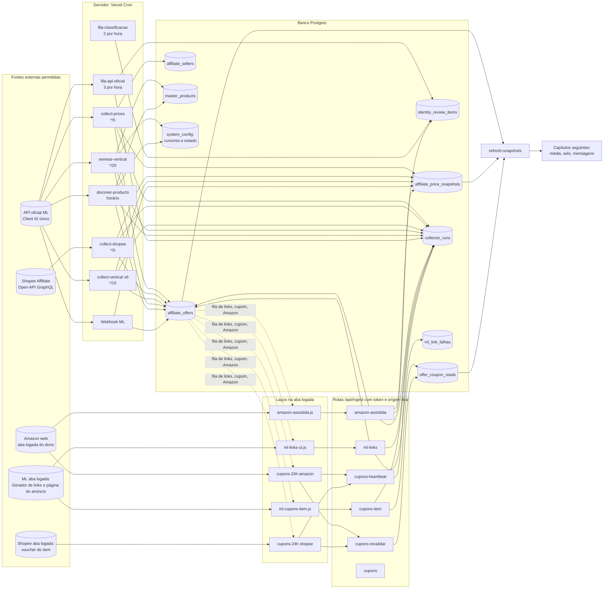

# Fluxo Mestre, capítulo 1: extração e ingestão do dado bruto

- **Data da leitura:** 2026-11-12 (medições às ~11:50 UTC).
- **Fontes:** `vercel.json`, `src/app/api/cron/*`, `src/app/api/ingest/*`, `src/server/collector/*`, `scripts/chrome/*`, `docs/03-metodologia/FLUXO_DE_ENVIO_TELEGRAM.md`, `docs/amazon-assistida-loop.md`, `docs/mercado-livre-limite-de-requisicoes-2026-11-12.md` e consultas SELECT (somente leitura) em `collector_runs`, `affiliate_offers`, `identity_review_items`, `offer_coupon_reads`, `affiliate_price_snapshots`, `system_config`.
- **Legenda:** MEDIDO = lido no banco ou no código agora. NÃO VERIFICADO = não consegui confirmar (variável de ambiente só existe na Vercel, aba do navegador, painel externo). Nenhum valor abaixo foi inventado.
- **Escopo:** da coleta até a gravação no banco (ofertas, snapshots de preço, leituras de cupom, filas de revisão). Cálculo de média, selo e mensagens ficam nos outros capítulos.

---

## 1. Inventário de fontes e jobs de extração

Todos os crons exigem `CRON_SECRET` (Bearer). Todas as rotas `ingest/*` exigem origem fixa (CORS) mais token dedicado (`AMAZON_INGEST_TOKEN` ou `ASSISTED_INGEST_TOKEN`); sem token respondem 503 (kill-switch).

### 1.1 Jobs de servidor (Vercel Cron, só API oficial)

| # | Job (rota) | Gatilho e cadência (vercel.json) | Orçamento por execução | Fonte permitida | Grava | Quem consome depois |
|---|---|---|---|---|---|---|
| 1 | `collect-prices` (Mercado Livre games) | `*/5 * * * *` (maxDuration 200 s) | `MAX_OFFERS_PER_RUN` = 500 ofertas; intervalo mínimo 15 min (5 min se o produto tem alerta ativo) | API oficial ML `/products/{id}/items` | `affiliate_offers` (preço atual, `last_checked_at`, `last_price_confirmed_at`, `consecutive_miss_count`, expira após 3 faltas), `affiliate_price_snapshots` (`source='api'`), `affiliate_sellers`, `collector_runs` | `refresh-snapshots` (estatística, vitrine, estado diário); motor de mensagens (`group-messages`) |
| 2 | `collect-shopee` (games) | `*/5 * * * *` (maxDuration 300 s) | `budgetMs` 240 s; ritmo ~480 ms entre chamadas (`shopee-pacing.ts`), dobra a cada erro 10030 até 2 s; ativa 30 min, com falta pendente 1 h, expirada 1x/24 h | Shopee Affiliate Open API (GraphQL) | `affiliate_offers`, `affiliate_price_snapshots`, variação (`shopee-variacao-store`), `collector_runs` | Idem 1 |
| 3 | `collect-vertical?v=<loja>` (6 lojas Plus, só ML) | tecnologia `1-59/15`, eletroeletrônicos `6-59/15`, livros `11-59/15`, eletrodomésticos `3-59/15`, esporte `8-59/15`, impressão 3D `13-59/15` | 240 chamadas por execução (`DEFAULT_MAX_CALLS`), 240 s, mais teto Plus horário/diário (item 4 do capítulo) | API oficial ML `/products/{id}/items` (NÃO usa multiget `/items?ids=`, que dá 403) | `affiliate_offers`, `affiliate_price_snapshots`, `sold_quantity`, `collector_runs`; expira oferta sem reconfirmar há 12 h (`staleExpireHours`, máx. 200 por execução) | Idem 1; fila de links e de cupom |
| 4 | `semear-vertical?apply=1` | `7-57/20 * * * *` (07, 27, 47) | 120 chamadas por fatia (`SEMEADURA_MAX_CALLS`), 48 s, teto diário 12.000 | API oficial ML `/products/*` | `master_products` (nasce em `review`, invisível), oferta-placeholder com cotação real, `system_config` (`semeadura_vertical_estado`, `semeadura_vertical_404`), `collector_runs` | Porteiro/aprovação do dono; depois entra no `collect-vertical`. Hoje ligado só para a loja eletroeletrônicos (`SEMEADURA_LOJAS`, NÃO VERIFICADO o valor na Vercel; medido: só `semear-vertical:eletroeletronicos` roda) |
| 5 | `discover-products?source=meli&maxNew=10&terms=4&probes=25` | `17 * * * *` | 4 termos, 25 sondas por termo, teto 10 masters novos, 90 s | API oficial ML (busca e catálogo) | `master_products` e ofertas (dúvida nasce em `review`), cursor em `system_config` (`discover_products_cursor`, `discover_products_last_run`), `collector_runs` | Porteiro; `collect-prices` |
| 6 | `fila-api-oficial?apply=1&limit=10` | `8,28,48 * * * *` | 10 itens (máx. 40); teto 1.200 chamadas em 24 h (`IDENTITY_API_DAILY_CAP`); para no 1º 429 e fica 60 min parado | API oficial ML `GET /items/{id}` | `identity_review_items` (evidência e decisão `api_oficial`), `collector_runs` (`fila-api-oficial-ml`) | Fila de classificação, motor de identidade |
| 7 | `fila-classificacao` | `13,43 * * * *` | 40 s | Banco (não chama marketplace) | `identity_review_items` (1 item por oferta+eixo, idempotente) | Dono (tela de fila), `fila-api-oficial` |
| 8 | `refresh-snapshots` (`stats`, `showcase`, `daily`, `inventory`) | stats `*/30`, showcase `4-59/15`, daily `9-59/30`, inventory `41 * * * *` | 240 s | Banco (derivação, não é extração) | `product_price_stats`, `showcase_snapshot`, `price_daily_*`, `catalog_inventory_snapshots`, `collector_runs` | Site público, motor de mensagens. Listado aqui só porque é o 1º consumidor do dado extraído |
| 9 | `collector-health` | `*/30 * * * *` | 60 s | Banco | Só alerta (Telegram) se `COLLECTOR_ALERTS=1`; não grava `collector_runs` | Equipe |
| 10 | `group-messages` | `* * * * *` | 38 s, 60 voltas | ML e Shopee ao vivo (reconferência `live-recheck`) | `group_messages` | Fora do capítulo (consumidor); registrado porque consome a cota ML na reconferência |
| 11 | `notify-price-drops` | `0 11 * * *` | n/d | Banco | Notificações | Fora do capítulo |
| 12 | Webhook ML `/api/webhooks/mercadolivre` | Evento do ML (tópicos Prices/Items) | Responde 200 em < 500 ms, trabalho em `after()` | API oficial (notificação do ML) | `affiliate_offers`, `affiliate_price_snapshots` | Idem 1. NÃO VERIFICADO se a URL está apontada no painel do app (a nota do código de 2026-08-02 dizia que não estava) |

### 1.2 Jobs de servidor que existem mas NÃO estão agendados (manuais)

| Job (rota) | Condição | Estado medido | Observação |
|---|---|---|---|
| `cobertura-shopee` | `SHOPEE_COBERTURA_ATIVA=1`, teto 800 chamadas/h, para no 1º erro 10030 | Último dia: 5 execuções, 3 com erro (`10000 System Error`, `10030`), `apply:false` | Ninguém agenda; sem dono definido |
| `ampliar-amostra-shopee` | chave própria ou `CRON_SECRET` | 3 execuções, 2 com erro (`erro_rate_limit`), última 11/11 23:27 UTC | Idem |
| `discover-shopee-esporte` | dry-run por padrão | Nenhuma oferta Shopee fora de games existe no banco (0 linhas) | Esporte/Plus na Shopee nunca foi aplicado |
| `import-shopee-conversions` | `?days=7` | Sem execução em `collector_runs` | "Decisão: só depois" no código |
| `loja-teste` | chave de teste | Não é extração | Só dry-run |
| `discover-products?source=shopee|all` (Shopee, Magalu) | Parâmetro `source` | Magalu = 0 ofertas; raspagem HTML desligada por flag | Dívida em `docs/divida-coleta-sem-api-oficial.md` |

### 1.3 Coleta assistida (aba logada do dono; permitida por decisão do dono, não é scraping em massa)

| # | Fonte (script na aba) | Gatilho e cadência | Orçamento | Fonte permitida | Rota de ingestão | Grava | Quem consome |
|---|---|---|---|---|---|---|---|
| 14 | Amazon coleta assistida (`scripts/chrome/amazon-assistida.js`, injetado em amazon.com.br) | Laço contínuo, ciclo `refresh` + `discover` em rodízio; pausa 4 a 9 s por busca; ciclo máx. 120 min, `idleMin` 10 | `AMAZON_CYCLE_BUDGET` 375 itens/ciclo (refresh até 240, discover o que sobra, mínimo 60), 6,4 s/busca (~40 min por ciclo na meta); medido hoje 276 a 510 itens por hora (média ~400) | Busca logada da própria Amazon (não há API para a conta: Creators API exige 10 vendas/30 dias) | `GET/POST /api/ingest/amazon-assistida` (lote até 40 linhas, 400 KB) | `affiliate_offers` (ASIN; dúvida = `draft`), `affiliate_price_snapshots` (`source='scrape'`), `identity_review_items` (origem `amazon_cobertura`), `collector_runs` (`amazon-assistida`) | Média única (Amazon dentro da média desde 2026-11-11), motor de mensagens (frescor 40 a 60 min) |
| 15 | Amazon vitrine (modo `vitrine` do mesmo laço) | Opt-in no laço (`modos:['vitrine']`), rotação por hora | Mesma rota (ids sintéticos 0000…-4000-8000) | Buscas características por loja | `amazon-vitrine` em `collector_runs`; master novo nasce `review`, oferta `draft` | Nenhum job `amazon-vitrine` nas últimas 24 h: modo hoje desligado (MEDIDO) |
| 16 | ML links meli.la (`ml-links-ui.js`, Gerador de links do programa de afiliados) | Laço contínuo; lote 25 (20 a 40); pausa 3,5 a 7 s | MEDIDO: 51 lotes e 461 links na última hora | UI do Gerador de afiliados da aba logada | `GET/POST /api/ingest/ml-links` (até 100) | `affiliate_offers.affiliate_url` (só oferta ativa sem meli.la; link antigo guardado em `collector_runs.meta`), `ml_link_falhas` | Motor de mensagens (ML só sai com link `https://meli.la/…`), cartão |
| 17 | ML cupom por item (`ml-cupons-item.js`) | Laço contínuo; lote 20; pausa 4 a 9 s (piso 3 s); releitura meta 45 min (prioridades 0 a 3) | MEDIDO: 12.723 leituras em 24 h (~530/h), 30 de 32 com cupom na última hora | Página do anúncio na aba logada | `GET /api/ingest/cupons-revalidar?rede=mercado-livre`, `POST /api/ingest/cupons-item` | `offer_coupon_reads` (`source='item_page_assistida'`) | Agente de cupons, gatilho CUPOM |
| 18 | Amazon cupons 24 h (`cupons-24h.js`, `rede:'amazon'`) | Laço contínuo; ciclo com batimento | MEDIDO: 177 leituras em 24 h (38 na última hora, 0 com cupom), 47 batimentos ok | Página do produto na aba logada (iframe de mesma origem) | `GET/POST /api/ingest/cupons-revalidar?rede=amazon`, `POST /api/ingest/cupons-heartbeat?rede=amazon` | `offer_coupon_reads` (`amazon-pagina`), `collector_runs` (`cupons-batimento`) | Agente de cupons |
| 19 | Shopee cupons 24 h (`cupons-24h.js`, `rede:'shopee'`) | Laço contínuo (deveria) | MEDIDO: 0 leituras `shopee-pagina` em 24 h; último batimento ok 02:17 UTC; 1 erro às 02:17 | Voucher na página do item (link curto s.shopee.com.br é pulado por padrão) | `…/cupons-revalidar?rede=shopee`, `…/cupons-heartbeat?rede=shopee` | `offer_coupon_reads` (`shopee-pagina`) | Agente de cupons. Hoje parado (ver ponta solta P1) |
| 20 | Lista de cupons dos portais | Quando `listas[].devida=true` na fila | Releitura completa; o que sumiu vira vencido | Aba logada, só leitura | `POST /api/ingest/cupons` | Tabela de cupons ativos | Agente de cupons |
| 21 | Agente de cupons (servidor) | Registrado como `agente-cupons`, 257 execuções em 24 h | n/d | Só lê o que as abas gravaram | n/d | Avisos de cupom encerrado | Grupos/equipe. Não extrai; valida e avisa |

Arquivo legado: `scripts/chrome/cupons-leitura-loop.js` (versão antiga do 18/19, para no primeiro captcha, pede endereço e token por `prompt`). Substituído por `cupons-24h.js`; continua no repositório.

---

## 2. Filas e pilhas

Tamanhos medidos em 2026-11-12 (~11:50 UTC). "Janela" = o que a rota entrega por consulta.

| Fila | Dono (quem monta) | Ordem e prioridade | Tamanho atual | Regra de saída | Erro / 429 |
|---|---|---|---|---|---|
| Devidas `collect-prices` (ML games) | `dueWhere` em `collect-prices.ts` | Mais antigas primeiro (`last_checked_at`); devida após 15 min (5 min se produto vigiado) | Devidas por execução: média 6.335, máx. 7.671 (MEDIDO, 24 h). Ativas ML games: 8.554, nenhuma com mais de 1 h | Sai ao receber preço (carimbo `last_checked_at`) ou 3 faltas seguidas viram `expired` | Sem 429 por padrão: erro é contado e a execução segue (11 execuções com 429 em 7 dias, 42 ocorrências). Não há freio no 1º 429 (diferente das lojas Plus) |
| Devidas `collect-shopee` | `shopeeDueWhere` | Mais antigas primeiro; ativa 30 min, falta pendente 1 h, expirada 24 h em fatia fixa | Devidas por execução: média 3.224 (máx. 4.794 s de idade = 80 min). Ativas: 2.282, 382 com mais de 1 h. Orçamento de tempo esgotado em 283 de 287 execuções | Preço válido, ou 3 respostas sem preço em horas diferentes = `expired`; reativa se a API devolver preço | 10030: dobra o espaçamento (até 2 s), espera 8 s; 10 erros seguidos param a rodada. 420 ocorrências de rate limit em 7 dias (303 execuções) |
| Devidas `collect-vertical` por loja | `collect-vertical.ts` + `queue.ts` | Mais antiga primeiro; cadência por camada (vitrine = master aprovado; revisão 60 a 120 min, padrão 90) | Devidas na última execução: livros 2.388 (mais velha 7,5 h), esporte 1.044 (4,1 h), impressão 3D 1.081, eletroeletrônicos 614, eletrodomésticos 497, tecnologia 175. Ativas com mais de 1 h: livros 377 (285 com mais de 6 h), eletroeletrônicos 159, esporte 147, tecnologia 17 | Preço confirmado; sem reconfirmação por 12 h = `expired` | 1º 429 para a execução inteira (`http_429`); orçamento de tempo ou de chamadas deixa o resto para o próximo tick. 5 execuções com 429 em 24 h |
| Semeadura (cursor por segmento) | `seed-slice.ts` | Segmentos em ordem de `seedOrder()`; cursores e termos "dead" em `system_config` | 504 chamadas consumidas hoje do teto de 12.000; 8 execuções hoje | Fatia termina por 120 chamadas, 48 s ou 429 | 1º 429: recua 15, 30, 60, 120 min (`blockedUntil`); 2 recuos hoje. Cache de 404 por 7 dias |
| Descoberta (cursor de termos) | `discover-products.ts` | Cursor circular de termos; `mode: doubt` | Cursor no índice 1 (`discover_products_cursor`); última execução: 800 achados, 0 criados, 0 em revisão | Teto 10 masters novos, 25 sondas/termo | 429: 1 retry (Retry-After, máx. 5 s), persistente para a execução (`rate_limit_429`, 3 vezes em 24 h) |
| Fila de links meli.la | `listarFilaLinks` (`src/server/ml-links/fila.ts`) | Lojas Plus antes de games; oferta mais barata do produto primeiro; ticket alto primeiro; falhas recentes (`ml_link_falhas`, 11 linhas) ficam fora até o reintento | ML ativas sem meli.la: 17.068 (games 8.486, Plus 8.582). Janela lida (1º recorte): prioridade "plus/demais-ofertas" 2.974 e "games" ~1.025+; 1.476 sem URL de item | Sai quando o link `https://meli.la/…` é gravado | Falha do Gerador vira skip registrado; 3 falhas seguidas de interface: nada é registrado como falha. Servidor 429/5xx: recuo 1, 2, 5, 10, 20 min |
| Fila de cupom ML | `listarFilaRevalidacao(n, 'mercado-livre')` | 0 cupom já divulgado, 1 mensagem pronta, 2 cupom positivo em 24 h, 3 na fila, 4 departamento com cupom de categoria, 5 enviado nas últimas 3 h, 6 resto; mais velha leitura primeiro | Janela de 60: 4 itens prio 0, 56 prio 1 | Sai quando lida (meta 45 min para prio 0 a 3; base maior para 4 a 6) | 429/login/captcha: loop recua (teto 30 min) e repete o item |
| Fila de cupom Amazon | idem, `rede=amazon` | idem | Janela de 60: 2 prio 1, 8 prio 3, 2 prio 5, 48 prio 6 | idem | idem |
| Fila de cupom Shopee | idem, `rede=shopee` | idem | Janela de 60: todos prio 1 (mensagem pronta); sem consumidor ativo (loop parado) | idem | idem |
| Fila Amazon `refresh` | `amazonRefreshQueue` (`amazon-assisted.ts`) | Quentes primeiro (`hot DESC`: candidato de mensagem nas últimas 6 h), depois `amz_checked ASC`; rodízio por departamento com pesos (`REFRESH_WEIGHT`: games 110, tecnologia 25, eletrodomésticos 25, livros 20, eletroeletrônicos 15, esporte 15, impressão 3D 10) | 240 (teto `AMAZON_REFRESH_CAP`) | Sai ao ser lida e gravada (carimbo da oferta Amazon) | Pausa com recuo (teto 30 min), respeita Retry-After; mesmo item repetido |
| Fila Amazon `discover` | `amazonDiscoverQueue` | Masters sem oferta Amazon, `scan_at` mais antigo primeiro, cooldown 72 h (`AMAZON_DISCOVER_COOLDOWN_H`); pesos `DISCOVER_WEIGHT` | 135 (mínimo garantido 60) | Sai com a busca feita (marca `attributes.amazonScan.at`) | idem |
| Fila `queue` (legado Amazon) | `amazonQueue` | Orçamento inteiro, sem separar | 375 | Idem | idem |
| Fila de identidade (classificação) | `fila-classificacao` + `fila-api-oficial` + Amazon (dúvida) | Por oferta+eixo, 1 item único | `pending`: dispersão 712, confiança 268 (154 delas de dúvida da Amazon), chave_nd 18, preço 1 = 999; `auto_resolved` 155 | Dono responde na tela, ou API oficial prova (R4), ou regra aprendida | `fila-api-oficial` para no 1º 429 (60 min) |
| Rascunhos e masters em revisão | Semeadura, descoberta, vitrine Amazon, Shopee | Aguardam aprovação do dono | Masters `review`: games 506, eletroeletrônicos 45, livros 27, eletrodomésticos 26, impressão 3D 13, tecnologia 12, esporte 9. Ofertas Amazon `draft`: 154 | Dono aprova (backup + log) ou rejeita | n/d |

---

## 3. Nós e arestas: da extração ao banco

Arestas de retorno relevantes: as abas leem a fila do servidor (`GET`), então a prioridade da fila é decidida no banco (`affiliate_offers`, `group_messages`, `offer_coupon_reads`), nunca na aba. O frescor exigido pelo motor de mensagens (30 min no envio, 40 a 60 min na Amazon) é o que prioriza a fila quente da Amazon.

---

## 4. Cotas e orçamentos

### 4.1 Mercado Livre (um único Client ID: `MERCADO_LIVRE_CLIENT_ID`)

Fato oficial (levantado 2026-11-12): sem número global publicado; limite por endpoint, em geral por Client ID; 429 pede backoff exponencial com jitter e distribuição no tempo; aumento de cota só pedindo à equipe de integrações com o consumo por Client ID. Os números abaixo são NOSSOS tetos (suposições, não oficiais).

| Consumidor da cota ML | Teto próprio | Entra no contador `plusCallsUsed`? |
|---|---|---|
| `collect-vertical` x6 | 240 chamadas/execução; horário 8.000 e diário 150.000 (`PLUS_ML_HOURLY_CALL_CAP`, `PLUS_ML_DAILY_CALL_CAP`, valores padrão do código; override na Vercel NÃO VERIFICADO), com `hourlyShare` 0,5 | Sim (soma `meta.apiCalls` de `collect-vertical:%` e `semear-vertical:%`) |
| `semear-vertical` | 120/fatia, 12.000/dia | Sim |
| `collect-prices` (games) | 500 ofertas/execução, orçamento de chamadas por master (linha de base + 10%) | NÃO (MEDIDO no código: o filtro é só `collect-vertical:%` e `semear-vertical:%`) |
| `discover-products` | 4 termos x 25 sondas, 2 páginas de busca | NÃO |
| `fila-api-oficial` | 10 a 40 itens, 1.200/24 h | NÃO (tem teto próprio) |
| `resolverUrlsLeitura` (dentro de `GET cupons-item` e `cupons-revalidar`) | 8 s de timeout por chamada, sem teto | NÃO e sem teto (chama `/products/{ref}/items` quando falta `external_item_id`; MEDIDO: 16.020 ofertas ML ativas sem `external_item_id`) |
| `live-recheck` (reconferência do envio no `group-messages`) | Por envio | NÃO |
| Webhook ML | n/d | NÃO |

Consumo real por hora e por endpoint: NÃO VERIFICADO (nenhum job grava o total por endpoint; só `rate_limited` por execução). Frequência de 429 em 24 h (MEDIDO): `collect-prices` 20 ocorrências, `discover-products` 3 execuções, `collect-vertical` 5 ocorrências, semeadura 2 execuções, concentradas em 11/11 20:00 UTC (17) e 12/11 11:00 UTC (7).

### 4.2 Shopee

- Documentação lida em 2026-11-10: 8.000 chamadas/hora; limite por segundo e por aplicativo não documentados; erro 10030 = esperar a próxima janela.
- `collect-shopee`: espaçamento mínimo 480 ms (~1,7 chamada/s, ~6.100/h se rodasse 100% do tempo); como roda 240 s a cada 300 s, o teto teórico fica perto de 4.900/h (cálculo, NÃO medido). `cobertura-shopee` tem teto próprio de 800/h e `ampliar-amostra-shopee` ritmo próprio; nenhum desconta do outro (soma não controlada).

### 4.3 Amazon (aba logada)

| Item | Valor |
|---|---|
| Orçamento por ciclo | 375 buscas (`DEFAULT_CYCLE_BUDGET`), 6,4 s por busca = ~40 min na meta; medido ~400 itens/hora, ou seja ~8 s por item incluindo envio |
| Pausa entre buscas | 4 a 9 s (aleatória) |
| Lote | 10 por padrão (máx. 40 por POST, 400 KB) |
| Cooldown da descoberta | 72 h por master |
| Backoff | até 30 min, respeita Retry-After; captcha, login, 403, 429, 503 não são contornados |

### 4.4 Prioridade quando disputam (regra de projeto, não arbitrada por código)

| Disputa | Quem ganha hoje | Fundamento |
|---|---|---|
| Cota ML: Plus x games | Só existe freio comum entre `collect-vertical` e `semear-vertical`; games e descoberta correm por fora | Isolamento por departamento (ADR 0008) |
| Semeadura x reconfirmação (mesmo Client ID) | Reconfirmação: a semeadura usa `plusCallQuota` com metade do espaço horário (`hourlyShare` 0,5) | `seed-slice.ts` |
| Links meli.la x cupom ML (mesma sessão logada do dono) | Abas separadas; recomendado em abas distintas | Cabeçalho de `ml-cupons-item.js` |
| Fila de links: Plus x games | Plus primeiro, depois a mais barata, depois ticket alto | Decisão do dono 2026-11-12 |
| Fila de cupom | Cupom já divulgado > mensagem pronta > cupom visto em 24 h > fila de envio > departamento com cupom de categoria | `revalidation-queue.ts` |
| Fila Amazon | Quente (candidato de mensagem em 6 h) > mais antiga; rodízio ponderado por departamento | `amazon-budget.ts` |
| Mensagem x coleta | Mensagens exigem preço confirmado em 30 min (ML/Shopee) ou 40 a 60 min (Amazon); o que o motor precisa fresco fica na frente apenas na Amazon | `FLUXO_DE_ENVIO_TELEGRAM.md` |

---

## 5. Regras imperativas e regras de decisão

### 5.1 Imperativas (não admitem exceção)

| # | Regra | Onde está |
|---|---|---|
| R1 | Nenhum dado fake, sintético, interpolado ou preenchido; sem preço lido, sem oferta; sem resposta válida, sem snapshot e sem carimbo | `AGENTS.md`; `collect-vertical.ts` ("Nunca interpola") |
| R2 | Coleta só por API oficial; a única exceção é a coleta assistida autorizada pelo dono (aba logada do próprio dono, fila curta, sem raspagem em massa, sem contornar captcha/login) | `CLAUDE.md`; decisões de 2026-10-28, 2026-11-10 e 2026-11-11 |
| R3 | Scraping proibido: busca pública Shopee e raspagem Magalu estão desligadas por flag | `docs/divida-coleta-sem-api-oficial.md` |
| R4 | Só produto NOVO e EM LINHA; retrô, usado, Open Box e fora de linha (Xbox One incluso) ficam fora; retrô de estilo mas produto novo (réplica, mini console novo) é permitido | Memória do dono 2026-11-11; `amazon-identity.ts`; condição `new` do catálogo ML |
| R5 | Um jogo, uma média: checar duplicata por título+plataforma normalizados (`findExistingMasterProduct`) antes de criar master; nunca cair em `platform='unknown'` sem derivar do título | `AGENTS.md`, `dedup.ts` |
| R6 | Dúvida de identidade fica FORA: master novo nasce `review`, oferta da Amazon em dúvida nasce `draft`; nenhum dos dois entra em média, selo, menor preço ou vitrine | `discover-policy.ts`, `amazon-assisted.ts`, `amazon-vitrine.ts` |
| R7 | Cada oferta vale 1 por dia na média e a mesma média serve a selo, gráfico e cabeçalho (afeta a coleta porque `last_price_confirmed_at` e snapshots precisam ser fiéis) | ADR 0004 |
| R8 | Loops nunca param: erro reinicia, vigia reinjeta; só `stop()` do operador encerra | Memória do dono 2026-11-12 |
| R9 | Token só em memória (closure), nunca em arquivo, localStorage ou log; rota sem token = 503 | `amazon-assistida.js`, `ml-links-ui.js`, `cupons-24h.js` |
| R10 | Toda gravação por aba é reversível: link antigo em `collector_runs.meta`; ids criados no resumo; aprovação em bloco com backup e log | Memória do dono; rota `ml-links` |
| R11 | O horário da leitura é carimbado pelo servidor (`now()`); o cliente não manda carimbo | `amazon-assistida-loop.md` |
| R12 | Cupom só vale com leitura na fonte; preço com cupom precisa ser menor que o preço atual; "sem cupom" só quando a página provou ser o anúncio certo | `cupons-item/route.ts`, `ml-cupons-item.js` |

### 5.2 De decisão (valem enquanto o contexto não muda)

| Situação | Decisão |
|---|---|
| 1º 429 de qualquer job Plus | Para a execução inteira, grava `http_429`, não faz chamada nova |
| 1º 429 da semeadura | Recuo 15, 30, 60, 120 min |
| Oferta ML sem vendedor 3 vezes seguidas | Expira (games); Plus: expira sem reconfirmação por 12 h, só se a coleta não foi limitada por backlog nosso |
| Oferta Shopee sem preço em 3 respostas válidas em horas diferentes | Expira; volta se a API devolver preço válido |
| Preço fora de 0,35x a 3x da referência do master | Quarentena ou descarte (`price-plausibility.ts`); Shopee entra quarentenada |
| Orçamento de tempo ou de chamadas esgotado | Resto fica para o próximo tick; registra `budget_exhausted` |
| Página sem layout reconhecível na aba | NÃO envia (evita marcar `sem_match` por engano); pausa e repete |
| Rota de ingestão sem token configurado | 503 (kill-switch) |
| Loja Plus sem kill-switch `VERTICAL_<NOME>_ENABLED` | `{skipped:'disabled'}` sem tocar banco nem API |
| Leitura de cupom ambígua (menção a cupom não convertida em preço) | Não envia; o item volta à fila |

---

## 6. Automações e recuperação

| Mecanismo | O que faz | Estado medido |
|---|---|---|
| Vercel Cron | Dispara os jobs do item 1.1 | 19 entradas em `vercel.json` |
| `collector_runs` | Registro de cada execução (job, duração, selecionadas, checadas, 429, motivo de parada, devidas, idade da mais velha) | Ativo (`COLLECTOR_RUNS=1` implícito: há 11.644 linhas desde 2026-11-08) |
| `collector-health` (`*/30`) | Avalia saúde e alerta no Telegram se `COLLECTOR_ALERTS=1` e `TELEGRAM_ALERT_CHAT_ID` | `collector_alert_state` está vazia e não há linha `collector-health` em `collector_runs`; NÃO VERIFICADO se as flags estão ligadas na Vercel |
| Laço Amazon | Pausa com recuo e retoma; exceção no ciclo reinicia em 60 s; sinal de parada no servidor: mais de 90 min sem lote | Ativo: 913 lotes em 24 h, 2 com erro |
| Laço de links ML | Recuo 1, 2, 5, 10, 20 min; para só em login/captcha ou token/origem recusados | Ativo: 971 lotes em 24 h |
| Laço de cupom ML | Pausa com recuo (teto 30 min) e retoma | Ativo: 12.723 leituras em 24 h |
| Laço de cupom Amazon/Shopee | Batimento por ciclo em `cupons-heartbeat`; servidor avisa se a rede passa de 60 min sem batimento ok | Amazon ativo; Shopee sem batimento ok há ~9 h |
| Vigia (agente de cupons) | Observa batimento e reinjeta | Aviso em execução (`agente-cupons`, 257 execuções, 6 parciais); reinjeção de aba é manual, feita pelo operador (eu opero as abas) |
| Reabrir aba | Se a aba recarrega o loop morre (sem persistência); reinjetar substitui o laço vivo | Procedimento manual (`window.__AMZA_CFG` + `fetch(...).then(eval)`); sempre começar com `enviar:false` |
| Recuperação de semeadura | Estado e cursor em `system_config` sobrevivem a execução cortada; cache de 404 7 dias | Ativo |
| Idempotência | `identity_review_items` único por (oferta, eixo); `ml-links` só atualiza oferta ativa ainda sem meli.la; ASIN conhecido só atualiza preço | Ativo |
| Limpeza de execuções órfãs | Não existe | 24 linhas `running` com mais de 15 min (ver P5) |

---

## 7. Pontas soltas

Severidade: ALTA = dado errado ou perda contínua agora; MÉDIA = risco concreto ou lacuna operacional; BAIXA = higiene.

| ID | Ponta solta (evidência) | Sev. | Correção proposta | Dono sugerido |
|---|---|---|---|---|
| P1 | **Loop de cupom da Shopee parado.** 0 leituras `shopee-pagina` em 24 h; último batimento ok 2026-11-12 02:17 UTC (seguido de 1 erro); fila Shopee com 60 itens prioridade 1 sem consumo; o agente de cupons registra `fontesSemLeitura: shopee:pagina`. Cupom Shopee anunciado fica sem revalidação, e a regra "nunca divulgar sem leitura" depende disso | ALTA | Reinjetar o `cupons-24h.js` na aba Shopee (começar com `enviar:false`), conferir `status()`; criar rotina do vigia que reinjete após 60 min sem batimento (hoje só avisa) | Operador de abas + agente-cupons |
| P2 | **Backlog crônico de coleta.** `collect-shopee` esgota o orçamento de tempo em 283 de 287 execuções (devidas ~3.200, mais velha ~80 min contra meta de 30 min). `collect-vertical:livros` devidas 2.388, mais velha 7,5 h, 285 ofertas com mais de 6 h; esporte mais velha 4,1 h. A oferta Plus que passa de 12 h sem reconfirmação vira `expired` (guarda `mayExpireStale` protege parcialmente) | ALTA | Medir e decidir: aumentar a cadência da loja de livros (já está no teto de 15 min), reduzir camada de revisão para 120 min, ou reduzir chamadas por página; pedir aumento de cota ao ML com o consumo por Client ID; para Shopee, reduzir o conjunto ativo (2.282 ativas, 1.971 expiradas, 113 pausadas) ou aceitar frescor de 60 min | Engenheiro de coleta + dono (negócio) |
| P3 | **Disparos extras fora do `vercel.json`.** `collect-prices` roda 24 vezes por hora (12 do cron e 12 a ~45 s do cron, pares `:00:01` e `:00:45`), `discover-products` roda nos minutos 0, 17 e 30 (3 por hora, cron só tem :17), e há `refresh-snapshots:stats/daily` com 95 e 96 execuções em 24 h contra 48 esperadas. Parte de `refresh-snapshots` é a transição do commit f27a8a0 (30 min), mas collect-prices e discover não. A origem do segundo disparador é NÃO VERIFICADA (candidato: pg_cron/Supabase conforme `docs/pg-cron-setup.md`; `cron.job` não existe no schema consultado, ou outro agendador/PC) | ALTA | Listar disparadores reais (Vercel, Supabase, agendador local); remover o duplicado ou torná-lo explícito. Sem isso o orçamento ML está dobrado sem estar documentado | Infra/SRE |
| P4 | **Contagem de cota ML subestima o consumo.** `plusCallsUsed` soma só `collect-vertical:%` e `semear-vertical:%`; `collect-prices`, `discover-products`, `fila-api-oficial`, `live-recheck`, o webhook e o `resolverUrlsLeitura` (sem teto) compartilham o mesmo Client ID e não entram. Nenhum job grava chamadas por endpoint | MÉDIA | Gravar `apiCalls` em todos os jobs ML e somar tudo no freio; contar por endpoint; ligar o freio horário de verdade ao 429 observado | Integrador de APIs |
| P5 | **Execuções órfãs.** 24 linhas `running` com mais de 15 min: `collect-prices` 8 e `collect-shopee` 6 desde 11/11 02:35 UTC, `collect-vertical` livros 5, impressão 3D 2, eletroeletrônicos 2, `discover-products` 1. Função cortada por timeout deixa a linha aberta; as medidas de SLO e o `collector-health` podem ler "em execução" para sempre | MÉDIA | Fechar linhas `running` com mais de `maxDuration` como `error` (`stopped_because='timeout_ou_morta'`) no início de cada execução ou no `collector-health` | Engenheiro de coleta |
| P6 | **Alerta de saúde provavelmente mudo.** `collector-health` roda `*/30` mas não deixa rastro; `collector_alert_state` vazia. Sem confirmar `COLLECTOR_ALERTS`/`TELEGRAM_ALERT_CHAT_ID` na Vercel, ninguém é avisado de job parado, 429 em série ou backlog | MÉDIA | Confirmar as variáveis; gravar um registro `collector_runs` por avaliação; testar com um alerta de prova | Infra/SRE |
| P7 | **Falha ao gravar dúvida da Amazon derruba o lote.** 2 lotes com `status='error'` em 24 h por `INSERT INTO identity_review_items` (consulta falhou; a causa exata NÃO VERIFICADA: texto do erro truncado, CHECKs de `axis` e `source` aceitam os valores usados). O que acontece com as linhas do lote (reenvio pelo laço ou perda) NÃO VERIFICADO | MÉDIA | Reproduzir com o item "Câmera Sony ZV-E10" (título do lote com erro); tornar o enfileiramento tolerante (try/catch por linha) para o lote não perder preços já lidos | Engenheiro de coleta + DBA |
| P8 | **Fila de identidade sem escoadouro automático.** 999 itens `pending` (712 dispersão, 268 confiança, 18 chave_nd), 154 deles dúvidas da Amazon (rascunhos fora de todo indicador). `fila-api-oficial` processa só 10 por execução e, medido, 26 das 36 execuções ficaram `partial`; só 36 execuções registradas em 24 h contra 72 esperadas (`8,28,48`) | MÉDIA | Medir por que `fila-api-oficial` registra a metade e fica `partial`; priorizar por impacto (produto com mais ofertas); definir meta de esvaziamento com o dono | Guardião do catálogo + dono |
| P9 | **Regra "loops nunca param" não vale para todos os scripts.** `ml-links-ui.js` para em login/captcha (cabeçalho: "Para só em login/captcha"); `cupons-leitura-loop.js` (legado) "para no primeiro captcha", ainda no repositório e pede token por `prompt`. `amazon-assistida.js` tem alteração não confirmada no repositório (`git status`: ` M`) | MÉDIA | Alinhar `ml-links-ui.js` à pausa com recuo e retomada; apagar ou marcar como obsoleto o `cupons-leitura-loop.js`; commitar ou descartar a alteração do `amazon-assistida.js` e republicar `public/loops/amazon-assistida.js` idêntico | Engenheiro de coleta |
| P10 | **Shopee fora de games não existe.** 0 ofertas Shopee em esporte e lojas Plus; `discover-shopee-esporte`, `cobertura-shopee`, `ampliar-amostra-shopee` e `import-shopee-conversions` não têm agendamento, dono nem rotina; `cobertura` e `ampliar` falharam por `10030`/`10000 System Error` | MÉDIA | Decisão do dono: agendar ou aposentar. Se agendar, definir cota comum com `collect-shopee` (hoje a soma não é controlada) | Dono + integrador de APIs |
| P11 | **Rótulo `source='scrape'` nos snapshots da Amazon.** 1.030 snapshots em 24 h (524 primeira, 270 mudança, 233 batimento, 3 sem tipo) usam `scrape` para dado vindo da coleta assistida autorizada. Auditoria ou painel que busque "scrape" vai confundir autorizado com proibido | MÉDIA | Passar a gravar `assistida` (exige ampliar o tipo `'manual' \| 'api' \| 'scrape'` e checar CHECK da coluna; NÃO VERIFICADO se há) e migrar o histórico com backup | DBA + engenheiro de coleta |
| P12 | **Dado gravado que ninguém lê (ou lê só em parte).** (a) Snapshot `batimento` (11.415 em 24 h, 32% dos ~35,7 mil snapshots gravados) existe para o gráfico de 24 h, sem consumidor medido além do estado diário; (b) `collect-shopee` e `sold_quantity` gravam quantidades vendidas, uso na vitrine NÃO VERIFICADO; (c) `offer_coupon_reads` guarda 12.900 leituras sem rotina de retenção; (d) `collector_runs` cresce ~11,6 mil linhas em 4 dias sem retenção | BAIXA | Definir retenção (ex.: 30 dias para leituras de cupom sem cupom, 14 dias para `collector_runs` fechadas) e confirmar leitor de cada coluna | DBA |
| P13 | **Documentação defasada em relação ao código.** Cabeçalhos dizem "NÃO está no vercel.json" para `collect-vertical`, `collector-health`, `group-messages`, `discover-products` (todos estão no arquivo); `docs/divida-coleta-sem-api-oficial.md` diz `collect-shopee` a cada 10 min (é `*/5`); `fluxo-de-envio` cita migração 0032 e arquivo 0046 | BAIXA | Atualizar os comentários e o runbook; um único quadro de cadência (este capítulo) | Engenheiro de coleta |
| P14 | **429 do `collect-prices` (games) não freia.** Diferente das lojas Plus (para no 1º), o coletor gamer só conta o erro e segue (MEDIDO: 42 ocorrências em 7 dias, 11 execuções). O freio documentado no relatório do ML ("freio no primeiro 429") não vale para o maior consumidor (500 ofertas por execução, dobrado em P3) | MÉDIA | Aplicar o mesmo freio (parar a execução e recuar) ao coletor gamer, depois de resolver P3 | Engenheiro de coleta |
| P15 | **Frescor da Amazon abaixo da exigência do motor.** 112 de 681 ofertas ativas com mais de 3 h sem leitura e 10 com mais de 12 h; o envio exige preço confirmado em 40 a 60 min. O ciclo de 375 itens leva ~50 min contra meta de 40 (MEDIDO ~8 s por item); 681 ofertas ativas mais 135 da descoberta competem pelo mesmo orçamento | MÉDIA | Aumentar a participação do `refresh` quente, ou segunda aba para a Amazon; medir o cumprimento da fila quente (`hot`) por hora | Operador + engenheiro de coleta |
| P16 | **Token do Mercado Livre gravado em `system_config`.** A chave `mercado_livre_oauth` guarda `accessToken` em texto no banco | BAIXA | Confirmar RLS e acesso restrito à tabela; avaliar cifrar; segurança de banco revisa (`docs/seguranca-rls-plano.md`) | Segurança DB |
| P17 | **Aprovação de masters em revisão sem fila de consumo clara.** 506 masters de games em `review` há tempo (medido só o total), mais 132 nas lojas Plus. Semeadura continua criando (10 a 11 por fatia) | MÉDIA | Definir quem aprova e a cadência (aprovação em bloco com backup e log já é prática do dono); ligar a semeadura a uma meta de fila | Dono + guardião do catálogo |
| P18 | **Cobertura de links meli.la é o gargalo do envio.** 17.068 ofertas ML ativas sem link (Plus 8.582; games 8.486), ritmo 461 links/h = ~37 h para zerar, sem contar novas ofertas; 1.476 itens da janela sem URL de item; 11 em `ml_link_falhas` | MÉDIA | Manter prioridade Plus; resolver `external_item_id` ausente (16.020 ofertas) na coleta para o link sair sem chamada extra (ver P4) | Engenheiro de coleta |

---

## 8. Resumo para o próximo capítulo

- A extração tem **3 famílias**: servidor por API oficial (ML e Shopee), abas assistidas (Amazon, links, cupons) e derivação interna. O dado bruto chega em `affiliate_offers`, `affiliate_price_snapshots`, `offer_coupon_reads`, `identity_review_items` e `master_products`.
- O que sustenta o preço fresco é `collect-prices` (games), `collect-vertical` (Plus), `collect-shopee` e o laço Amazon; todos têm orçamento de tempo, e três deles trabalham em atraso medido.
- Antes de qualquer mudança de cadência, resolver P3 (disparos duplicados) e P4 (contagem de cota), porque os números de consumo hoje não são confiáveis.
