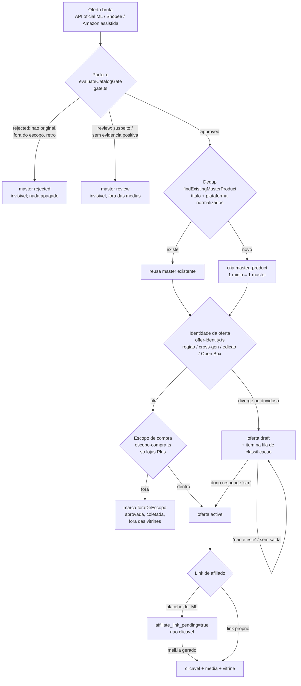
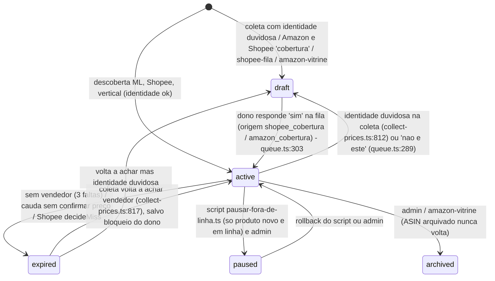
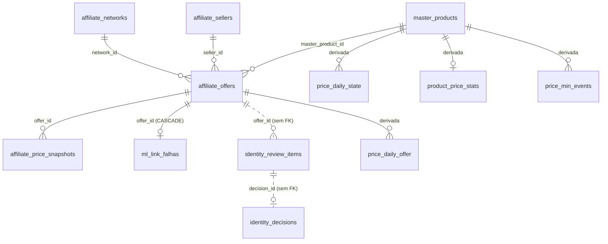

# Fluxo Mestre, capítulo 2: catálogo, identidade e banco

Data da medição: 2026-11-12 (banco de produção, somente SELECT, sessão read-only). Código: branch `main`, árvore de trabalho com `gate.ts`, `vertical/identity.ts` e `cobertura-shopee.ts` modificados e ainda não commitados (leitura feita no estado do disco).

Legenda de confiança: **MEDIDO** = SELECT no banco hoje; **CÓDIGO** = lido no arquivo citado; **NÃO VERIFICADO** = não confirmado, não deve ser tratado como fato.

---

## 1. Ciclo de vida de um item

### 1.1 Duas entidades, dois ciclos

- `master_products` (7.941 linhas, MEDIDO) = o produto único do mundo real. Não tem coluna de status. O "estado" dele vive em `attributes` (jsonb): `catalogGate.verdict` (`approved` | `review` | `rejected`), `catalogGate.manual`, `mergedInto`/`archived` (fundido), `vertical.foraDeEscopo` (marca de vitrine), `vertical.identityKey`.
- `affiliate_offers` (30.446 linhas, MEDIDO) = o anúncio de uma loja/vendedor ligado a um master. Tem o enum real `affiliate_offer_status`: `draft`, `active`, `paused`, `expired`, `archived` (CÓDIGO `src/db/schema/_enums.ts:223`), mais as marcas ortogonais `quarantined_at` (migration 0023) e `avg_excluded_at` (migration 0044, aplicada, MEDIDO).

### 1.2 Fluxo ponta a ponta

### 1.3 Estados da oferta e quem os muda (CÓDIGO + MEDIDO)

| Estado | Quantidade (MEDIDO) | Quem entra | Quem sai | Visível/entra em média? |
|---|---|---|---|---|
| `active` | 20.107 (ML 17.156, Shopee 2.270, Amazon 681) | coletores de descoberta; dono na fila; promoção de rascunho | coletores (expira), pausa, admin | Sim, se master `approved`, sem quarentena, sem `avg_excluded_at`, identidade visível (`eligibleOfferSql`) |
| `draft` | 182 (Amazon 154, Shopee 18, ML 10) | coleta com identidade duvidosa, `amazon-vitrine.ts`, `shopee-fila.ts`, `amazon-assisted.ts` | dono ('sim' ativa) ou admin | Não: fora de média, mediana, menor preço, selo e vitrine; a coleta continua gravando preço |
| `paused` | 1.466 (games 1.464: xbox_one 781, unknown 354, xbox_360 331) | `scripts/pausar-fora-de-linha.ts` (11/11) | rollback do script com backup NDJSON | Não |
| `expired` | 8.650 (ML 6.679, Shopee 1.971) | `collect-prices.ts:852`, `collect-vertical.ts:369` (`expireStaleOffers`), `collect-shopee-prices.ts:221` | a própria coleta quando o vendedor reaparece | Não |
| `archived` | 41 (Amazon 39, ML 2) | admin, ASIN arquivado | ninguém automático | Não |
| quarentena (`quarantined_at`) | 488 (expired 370, active 86, paused 32) | `ampliar-amostra-shopee.ts`, `cobertura-shopee.ts`, `collect-vertical.ts:295`, fila 'preco_errado' | fila (desfazer) ou script | Some de toda leitura pública e indicador |
| fora da média (`avg_excluded_at`) | 20 (todas `active`: 16 identidade-incerta, 4 cerca-superior; piloto de identidade) | `scripts/aplicar-piloto-identidade.ts` | script/rollback | Visível na lista, fora de média/mediana/selo |

### 1.4 Estados do master (CÓDIGO + MEDIDO)

| Veredito do porteiro | Games (não fundidos) | Plus (6 lojas) | Quem muda | Efeito |
|---|---|---|---|---|
| `approved` | sem marca persistida em 4.259 (tratado como aprovado por omissão, ver §5 G-07) | 1.199 | Plus: `aprovar-masters-nicho.ts`, `aplicar-aprovacao-plus.ts`, `aprovacao-impressao3d.ts`; override `manual` do dono | Entra em vitrine, busca, sitemap, indicadores |
| `review` | 504 | 132 (eletrodomésticos 26, eletroeletrônicos 45, esporte 9, I3D 13, livros 27, tecnologia 12) | porteiro na entrada | Invisível, fora de média, até humano aprovar |
| `rejected` | 1.574 | 1 | porteiro; só humano reverte | Invisível |
| fundido (`mergedInto`) | 272 (arquivados) | 0 | `merge-duplicate-masters.ts`, `master-consolidation.ts` | Ofertas migram para o canônico; 0 ofertas `active` presas em fundido (MEDIDO) |
| `foraDeEscopo` (marca de vitrine) | n/a | 69: esporte abaixo_do_piso 47, eletroeletrônicos abaixo_do_piso 13 e tipo_excluido 8, eletrodomésticos preco_anomalo 1 | `scripts/aplicar-escopo-compra.ts` | Segue aprovado, coletado e no dedup; sai de vitrine, faixas, mensagens e "menor preço do dia" |

Observação: a coluna `manual` do porteiro está vazia em todos os 7.941 masters (MEDIDO). Nenhum override humano de aprovação existe hoje.

---

## 2. Filas

| Fila | Dono | Ordem | Tamanho (MEDIDO 2026-11-12) | Regra de saída | Prazo |
|---|---|---|---|---|---|
| Classificação de identidade (`identity_review_items`, status `pending`) | Dono do projeto (humano); o robô resolve o "óbvio" (`auto_obvio`, 155 já resolvidos) e consulta a API oficial (`api_checked_at`) | `ORDER BY (source='preco') DESC, created_at, id` (`queue.ts:199`); itens adiados (`snoozed_until`) ficam fora | 999 pendentes: identidade 933 (dispersão 712, confiança 221), mídia 44, modelo 18, armazenamento 3, preço 1. Por loja: games 418, livros 204, eletrodomésticos 111, esporte 83, eletroeletrônicos 73, I3D 73, tecnologia 37. Origem: Amazon cobertura 154, aprovacao-plus-v3 67, demais 778. Com prova de API: 82 | Dono escolhe uma opção (`resolved`), ou prova da API / regra por título (`auto_resolved`). "Não sei" adia 7 dias (`SNOOZE_DAYS`, `queue.ts:26`) e volta | Mais antigo: 2026-11-11 23:43; nenhum com mais de 3 dias. Não existe SLA formal. NÃO VERIFICADO se há alarme de envelhecimento |
| Recálculo pós-decisão (`identity_decisions.recalc_masters`) | Job de recálculo (`queue.ts:410`) | `decided_at` | 0 pendentes | `recalc_done_at` preenchido | Imediato no ciclo do job |
| Aprovação de masters Plus (rascunho de master = veredito `review`) | Dono, via `aplicar-aprovacao-plus.ts` (critérios v3 relaxados, flag `PLUS_APROVACAO_RELAXADA`) | por vertical/ticket | 132 masters Plus em `review` (sugestão do semeador: 129 `approved`, 5 `review`) | Passa nos critérios v3 (identidade forte, 1+ oferta clicável, foto, amplitude, quarentena) ou vai à fila de identidade (67 itens `aprovacao-plus-v3`) | Sem prazo fixo. Rodada manual |
| Aprovação de games (porteiro) | Porteiro automático; dono decide `review` | n/a | 504 masters `review` e 1.574 `rejected` | Override `manual:'approved'` (nunca vale para não-original) | Sem prazo |
| Rascunhos de oferta (`status='draft'`) | Dono (Amazon/Shopee via fila); admin (ML) | `created_at` | 182: Amazon 154 (todos com item pendente na fila, mais antigo 11/11 10:10), Shopee 18 e ML 10 **sem item na fila** (mais antigos 2026-08-03 e 2026-07-13) | 'sim' na fila ativa; sem isso, nada | Amazon: menos de 2 dias. Shopee/ML: 100 e 122 dias parados (ver G-03) |
| Links meli.la pendentes (`affiliate_link_pending`) | Aba logada do ML (ingestão `/api/ingest/ml-links`); fila em `src/server/ml-links/fila.ts` | Plus antes de games; mais barata de cada produto (`rn=1`); ticket alto (`TIPOS_TICKET_ALTO`, piso R$1.500); preço maior (`src/lib/ml-links/fila.ts`) | Flag ligada: 933 ofertas (active 905, expired 24, paused 4). Elegíveis hoje na fila (SELECT equivalente à query): 8.917, sendo games 5.166, livros 1.154, eletrodomésticos 874, I3D 608, esporte 497, eletroeletrônicos 335, tecnologia 283. Falhas gravadas: 11 (`sem_resultado`, 1 tentativa) | Link `https://meli.la/%` gravado, ou falha (`ml_link_falhas`). Reintento: nao_elegivel 30 d, sem_resultado 3 d, erro_pagina 1 d, teto de 3 tentativas | Sem prazo. Ver G-05: os números 933 e 8.917 medem coisas diferentes |
| Revisar escopo/dado (`foraDeEscopo.revisao=true`) | Dono | n/a | 1 (eletrodomésticos, preço anômalo) | Corrigir dado ou aceitar | Sem prazo |

---

## 3. Regras imperativas e de decisão, e onde cada uma vive

| Regra | Tipo | Onde é implementada (CÓDIGO) | Observação |
|---|---|---|---|
| Um jogo, uma média, um master (sem duplicata) | Imperativa | `src/lib/affiliate/dedup.ts` (`findExistingMasterProduct`, `normalizeTitle`, `isSameProduct` com limiar 0,8, `compareIdentity`); índices únicos `master_products_meli_catalog_id_uq`, `master_products_gtin_uq`, `master_products_slug_uq` | Chamada por `discover-products`, `discover-shopee-products`, `discover-magalu-products`, `cobertura-shopee`, `amazon-vitrine`, `actions/affiliate.ts`, `actions/collector.ts`. Só jogos (vertical games) |
| Dedup fora de games | Imperativa | `src/lib/catalog/vertical/identity.ts` (`normalizeTitleKey`, `identityKey`), `scripts/_aprovacao-plus-shared.ts` (detecta nome/título/chave/GTIN duplicados) | Vertical tem identidade própria, não usa o léxico gamer |
| Nunca `platform='unknown'` como padrão | Imperativa | `dedup.ts` (deriva plataforma do título; candidatos `unknown` entram na comparação) | MEDIDO: ainda existem 599 jogos, 35 consoles e 716 acessórios `unknown` (ver G-02) |
| Região, cross-gen, edição limitada separam; cor junta | Imperativa | `dedup.ts` (eixos de `compareIdentity`; cor removida do núcleo, linha 100), `game-classification.ts` (`mentionsMultipleGenerations`), `offer-identity.ts` | Memória do dono `regras-identidade-cesta` |
| Open Box, usado, recondicionado fora das médias | Imperativa | `offer-identity.ts` (`OfferCondition`), `offer-identity-sql.ts` (`offerExcludedTitleSql`), `eligibility-sql.ts` | Entra como `draft` na coleta (`collect-prices.ts:760`) |
| Porteiro: só original, só games/consoles/acessórios | Imperativa | `src/lib/catalog/gate.ts` (`evaluateCatalogGate`, `GATE_VERSION=1`); `catalogGateVisibleSql` em `public-offers.ts` | Preço nunca rejeita sozinho, só prioriza revisão. Pisos auxiliares: `LEGACY_PHYSICAL_PRICE_FLOOR_CENTS=6000`, `ANY_PHYSICAL_PRICE_FLOOR_CENTS=3000` |
| Só produto novo e em linha | Imperativa (decisão 2026-11-11) | `gate.ts` (`RETRO_CONSOLE`, `RETRO_GAME_PLATFORM`, `MODERN_CONSOLE`, `mentionsRetroPlatformOnly`), `platform.ts` (`titleIsLegacyPlatformOnly`, `legacyPlatformLabel`), `scripts/pausar-fora-de-linha.ts`, `amazon-assisted.ts` | Xbox One e Xbox 360 incluídos como fora de linha (781 + 331 ofertas pausadas) |
| Exceção retrô-estilo **novo** | Decisão | `gate.ts:173-176` `NEW_RETRO_MAKER` (hyperkin, analogue, retro-bit, 8bitdo) e `isNewRetroStyleHardware`; `NOT_NEW_WORDS` barra "usado/seminovo" | Em edição local não commitada (`M gate.ts`). NÃO VERIFICADO se já foi testada em `scripts/test-gate.ts` |
| Não original (pirata, réplica, ISO, destravado, "N em 1") | Imperativa | `gate.ts` `NOT_ORIGINAL` | Override manual nunca libera |
| Escopo de compra das lojas Plus | Decisão (ata 2026-11-12) | `src/lib/catalog/escopo-compra.ts` (`escopoCompra`, 5 motivos em `MotivoForaEscopo`), aplicado por `scripts/aplicar-escopo-compra.ts` | Flag `PLUS_ESCOPO_VITRINE=0` desliga os leitores. Marca reversível, nada é apagado |
| Pisos de preço (centavos) | Decisão | `escopo-compra.ts` `PISOS_CENTS`: carregadores 10.000; fones 8.000; eletroeletrônicos demais 10.000; eletrodomésticos 10.000; mouse/teclado/headset 8.000; bola 6.000; proteção/fitness/garrafas/meias-roupas/bonés 5.000; I3D peças 5.000 | Ticket alto `TICKET_ALTO_CENTS=30.000` nunca é barrado; exceção ao piso com 5+ ofertas e 3+ vendedores |
| Sinal de demanda abaixo de R$300 | Decisão | `escopo-compra.ts`: 3+ ofertas ou 2+ vendedores; livros e I3D (exceto peças) isentos; vendas do vendedor ≥ 1000 só para fones/mouse/headset | `sold_quantity` ainda não existe no banco (migration 0045 pendente), então o ML não entrega esse sinal |
| Tipo excluído por inteiro | Decisão | `TIPOS_EXCLUIDOS = {'eletroeletronicos:cabos-acessorios'}` | 8 masters marcados |
| Preço anômalo | Decisão | `MULTIPLO_ANOMALIA=10` x mediana do tipo e piso absoluto R$50.000 | 1 master em revisão |
| Aprovação de nicho (Plus) | Decisão | `src/lib/catalog/aprovacao-nicho.ts` (critérios v2/v3: amplitude 2,5x, núcleo 0,35x-3x, quarentena máx. 30%, clicável com check em até 6 h, voltagem, gênero), `aprovacao-impressao3d.ts` | Flag `PLUS_APROVACAO_RELAXADA` |
| Reputação baixa do vendedor fora (`1_red`, `2_orange`) | Decisão | Aplicada em: `ml-links/fila.ts:54` (não gera link), `aprovacao-impressao3d.ts:25` (`REPUTACOES_BAIXAS`), `messaging/group-rules.ts:70` (`ML_LOW_REPUTATIONS`) | **Não aparece em `eligibleOfferSql` nem nos coletores** (CÓDIGO). MEDIDO: 612 ofertas ativas de vendedor vermelho/laranja, 512 delas em master aprovado e sem quarentena. Ver G-01 |
| Concorrência real (próximo mais barato quando a loja cai) | Imperativa | `collect-prices.ts` (buy-box por vendedor, expiração por união de catálogos `decideMasterExpiry`) | Cobertura de teste NÃO VERIFICADA |
| Cada oferta vale 1 por dia | Imperativa (ADR 0004) | `src/server/pricing/price-daily.ts`, `price_daily_offer`, `price_daily_state` | Fora do escopo deste capítulo |
| Fora da média sem quarentena | Decisão (2026-11-11) | `avg_excluded_at` + `avgExcludedFlagSql`/`inAverageSql` em `public-offers.ts`; válvula `AVG_EXCLUDED_DISABLED=1` | Aplicada no banco |

---

## 4. O banco como recurso

### 4.1 Tabelas centrais e relação

### 4.2 Volume (MEDIDO)

| Tabela | Linhas | Tamanho | Papel |
|---|---|---|---|
| `affiliate_price_snapshots` | 3.407.237 | 639 MB | Cotação bruta (série). 647.921 linhas com mais de 90 dias; mais antiga 2026-07-13; nenhuma com mais de 180 dias |
| `coupon_reads` | 129.247 | 40 MB | Leituras de cupom |
| `affiliate_offers` | 30.446 | 38 MB | Oferta |
| `price_daily_offer` | 134.780 | 33 MB | Preço do dia por oferta (mediana do dia) |
| `price_daily_state` | 52.703 | 22 MB | Estado diário por master (média, mediana) |
| `product_price_stats` | 6.410 | 15 MB | Estatísticas pré-calculadas |
| `master_products` | 7.941 | 13 MB | Catálogo canônico |
| `identity_review_items` | 1.154 | 1,6 MB | Fila (999 pendentes + 155 auto-resolvidos) |
| `identity_decisions` | 155 | 0,2 MB | Trilha de decisão (todas `auto_regra`/`auto_obvio`, nenhuma humana ainda) |
| `ml_link_falhas` | 11 | pequeno | Falhas do gerador meli.la |

Masters por departamento: games 6.609 (jogo 4.104, acessório 2.027, console 478), esporte 339, eletrodomésticos 293, livros 245, eletroeletrônicos 197, tecnologia 141, impressão 3D 117.

### 4.3 Índices críticos

| Tabela | Índice | Para quê |
|---|---|---|
| `master_products` | `master_products_meli_catalog_id_uq` (parcial), `_gtin_uq`, `_slug_uq`, `_game_classification_idx` | Dedup determinística por catálogo ML/GTIN; filtro por formato/geração/edição |
| `affiliate_offers` | `affiliate_offers_network_external_ref_uq` (parcial: `seller_id IS NULL`), `affiliate_offers_network_item_uq`, `affiliate_offers_master_idx`, `_active_price_idx`, `_status_published_idx`, `_price_confirmed_idx`, `_vertical_status_idx` (parcial `vertical<>'games'`), `_quarantined_idx`, `_avg_excluded_idx` | Impedem 28.673 duplicatas de placeholder (incidente 2026-07-30); servem `listRankedOffers` e a expiração de cauda |
| `affiliate_price_snapshots` | `(offer_id, collected_at)` btree e `collected_at` BRIN | Série por oferta; varredura temporal barata |
| `identity_review_items` | `_pending_idx (created_at) WHERE status='pending'`, `_api_todo_idx`, `UNIQUE(offer_id, axis)` | Fila e idempotência da geração |
| `identity_decisions` | `_rule_idx (vertical, axis, title_norm) WHERE is_rule AND undone_at IS NULL`, `_recalc_idx` | Regra reaproveitada por título; fila de recálculo |

### 4.4 Retenção

- Snapshots: **nenhuma retenção implementada** (CÓDIGO: não há `DELETE` agendado em `affiliate_price_snapshots`; `prune-*.ts` tratam produtos, não série). Cresce sem teto (639 MB em 4 meses). Ver G-08.
- `expired`: 8.650 ofertas, 2.993 sem tocar há mais de 30 dias e 1.672 há mais de 90 dias, sem política de arquivamento (G-06).
- Backups reversíveis de ações em massa ficam em `docs/backups/` (NDJSON + log JSON), padrão da aprovação ampla com backup.
- `pg_cron` não está instalado (MEDIDO: `cron.job` não existe); a agenda vive em `vercel.json` (Vercel Cron). `docs/pg-cron-setup.md` descreve um plano, não o estado real.

### 4.5 Limites do plano e conexões

- Supabase Micro, `max_connections = 60` (MEDIDO). Foto no momento da medição: 1 ativa, 11 ociosas, 1 "idle in transaction" (a consulta de detalhe voltou vazia segundos depois, então foi transitória).
- Pool da aplicação (`src/lib/db/index.ts`): `prepare:false`, pooler de transação, `max` por tipo `live` 3 e `bg` 3 na Vercel (local 4 e 7), `idle_timeout:20 s`, `max_lifetime:600 s`, `connect_timeout:10 s`, `application_name:'egeek-web'`. Cada instância serverless abre seu próprio pool: N instâncias x 6 conexões compete pelas 60.
- Timeouts do banco (MEDIDO): `statement_timeout` padrão 120 s; **`idle_in_transaction_session_timeout = 0` (desligado) e `lock_timeout = 0`** para o papel que o app usa. Só `authenticator` (8 s), `anon` (3 s), `authenticated` (8 s) e `supabase_auth_admin` têm limites.
- Regras de conduta (documentadas em `docs/plano-convivencia-frentes.md`, §2 item 5): escrever só mudança real, em lote, transação curta; **nunca manter transação aberta durante chamada externa**; teto de linhas por execução; minutos fixos por cron (coleta Plus 1, 3, 6, 8, 11, 13 a cada 15 min; semeadura 7/27/47; médias 0/30; estado diário 9/39). Migrations usam `SET LOCAL lock_timeout='5s'` e `statement_timeout='60s'`.
- A defesa contra "idle in transaction" hoje é manual: `src/scripts/kill-connections.ts` encerra sessões com mais de 60 s ou nesse estado. Não há trava no servidor (G-04).

---

## 5. Pontas soltas (gaps)

| ID | Gap | Evidência | Severidade | Correção proposta |
|---|---|---|---|---|
| G-01 | **Reputação baixa não é barrada na média nem na coleta.** A regra está em fila de links, mensagens e aprovação I3D, mas não em `eligibleOfferSql` | MEDIDO: 612 ofertas ativas de vendedor `1_red`/`2_orange`; 512 contam em master aprovado sem quarentena. CÓDIGO: `eligibility-sql.ts` não tem filtro de reputação | **Alta** (afeta a média pública e contradiz regra do dono). Antes de agir confirmar com o dono se vale para a média ou só para vitrine/links: NÃO VERIFICADO | Decidir escopo; se for para a média, adicionar predicado em `eligibleOfferSql` com flag de desligar e recalcular via backfill, no padrão da 0044 |
| G-02 | Plataforma `unknown` residual | MEDIDO: 599 jogos, 35 consoles, 716 acessórios com `game_platform_gen='unknown'`; 1.131 jogos com formato `unknown` | **Alta** (esconde duplicatas, regra da casa) | Reexecutar derivação por título (`platform.ts`, `game-classification.ts`) em dry-run; o que não derivar vai à fila `modelo`/`midia` |
| G-03 | Rascunhos sem saída: 18 Shopee (desde 2026-08-03) e 10 ML (desde 2026-07-13) sem item pendente na fila | MEDIDO (`draft_sem_fila`) | Média | Enfileirar na fila de classificação (origem `legado_rascunho`) ou arquivar com backup |
| G-04 | Sem trava de servidor contra "idle in transaction" e contra lock longo | MEDIDO: `idle_in_transaction_session_timeout=0`, `lock_timeout=0`; incidente citado em `plano-convivencia-frentes.md` | **Alta** (60 conexões; uma transação pendurada derruba o pool) | `ALTER ROLE <papel do app> SET idle_in_transaction_session_timeout='30s'` e `lock_timeout='10s'` (aprovação do dono/DBA; reversível). Revisar qualquer fluxo com transação aberta ao redor de `fetch` |
| G-05 | Dois números diferentes para "links pendentes": 933 (flag `affiliate_link_pending`) contra 8.917 (elegíveis na fila por URL não-meli.la). A flag só marca os placeholders; o restante já é link de catálogo/anúncio sem meli.la | MEDIDO | Média | Definir um único indicador de "oferta sem link de comissão" e usá-lo no painel de `/admin/catalogo`; revisar com o `integrador-apis` |
| G-06 | Ofertas `expired` acumulam sem destino | MEDIDO: 8.650; 1.672 com mais de 90 dias | Média | Política: `expired` há mais de 90 dias e sem snapshot recente vai a `archived` (com backup). Cuidado: a coleta reativa `expired`, então arquivar só o que a coleta já tentou N vezes sem sucesso |
| G-07 | Games sem marca do porteiro persistida: 4.259 masters "sem marca" tratados como aprovados por omissão; só 504 `review` e 1.574 `rejected` têm marca | MEDIDO | Média | Gravar `catalogGate` para todos (script `apply-catalog-gate.ts` existe); sem isso, auditoria depende de recomputar |
| G-08 | Sem retenção em `affiliate_price_snapshots` (3,4 M linhas, 639 MB, crescente) | MEDIDO; CÓDIGO sem purga | Média hoje, alta no Micro (IO/disco) | Agregar o que já está em `price_daily_offer` e comprimir/arquivar snapshots além de 90 dias, mantendo o necessário para "menor preço" e gráficos. Exige parecer do `cientista-precos` e do `dba-postgres`; não apagar sem o histórico diário íntegro |
| G-09 | Coleta continua em ofertas ativas de master `rejected`: 1.167 ofertas (todas checadas nas últimas 24 h) e 909 em master `review` (games) | MEDIDO | Média (gasta cota da API oficial e conexões sem render) | Excluir `rejected` da seleção de coleta ou reduzir cadência; manter `review` coletado (pode virar aprovado) |
| G-10 | Migrations não aplicadas **0045** (`sold_quantity`, `sold_quantity_at`) e **0048** (`variant_min_cents`, `variant_max_cents`, `variant_spread`) | MEDIDO: nenhuma das 5 colunas existe em `affiliate_offers`. Aplicadas e confirmadas: 0044 (colunas `avg_excluded_*`), 0047 (`ml_link_falhas`), 0046 (constraint com gatilho `AC`), 0049 (`coupon_name`, `coupon_code`) | Baixa/Média. Código atual é tolerante: não grava sem a coluna (flag `SHOPEE_VARIANTE_COLUNAS`; 0045 por SQL cru). Consequência: sinal de demanda por `sold_quantity` e faixa de variação Shopee indisponíveis | Aplicar com o molde `apply-*.ts` (dry-run primeiro), 0045 antes de ligar qualquer leitura; 0048 antes de ligar `SHOPEE_VARIANTE_COLUNAS=1`. Observação: o cabeçalho de `0048_oferta_variacao_preco.sql` diz "0047" (rótulo errado, só comentário) |
| G-11 | Migrations 0019 a 0049 não estão em `drizzle/migrations/meta/_journal.json` (journal tem 19 entradas, até 0018) | CÓDIGO; MEDIDO: `drizzle.__drizzle_migrations` com 19 linhas | Média (se alguém rodar `drizzle-kit migrate`, o estado real e o journal divergem) | Documentar que 0019+ são aplicadas por scripts `apply-*.ts`, ou registrar no journal depois de conferir cada uma contra o banco |
| G-12 | Duplicatas possíveis de master | MEDIDO: 2 grupos por nome exato (4 masters): "mochila academia camping trilha resistente impermeável" (esporte, 2) e "nintendo switch" (games, `product_type=game`, `switch_1`, 2 masters). Quase-duplicatas por similaridade (limiar 0,8) NÃO VERIFICADAS neste capítulo | Média | Rodar `dry-run-dup-report.ts` (somente leitura) e `merge-duplicate-masters.ts` em dry-run; o "nintendo switch" como `game` parece lixo de classificação |
| G-13 | Tabela escrita e pouco lida | MEDIDO: `identity_links` 0 linhas (2 leituras); `coupon_consults` 1.061 linhas e 70 leituras. Escopo de outro capítulo | Baixa | Confirmar uso com o dono do capítulo de cupons antes de qualquer remoção. NÃO VERIFICADO se há leitura só por script |
| G-14 | Decisões humanas na fila: zero | MEDIDO: `identity_decisions` tem 155 linhas, todas `auto_regra`/`auto_obvio`; 999 itens pendentes | Média (gargalo é o dono, não o sistema) | Priorizar por impacto: itens com `api_evidence` já consultada (82) e itens de loja Plus que bloqueiam aprovação (67 `aprovacao-plus-v3`) |
| G-15 | `affiliate_offers.vertical` e `master_products.vertical` separados | CÓDIGO: a fila de links exige `o.vertical = m.vertical`; nada garante a igualdade por constraint | Baixa | Conferir por SELECT divergentes (NÃO VERIFICADO) e avaliar CHECK ou trigger |
| G-16 | Mudanças locais não commitadas em `gate.ts`, `vertical/identity.ts`, `cobertura-shopee.ts` alteram as regras descritas aqui | git status | Média (o documento reflete o disco, não o commit) | Commitar após o `qa-verificador` e rodar `scripts/test-gate.ts` |

### Dependências declaradas

- `dba-postgres`: G-04, G-08, G-10, G-11 (timeouts do papel, retenção, aplicação de migrations).
- `cientista-precos` e `estatistico-senior`: G-01 (efeito na média), G-08.
- `engenheiro-coleta`: G-09, G-03, G-01 no coletor.
- `qa-verificador`: antes de declarar qualquer correção acima concluída.
- Decisão de negócio do dono: G-01 (alcance da regra de reputação), G-06 (arquivar `expired`), G-14.

---

## 6. Relatório curto

1. O ciclo de vida existe, mas o estado do master mora em `attributes` (jsonb) e o da oferta em enum; o documento mapeou os dois e quem muda cada estado.
2. Fila de identidade: 999 pendentes (games 418), nenhuma com mais de 3 dias, nenhuma decisão humana ainda (as 155 são automáticas). Rascunhos: 182, dos quais 28 (Shopee e ML) estão sem saída há mais de 100 dias.
3. Regra de reputação baixa está só em links, mensagens e I3D; 512 ofertas de vendedor vermelho/laranja contam em médias de masters aprovados. É o achado de maior impacto de negócio.
4. Banco: 60 conexões, `idle_in_transaction_session_timeout` e `lock_timeout` desligados, snapshots sem retenção (3,4 M linhas, 639 MB). Migrations 0045 e 0048 confirmadas como NÃO aplicadas (0044, 0046, 0047, 0049 estão aplicadas); 0019+ fora do journal do drizzle.
5. Nenhuma alteração de código, dado, loop, aba ou cron foi feita; todas as consultas foram SELECT em sessão read-only (script temporário fora do repositório).
