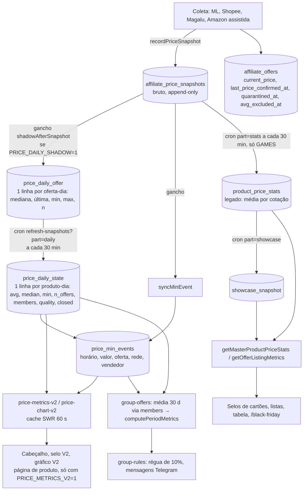
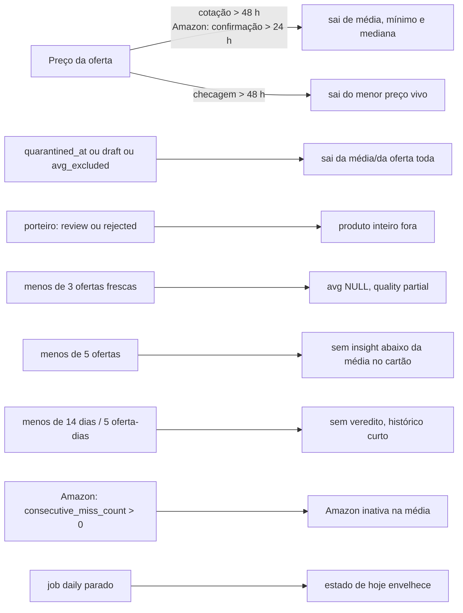

# Fluxo Mestre, capítulo 3: preço, média única, eventos e selos

Data da leitura: 2026-11-12. Base: código em `src/lib/pricing/*`, `src/server/pricing/*`, `src/server/jobs/*`, `vercel.json`, ADR 0004 (média oferta-dia) e ADR 0010 (Amazon na média), mais consultas somente-leitura ao banco de produção em 2026-11-12 ~11h40 UTC. Legenda: **[código]** lido no fonte; **[banco]** medido agora; **NÃO VERIFICADO** = não consegui confirmar. Dado real, hipótese e recomendação estão separados no texto.

---

## 1. Pipeline do preço bruto até selo, gráfico, cabeçalho e mensagem

| Etapa | O que faz | Job / gatilho | Tabela | Cadência | Quem lê |
|---|---|---|---|---|---|
| 1. Cotação bruta | grava preço novo da oferta (só quando muda ou na coleta) | `collect-prices` e `collect-shopee` (*/5), `collect-vertical` (15 min por loja), coleta assistida Amazon (aba logada) | `affiliate_price_snapshots`, `affiliate_offers` | contínua | tudo abaixo |
| 2. Oferta-dia (gancho) | refaz a linha de HOJE daquela oferta e confere o menor preço do produto | `shadowAfterSnapshot` dentro de `recordPriceSnapshot`, só com `PRICE_DAILY_SHADOW=1`, melhor esforço (nunca derruba a coleta) | `price_daily_offer`, `price_min_events` | a cada cotação nova | etapa 3, gráfico |
| 3. Oferta-dia (job) e estado diário | reagrega `price_daily_offer` dos dias a tratar, recalcula `price_daily_state` em lotes de 250 produtos, fecha dias passados, evento de fallback | `/api/cron/refresh-snapshots?part=daily` (`refreshPriceDaily`), pool `bg`, orçamento 240 s | `price_daily_offer`, `price_daily_state`, `price_min_events` | `9-59/30 * * * *` (de 30 em 30 min) **[código]**; 24 execuções ok em 6 h, ~11 s cada, ~5.000 produtos, 0 lotes falhos **[banco]** | gráfico, cabeçalho, mensagens, cartões |
| 4. Estatística legada | média por cotação (soma de snapshots / total), mínimos, mediana, piso | `part=stats` (`refreshProductStats`) | `product_price_stats` (6.410 linhas **[banco]**) | `*/30` (o comentário do código diz 15 min, o `vercel.json` diz 30; vale o `vercel.json`) | tabela de preços, listas, selos de cartão, `/black-friday` |
| 5. Vitrine | contadores, rankings, tabela | `part=showcase` | `showcase_snapshot` | `4-59/15` | home, tabela |
| 6. Leitura V2 | monta cabeçalho, selo, gráfico e lojas de hoje | `getPriceMetricsV2`, `getPriceChartV2`, `getLojasHoje` (cache SWR 60 s por processo) | lê `price_daily_state`, `price_daily_offer`, `price_min_events`, `affiliate_offers` | por requisição | página `/ofertas/[slug]`, rotas `/api/produtos/[id]/grafico` e `/lojas` |
| 7. Mensagem | detecta candidatos, aplica régua e frescor | `/api/cron/group-messages` (`* * * * *`) via `group-offers.ts` | lê `price_daily_state.members`, `price_min_events` | 1 min | Telegram |

Flags que mudam o caminho (todas lidas em um ponto só por flag):

| Flag | Padrão | Efeito | Valor em produção |
|---|---|---|---|
| `PRICE_DAILY_SHADOW=1` | desligada | liga o gancho da coleta e o job `daily` | ligada: o job `daily` roda e grava (`skipped` nulo nas últimas execuções) **[banco]** |
| `PRICE_AMAZON_MODE` (off, shadow, on) | off | `on` inclui a Amazon na média única, `shadow` só compara | `on` no ambiente do cron (`collector_runs.meta.daily.amazonMode = on`, últimas 3 execuções) **[banco]**. No ambiente que serve as páginas: **NÃO VERIFICADO** (é variável separada da Vercel, a doc exige o mesmo valor nos dois) |
| `PRICE_METRICS_V2=1` | desligada | página de produto lê cabeçalho, selo e gráfico V2 (oferta-dia) | **NÃO VERIFICADO** (não há `.env.local` com valor e não li a Vercel) |
| `PRODUCT_CARD_V1=1` | desligada | cartão-pai, só junto de `PRICE_METRICS_V2` | **NÃO VERIFICADO** |
| `VERDICT_JUDGEMENT_ENABLED` (constante, false) | false | rótulo de juízo ("abaixo do usual") fica desligado; o topo mostra só fatos | false no código **[código]** |
| `PRICE_STATS_LIVE=1` | desligada | força cálculo legado ao vivo | só para comparação |

---

## 2. Fórmulas e regras de decisão

Todas em `src/lib/pricing/daily-state.ts` (módulo puro, usado por job, backfill, gancho e scripts) **[código]**. Dia civil = America/Sao_Paulo, deslocamento fixo -03:00.

### 2.1 Quem entra (elegibilidade da oferta, SQL em `eligibility-sql.ts`)

| Critério | Regra |
|---|---|
| Quarentena | `quarantined_at IS NULL` (488 ofertas em quarentena hoje **[banco]**) |
| Rascunho | `status <> 'draft'` (identidade duvidosa fica fora da média, mas a coleta segue gravando) |
| Open Box, usado, recondicionado, cross-gen | fora por `offerExcludedTitleSql` (regex de título + tipo + formato) |
| Porteiro do catálogo | produto fora de `review` e `rejected` |
| Placeholder redundante | oferta do ML sem vendedor sai quando existe oferta ativa com vendedor na mesma rede e produto (`EXCLUDE_REDUNDANT_PLACEHOLDER = true`) |
| Preço | maior que zero |
| Fora da média (`avg_excluded_at`) | continua visível (conta em mínimo e máximo), mas NÃO entra em média, mediana, n_offers nem em `members` |
| Amazon | só se `PRICE_AMAZON_MODE=on`; vertical dentro de `AMAZON_MODE_VERTICALS` (hoje todas as sete); oferta sem ausência na busca (`consecutive_miss_count = 0`) |

### 2.2 Preço da oferta no dia (cada oferta vale 1 por dia)

| Situação | Preço da oferta no dia |
|---|---|
| Teve cotação no dia | mediana do dia, `percentile_disc(0.5)` (preço realmente observado) |
| Sem cotação, oferta "fresca" e "viva" | carry-forward do último preço medido |
| Fresca | ML, Shopee e demais: última cotação há no máximo 48 h. **Amazon**: idade contada desde `last_price_confirmed_at`, teto 24 h |
| Viva | status ativo agora, ou cotação posterior ao instante de referência (oferta expirada não ressuscita) |
| Ativa no dia mas velha (mais de 48 h) | conta em `stale_offers`; NÃO entra em média, mínimo nem mediana |
| Fora da janela de 7 dias | nem é considerada ativa |

Instante de referência = min(agora, fim do dia); dia fechado usa o fim do dia.

### 2.3 Faixa plausível e outliers

| Regra | Valor |
|---|---|
| Quando se aplica | só com 3 ou mais ofertas frescas no dia (`PLAUSIBILITY_MIN_OFFERS`); com menos, passa |
| Piso (estrito) | preço > 35% da mediana das ofertas frescas |
| Teto | preço <= 3x essa mediana |
| Fora da faixa | vira `outlier_offers` no dia, não entra na média |
| Mínimo bruto do dia fora da faixa | vale a mediana do dia da oferta (que já passou) |
| Ofertas "fora da média" | não entram no cálculo da régua; são conferidas contra ela para o mínimo |
| Quarentena na coleta | `price-plausibility.ts`: preço < 0,35x ou > 3x a mediana das ofertas ativas do master (com pelo menos 2 referências) é tratado como isca/erro e a oferta vai a quarentena; nada é apagado |
| Mensagens | mesma faixa (0,35x a 3x) vira "retido"; desconto > 45% contra a média ou queda > 45% = retido; faixa verde automática até 30% |
| Legado (`product_price_stats`) | piso de 35% da mediana de cotações e, além disso, descarte de cotação > 2x a média bruta para média e máximo; **regra diferente da diária** (ver ponta P1) |

### 2.4 Indicadores do dia (`price_daily_state`)

| Campo | Fórmula |
|---|---|
| `avg_cents` | média simples dos preços oferta-dia das N ofertas frescas e plausíveis, **só com N >= 3**; com menos, NULL |
| `median_offer_day_cents` | mediana contínua dos mesmos preços (grava com N >= 1) |
| `min_cents` | menor cotação BRUTA elegível do dia (inclui oferta "fora da média" e oferta carregada) |
| `max_cents` | análogo, dentro do teto |
| `n_offers`, `n_stores`, `n_quotes` | ofertas na média; lojas/vendedores distintos; cotações brutas medidas |
| `quality` | `complete` (N >= 3), `partial` (N de 1 a 2), `gap` (0, tudo nulo, lacuna fica lacuna), `legacy` (antes de 2026-10-31, só contagem) |
| `members` | jsonb oferta -> preço do dia; é o que permite recalcular a média do período |
| Decomposição | `matched_change_pct` = M_C(d2)/M_C(d1) - 1 sobre as ofertas presentes nos dois dias; `composition_flag` quando o efeito composição passa de 50% da variação |

Hoje (2026-11-12): 3.227 produtos com estado, 1.108 `complete`, 2.119 `partial` **[banco]**. Ou seja, dois terços dos produtos ainda não têm média (menos de 3 ofertas).

### 2.5 Média do período e amostra mínima

| Indicador | Regra |
|---|---|
| Média do período | soma dos preços oferta-dia / número de oferta-dias (NÃO a média das médias diárias) |
| Elegível a veredito | 3 ofertas distintas, 5 oferta-dias e 14 dias de histórico (`MIN_DISTINCT_OFFERS_FOR_VERDICT`, `MIN_OFFER_DAYS_FOR_VERDICT`, `MIN_SPAN_DAYS_FOR_VERDICT`) |
| Janela das mensagens e do gráfico | 30 dias, mesma base `members` |
| Insight "abaixo da média" no cartão de oferta | só com **5 ou mais ofertas distintas** (`INSIGHT_MIN_OFFERS_FOR_AVG = 5`, decisão do dono 2026-11-11) e queda >= 10% (`INSIGHT_BELOW_AVG_MIN_PCT`) |
| Cartão de histórico | pelo menos 3 dias (`CARD_MIN_DAYS`), 3 ofertas para média (`CARD_MIN_OFFERS_FOR_AVG`) |
| Black Friday | ata exige "queda real contra a média única (>= 5 ofertas)"; a página usa `m.verdict.kind === 'below'` e `!lowConfidence` (ver capítulo 6 e ponta P5: o limite de 5 ofertas não está no código da página) |
| Amazon-only | média só com 3 ou mais ASIN (`AMAZON_ONLY_MIN_ASIN_FOR_AVG`); abaixo disso a régua usa a mediana de 14 dias do próprio ASIN, com no mínimo 7 dias de série; sem série, a régua de 10% bloqueia (nada inventado) |

### 2.6 Régua de 10% e mensagens

| Item | Regra |
|---|---|
| Régua | mensagem de preço (alerta, insight, radar) só com preço >= 10% abaixo da média única (`MIN_BELOW_AVG_PCT = 10`); sem média, bloqueia |
| Formação de amostra | lojas que não são Games, até 2026-11-30 (`DATA_DE_CORTE_FORMACAO`), usam média simples com piso de 0,1% e mínimo de 2 lojas; em 2026-11-30 a régua cheia entra sozinha |
| Frescor Amazon para envio | 40 min na detecção e no envio (`AMAZON_SEND_MAX_AGE_MIN`), mais estrito que os 24 h da média |
| Oferta `avg_excluded` | nunca escolhida para mensagem (`fora_da_media`) |

### 2.7 Menor preço do momento e eventos (registro obrigatório)

| Item | Regra |
|---|---|
| Menor preço vigente | `computeLiveMin`: ofertas ativas, frescas (<= 48 h; Amazon 24 h por confirmação), dentro da faixa; preço = ÚLTIMA cotação da oferta |
| Empate | vale a oferta de menor id; `tiedAtMin` informa quantas empatam; a loja não é afirmada se não é única |
| Concorrência real | se a oferta mais barata sai (inativa, sem estoque, velha ou fora da faixa), o mínimo passa à próxima mais barata viva no ciclo seguinte; o evento registra a alta (instante da detecção) |
| Evento | `price_min_events`: `at` (queda = instante da cotação que passou a deter o mínimo; alta/expiração = instante da detecção), `min_cents`, `prev_min_cents`, `offer_id`, `network_id`, `seller_id`, `source` (`live` ou `reconstructed`); chave de unicidade (produto, at, min_cents, source) |
| Concorrência de escrita | `syncMinEvent` usa lock advisory por produto (`pg_try_advisory_xact_lock`); quem não pega o lock pula |
| Agrupamento | varredura de uma mesma rodada chega em 0,2 a 0,5 s; na reconstrução vale só o estado final do lote de 2 s (`RECON_BATCH_WINDOW_MS`), nunca cruza meia-noite |
| Altas não observáveis | sem cotação naquele instante, a alta por expiração não é reconstruída: lacuna fica lacuna |
| Volume real | 15.492 eventos (5.638 `live`, 9.854 `reconstructed`); 3.514 nas últimas 24 h **[banco]**; todos têm `offer_id` |
| Vendedor fraco | `LOWS_INCLUDE_WEAK_SELLER = false`: não define "menor de 30/90 dias/sempre" nem dá selo; o "preço agora" continua mostrando o menor real |

Selo "Menor preço do período": exige corroboração por 2ª loja a até 10% (`CORROBORATION_BAND_PERCENT`) ou reconfirmação do preço com pelo menos 30 min de folga. O rótulo de juízo está desligado (`VERDICT_JUDGEMENT_ENABLED = false`).

---

## 3. Frescor e dependências: o que invalida um indicador

| Dependência | O que a quebra faz | Detecção hoje |
|---|---|---|
| Coleta (qualquer rede) parada | ofertas passam de 48 h e saem da média; n cai; a média some quando n < 3 | `collector-health` e `slo` (`src/lib/collector-runs/*`) leem `price_daily_state`; sinal indireto |
| Coleta assistida da Amazon sem lote | Amazon sai da média em 24 h; classe Amazon das mensagens pausa quando passa do limite sem lote | `amazonLoopPaused`, `loadAmazonLastRun` |
| Cron `part=daily` parado | `price_daily_state` de hoje fica velho (a leitura continua servindo o último estado); `price_min_events` ainda recebe eventos do gancho se `PRICE_DAILY_SHADOW=1` | `collector_runs` job `refresh-snapshots:daily` (24 ok em 6 h hoje) |
| Cron `part=stats` parado | selos de cartão, tabela e `/black-friday` envelhecem; `statsSnapshotReady` volta ao cálculo ao vivo se menos de 80% das linhas estão frescas | 73 linhas com mais de 2 h e 3 com mais de 1 dia hoje **[banco]** |
| `PRICE_DAILY_SHADOW` desligada | job `daily` devolve `skipped` e nada novo é gravado | resposta do cron mostra `skipped` |
| `PRICE_AMAZON_MODE` divergente entre cron e app | o estado diário gravado tem Amazon e a leitura em tempo real não (ou o inverso) | **NÃO VERIFICADO** (ver ponta P2) |
| Backfill ausente | `refreshPriceDaily` devolve `skipped: backfill_required` quando não há `price_daily_offer` anterior ao primeiro dia a tratar | resumo do job |
| Mudança de regra (identidade, porteiro, Open Box) | dias FECHADOS não se corrigem sozinhos (ver ponta P3) | scripts de reprocesso manuais |

---

## 4. Filas e pilhas: recálculos pendentes e dias fechados

Não existe tabela de fila de recálculo. O "pendente" é implícito: o job `daily` recalcula, a cada 30 min, **os dias de (último dia fechado + 1) até hoje, no máximo 7 dias**, nunca antes de 2026-10-31 **[código]**.

Prioridade efetiva (do mais para o menos urgente):

| Prio | Trabalho | Quem faz | Observação |
|---|---|---|---|
| 1 | Cotação nova de uma oferta vira linha oferta-dia de HOJE e confere evento do menor preço | gancho da coleta (`shadowAfterSnapshot`) | imediato, por oferta; falha é engolida (sem fila de repetição) |
| 2 | Estado de HOJE (aberto) recalculado a cada ciclo | job `daily` | todos os ~5.000 produtos com oferta-dia nos últimos 7 dias, em lotes de 250 |
| 3 | Fechamento do dia anterior (recalcula com instante de referência = fim do dia, grava `closed=true`) | primeiro ciclo após a meia-noite | `UPSERT ... WHERE closed = false`: dia fechado nunca é reescrito |
| 4 | Catch-up de até 7 dias se o cron ficou parado | job `daily` | limitado a 7; depois disso o buraco permanece |
| 5 | Evento de fallback do menor preço (produto cujo mínimo vivo difere do último evento) | job `daily`, dentro de cada lote | cobre o que o gancho perdeu |
| 6 | Estatística legada por produto | `part=stats`, ordenada por `computed_at` mais antigo (NULL primeiro) | só GAMES, mínimo de 10 min entre recálculos do mesmo produto, orçamento 240 s, 2 lotes em paralelo |
| 7 | Vitrine | `part=showcase`, 4 min após stats | lê estatísticas prontas |
| 8 | Reprocessos de dias fechados | scripts manuais (`reprocess-amazon-state.ts`, `reprocess-draft-offers.ts`, `reprocess-placeholder-collision.ts`, `reprocessar-eventos-minimo.ts`, `backfill-price-daily.ts`, `apply-price-daily.ts`) com backup NDJSON e log | dono aprova; fora do ciclo |

Estado dos dias fechados **[banco]**: de 2026-11-05 a 2026-11-11 há 7 dias fechados (1.644 a 2.723 produtos por dia). Existem **99 linhas `closed=false` com data anterior a hoje** (12 `complete` e 87 `partial`, de 2026-11-05 a 2026-11-11): o job só olha dias depois do `max(day)` fechado, então essas linhas nunca mais são recalculadas nem fechadas.

---

## 5. Como o indicador chega ao front e à mensagem

| Consumidor | Fonte | Cache / atualização | Mesma média? |
|---|---|---|---|
| Cabeçalho, selo V2 e gráfico da página de produto | `price_daily_state` + `price_min_events` via `getPriceMetricsV2` e `getPriceChartV2` | SWR em memória 60 s por processo (`createCachedQuery`), pool `live`, timeout duro 20 s; a rota `/ofertas/[slug]` é dinâmica, não há ISR | Sim entre si; só com `PRICE_METRICS_V2=1` (**NÃO VERIFICADO**) |
| Lojas de hoje | `getLojasHoje` (ofertas vivas do cadastro) | SWR | usa as ofertas atuais, não o estado diário |
| Selo e veredito de cartões e listas, tabela, home, `/black-friday` | `getOfferListingMetrics` / `getMasterProductPriceStatsBatch` → `product_price_stats` (legado, por cotação) e `showcase_snapshot` | SWR 60 a 120 s + persistido no banco (`persist: 1800 s`) alimentado pelo cron | **Não**: base de cálculo diferente (ver P1) |
| Cartão de oferta (insight) | `offer-card-model.ts` (média oferta-dia sem Amazon, 5+ ofertas, 10%) | gerado na hora | tenta alinhar com a média V2 |
| Mensagem do Telegram | `group-offers.ts`: `price_daily_state.members` → `computePeriodMetrics`, 30 dias; menor preço de `price_min_events` | detecção a cada minuto; frescor 40 min Amazon | Sim com a V2 (mesma função) |
| Black Friday | `listRankedOffers` + `getOfferListingMetrics` (legado) | `force-dynamic`, SWR da listagem | usa a base legada |

Observação sobre "ISR": o código usa `force-dynamic` nas páginas de preço e cache SWR em memória por instância, além do pré-cálculo persistido no banco pelo cron. Não há revalidação por tag (`revalidateTag` não é chamado em lugar nenhum, segundo o comentário de `server-cache.ts`). Cada instância fria da Vercel tem sua própria janela de 60 s.

---

## 6. Trilha de Black Friday: mostrar queda real sem inventar

Princípios (regra inegociável + ata de 2026-11-12): só dado medido; nenhum selo "Black Friday" sem queda comprovada contra a média única; um produto, uma média; só produto novo e em linha.

Hierarquia de prova (do mais forte ao mais fraco), todas as peças já existem no código:

| Nível | Prova | Fonte | Condição mínima |
|---|---|---|---|
| A | Preço agora abaixo da média única oferta-dia de 30 dias | `members` → `computePeriodMetrics` | média elegível: 3 ofertas, 5 oferta-dias, 14 dias; recomendado também 5 ou mais ofertas (ata) |
| B | Novo menor preço registrado, com data e loja | `price_min_events` + série de mínimos diários | série >= 3 dias, não vale para Amazon |
| C | Queda >= 5% contra o último preço da PRÓPRIA oferta, com "desde ontem / desde dd/mm" | `price_daily_offer` | vale para Amazon (histórico dela mesma) |
| D | Tendência: variação da média oferta-dia (ou do mínimo diário) entre janelas (por exemplo 7 dias contra os 7 anteriores), mostrada como número e série, nunca como adjetivo | `price_daily_state` com `matched_change_pct` (mesmas ofertas nos dois dias) | **a implementar**: o indicador de tendência está pendente na ata (pendência 3e); o selo antigo de tendência só olha os 2 últimos snapshots e foi marcado como inválido (D3) |

Regras de segurança para a tendência (recomendação, não implementada):

1. Usar a variação de ofertas pareadas (`matched_change_pct`) para não confundir composição (loja entrou ou saiu) com queda de preço; se `composition_flag` for verdadeiro, mostrar "variação por mudança de lojas" ou omitir.
2. Série curta: com menos de 7 dias medidos, mostrar o menor preço e a data, não "em queda".
3. Teto de plausibilidade (60% de queda na página, 45% nas mensagens) para não promover isca ou erro; acima do teto vai a "revisão", não a destaque.
4. Antes da Black Friday de 27/11, ancorar a queda na média dos 30 dias anteriores a cada oferta ter sido "promovida" (o histórico pré-Black é a única base honesta; subir preço antes e "descontar" depois é visível em `members`).
5. Amazon: comparar só contra o próprio histórico ou a média única qualificada, com carimbo de data e hora.
6. Selo e mensagem devem citar a MESMA média e o mesmo número de ofertas; a página `/black-friday` hoje lê a base legada (ponta P1) e precisa migrar para a V2 antes de prometer "queda real".

---

## 7. PONTAS SOLTAS

| # | Ponta | Severidade | Evidência | Correção recomendada | Dono sugerido |
|---|---|---|---|---|---|
| P1 | **Duas médias no mesmo site.** Selos de cartões, listas, tabela, home e `/black-friday` leem `product_price_stats` (soma de TODAS as cotações / total, com descarte de cotação > 2x média bruta, só GAMES, sem escopo da Amazon nem frescor de 24 h). Cabeçalho/gráfico V2 e mensagens leem `price_daily_state` (oferta-dia, 48 h, faixa 0,35x a 3x, Amazon com escopo). A regra inegociável diz "Selo, gráfico e cabeçalho usam a MESMA média" | Alta | `product-price-stats.ts` (`priceQuotesCtes`, sem referência a Amazon) e `affiliate.ts` `getOfferListingMetrics`; `group-offers.ts` usa `members` | Fazer `product_price_stats.avg_cents` derivar do estado diário (ou trocar `getOfferListingMetrics` para ler `price_daily_state`) e ligar `PRICE_METRICS_V2` com a emenda do `AGENTS.md`; antes, rodar a comparação em sombra (`comparar-metricas-sombra.ts`) | cientista-precos + engenheiro-backend |
| P2 | **Flags não confirmadas no app.** `PRICE_AMAZON_MODE=on` aparece no ambiente do cron; no ambiente que serve as páginas, `PRICE_METRICS_V2` e `PRODUCT_CARD_V1` não foram confirmados | Alta | `.env.local` sem valores; só o cron grava `amazonMode` | Conferir as variáveis da Vercel e registrar o valor no `.env.example`; adicionar ao `collector-health` um alerta de divergência de modo | engenheiro-infra-sre |
| P3 | **Dia fechado sem reprocesso.** `lastClosed` é o `max(day)` GLOBAL fechado; um lote que falha ou estoura o orçamento no ciclo de fechamento deixa produtos com linha `closed=false` para sempre. Hoje: 99 linhas abertas com data passada (2026-11-05 a 2026-11-11), com mínimo gravado mas média possivelmente parcial | Alta | consulta `price_daily_state WHERE NOT closed AND day < hoje` = 99 **[banco]** | Fechar por produto: no ciclo, selecionar `closed=false AND day < hoje` e reprocessar; alerta se a contagem for > 0 depois do ciclo da meia-noite; opção `--fechar-pendentes` no script | engenheiro-backend + dba-postgres |
| P4 | **Dias fechados não acompanham mudanças de regra.** Identidade, porteiro, Open Box, quarentena e entrada da Amazon alteram o passado, mas o `UPSERT` nunca reescreve `closed=true`; a correção depende de script manual com backup. O gráfico mistura dias "pré e pós regra" | Média | desenho do `upsertStates`; ADR 0010 cita `reprocess-amazon-state.ts` | Registrar versão da regra no estado (coluna `rule_version`) e reprocessar por versão; documentar cada reprocesso na ata | cientista-precos |
| P5 | **Limite de 5 ofertas na Black Friday só na ata.** A página usa `verdict.kind === 'below'` e `!lowConfidence`; o piso de 5 ofertas (`INSIGHT_MIN_OFFERS_FOR_AVG`) vale no cartão, não na página. O veredito legado exige 5 cotações e 14 dias, e cotação não é oferta | Média | `black-friday/page.tsx` vs `offer-card-model.ts` | Exigir `distinctOffers >= 5` e média oferta-dia na página (depende de P1) | engenheiro-frontend |
| P6 | **Tendência sem dono.** Indicador de tendência não existe (pendência 3e); o selo antigo de tendência (2 últimos snapshots) é desligado com V2 e ainda aparece sem V2 | Média | `page.tsx` linha 130; ata de 2026-11-12 | Criar `tendencia-preco.ts` puro sobre `price_daily_state` (itens da seção 6), com teste e nome do dono | cientista-precos |
| P7 | **Indicadores sem dono:** `product_price_stats` (legado, só GAMES, 73 linhas > 2 h), `showcase_snapshot`, `lojas-hoje`, `percentualExtremo` (sinalizador sem efeito), `PARECER_PERCENTUAL_EXTREMO`, juízo desligado | Média | `price-metrics-config.ts`, `refresh-snapshots.ts` | Atribuir dono por indicador numa tabela única; definir SLO de frescor (por exemplo `daily` <= 45 min, `stats` <= 45 min) e alerta | geek-lead |
| P8 | **Só 1.108 de 3.227 produtos têm média** (34%). Os `partial` mostram mínimo e mediana, não média; nas lojas que não são Games vale a fase de formação até 2026-11-30 | Média | `quality` de hoje **[banco]** | Não relaxar a regra (3 ofertas). Medir a cobertura por loja diariamente e priorizar a coleta de segunda e terceira loja nos produtos mais vistos | engenheiro-coleta |
| P9 | **Eventos sem `prev_min_cents`:** 3.522 de 15.492 (23%) não têm preço anterior; correto para o primeiro evento do produto, mas a proporção sugere eventos de reconstrução ou perda do elo | Baixa | **[banco]** | Verificar se são todos "primeiro evento do produto"; senão religar o predecessor (`collapseMinEventBatches`) | dba-postgres |
| P10 | **Gancho da coleta engole falha.** Se `shadowAfterSnapshot` falha, só o ciclo de 30 min repara, e o evento sai com atraso (até 30 min) | Baixa | `record-price-snapshot.ts` | Aceitável; registrar contador de falhas do gancho em `collector_runs.meta` | engenheiro-coleta |
| P11 | **Comentário e cadência divergentes.** O comentário do cron diz 15 min para `stats` e `daily`; o `vercel.json` usa 30 | Baixa | `route.ts` vs `vercel.json` | Corrigir o comentário (o `vercel.json` é a verdade) | engenheiro-backend |
| P12 | **Frescor Amazon em dois níveis.** Média: 24 h por confirmação; mensagem: 40 min; só 256 de 676 ofertas Amazon ativas estavam abaixo de 40 min na ata de hoje. Média com Amazon pode usar preço de 23 h enquanto o cartão se recusa a mostrá-lo | Média | ata 2026-11-12; `amazon-mode.ts` | Mostrar "confirmado há X" junto do preço e da média com Amazon; revisar o teto de 24 h só com decisão do dono (risco contratual) | integrador-apis + dono |

### Resumo do que foi verificado no banco (2026-11-12 ~11h40 UTC, somente leitura)

| Medida | Valor |
|---|---|
| Execuções `refresh-snapshots` nas últimas 6 h | daily 24 ok, stats 23 ok, showcase 24 ok, inventory 6 ok |
| Job daily | ~11 s, 5.001 a 5.052 produtos, 0 lotes falhos, orçamento não estourado |
| `price_daily_offer` em hoje | 134.780 linhas |
| Estado de hoje | 3.227 produtos (1.108 complete, 2.119 partial) |
| Produtos com Amazon dentro da média de hoje | 485 |
| Linhas abertas com data passada | 99 |
| Eventos de menor preço | 15.492 (3.514 nas últimas 24 h) |
| Ofertas em quarentena | 488 |

NÃO VERIFICADO: valores de `PRICE_METRICS_V2`, `PRODUCT_CARD_V1` e `PRICE_AMAZON_MODE` no ambiente que serve as páginas; paridade numérica entre `product_price_stats` e `price_daily_state` para os mesmos produtos hoje; comportamento real da página `/black-friday` em produção.
