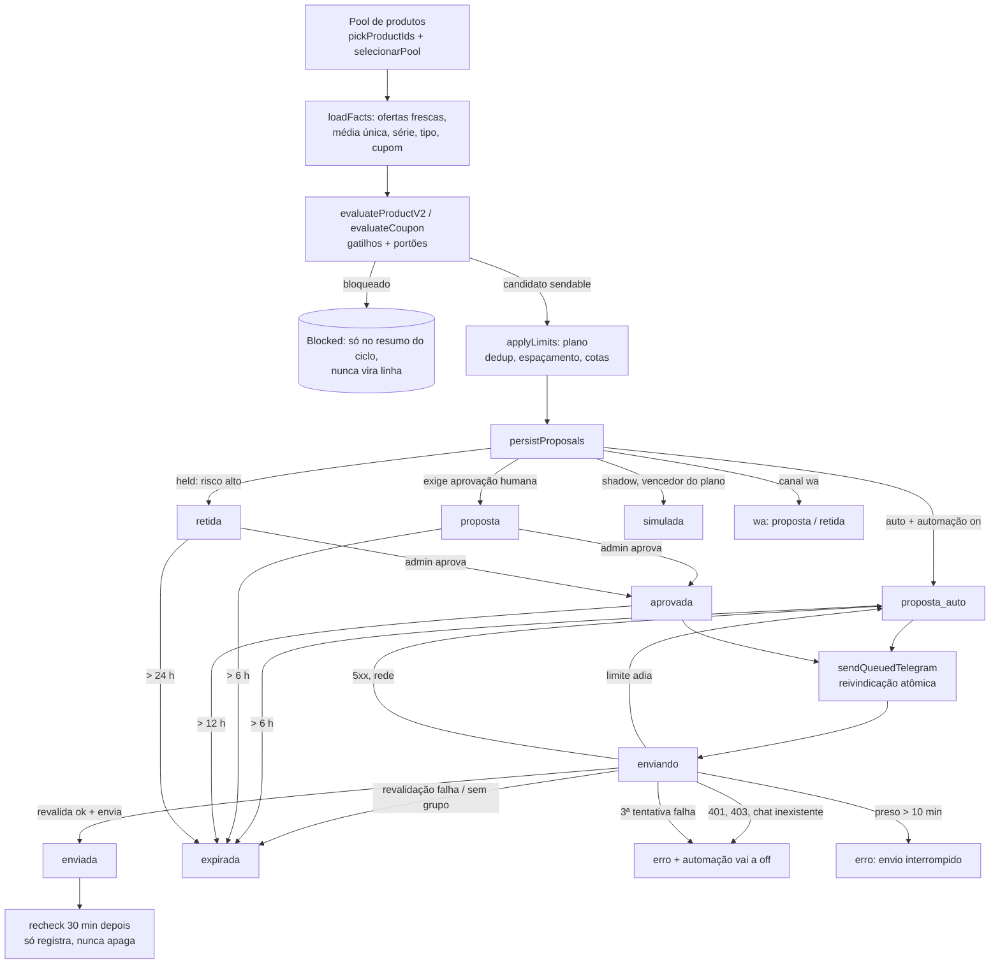
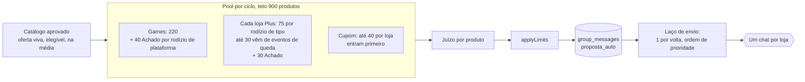
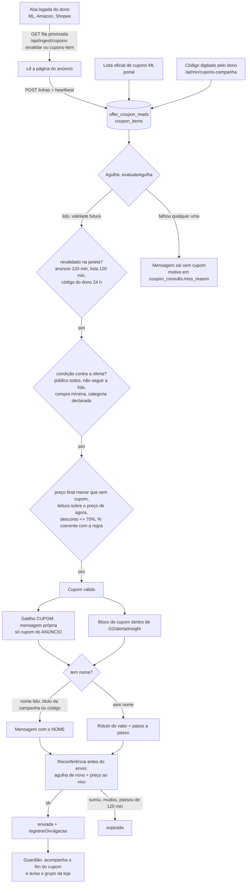
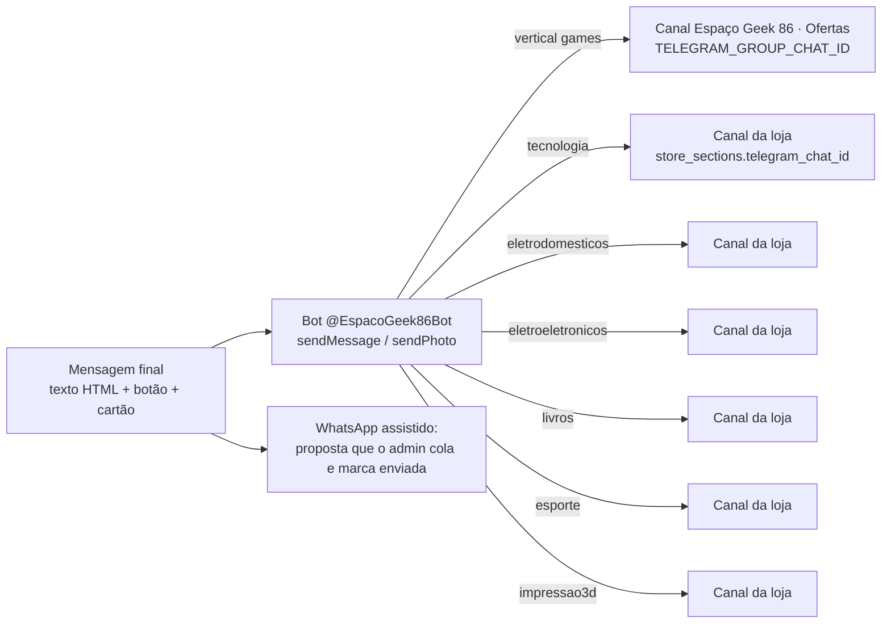

# Fluxo mestre, capítulo 4: mensagens automáticas (Telegram/WhatsApp) e cupons

- **Data da leitura:** 2026-11-12, banco consultado às 11:50 UTC (08:50 em Brasília). Horários de `sent_at` abaixo estão em Brasília (BRT) quando dito.
- **Método:** código lido em `src/lib/messaging/*`, `src/server/messaging/*`, `src/lib/coupons/*`, `src/app/api/cron/group-messages/route.ts`, `vercel.json`; documentos `docs/03-metodologia/FLUXO_DE_ENVIO_TELEGRAM.md` e `docs/03-metodologia/CUPOM_NA_AGULHA.md` (os dois ficam em `03-metodologia`, não em `docs/`); ata `docs/conselho/atas/2026-11-11-telegram-sem-teto-diario.md`. Medições: SELECT somente leitura contra o banco real (`group_messages`, `collector_runs`, `offer_coupon_reads`, `coupon_items`, `coupon_consults`, `coupon_announcements`, `affiliate_offers`, `store_sections`). Nenhum dado foi escrito.
- **Convenção:** [C] visto no código, [M] medido no banco em 2026-11-12, [D] vem de documento e não foi reconferido, **NÃO VERIFICADO** = não consegui confirmar.
- **Escopo:** só leitura e documentação. Nada de código, cron, loop ou aba foi tocado.

---

## 0. Resumo executivo

1. A cadeia roda a cada minuto (`vercel.json`: `/api/cron/group-messages`, `* * * * *`) [C][M: 1.393 execuções em 24 h; 60 por hora]. Em 24 h entraram 2.322 linhas de Telegram; **1.184 foram enviadas (51%)**, 587 expiraram (25%), 416 estão na fila, 77 esperam humano, 48 estão retidas, 10 viraram erro [M].
2. O funil real tem três pontos de perda: a **reconferência no envio** (359 expirações "já não vale", 61% de todas as expirações), a **espera de aprovação humana** (202 "expirada sem envio") e a **fila do Achado** (313 propostas esperando; latência mediana 2,2 h contra 28 min do G2) [M].
3. Há **dois defeitos de confiabilidade que merecem ação imediata**: 10 linhas ficaram "enviando" até virar `erro` sem `message_id` (execuções que passam de 60 s, o `maxDuration`), e 25 execuções do cron terminaram em erro de consulta ao banco em 24 h [M].
4. Cupom: a agulha funciona e barra o certo (818 "seguir a loja" e 100 "desconto implausível" na última hora), mas **só o Mercado Livre tem leitura viva**. Shopee: 0 leituras de cupom registradas na história; Amazon: 177 leituras em 24 h, todas "sem cupom" [M].
5. Textos que o dono proibiu em 2026-11-12 (média simples/"amostra pequena", "(Brasília)", "Cupom do anúncio") ainda saíram em centenas de mensagens nas últimas 24 h; a última com "amostra" foi às 10:15 UTC de hoje e a última com "Brasília" às 20:15 UTC de ontem. A trava `BANNED` **não** contém esses termos, então a regressão não seria barrada [C][M].

---

## 1. Máquina de estados da mensagem

### 1.1 Linha do tempo de um candidato

### 1.2 Estados e transições [C: group-queue.ts, group-auto.ts, group-automation.ts]

| Estado (`status`) | Entra por | Sai por | Quem executa | Tempo limite | Observação |
|---|---|---|---|---|---|
| (candidato, em memória) | `detectGroupCandidates` a cada ciclo | `persistProposals` ou descarte | cron `group-messages` | só existe dentro da execução | Candidato não enviável (`sendable=false`) nunca é gravado. Se já existe linha aberta do mesmo produto nas últimas 6 h no mesmo canal (cupom e não-cupom contam separado), a nova não é gravada. `ON CONFLICT (dedup_key, channel) DO NOTHING`. |
| `proposta_auto` | candidato seguro (`dispositionOf` = auto) com automação `on` | `enviando` (reivindicada), `expirada` | cron (`sendQueuedTelegram`) | 6 h; Radar composto 20 min | Estado normal de espera na fila. |
| `proposta` | candidato que exige humano (`needs_review`) ou automação `off` | `aprovada`, `rejeitada`, `expirada` | admin em `/admin/mensagens` (`setStatusByKey`) | 6 h | No canal `wa` toda linha nasce `proposta`. |
| `retida` | candidato `held` (desconto > 45% contra a média, queda > 45%, preço fora de 0,35x a 3x a mediana) | `aprovada` (humano), `expirada` | admin | 24 h | Nunca sai sozinha. |
| `aprovada` | admin aprova `proposta` ou `retida` | `enviando`, `expirada` | admin; depois cron | 12 h | O cron envia `aprovada` mesmo com automação pausada pelo freio de inscritos. |
| `simulada` | modo `shadow` (só o vencedor do plano que passa na releitura) | nunca envia | cron | n/d | Registro para comparar com o banco. |
| `enviando` | reivindicação atômica: `UPDATE ... WHERE status IN ('aprovada','proposta_auto')` | `enviada`, `expirada`, volta ao estado de origem (`claim_from`), `erro` | cron | **10 min** parado vira `erro` (nunca volta à fila, para não duplicar) | Só uma execução vence a reivindicação. |
| `enviada` | Telegram aceitou (`message_id` gravado) | recheck | cron | n/d | Grava texto final, preço, som, `has_card`, `recheck_due_at = +30 min`. |
| `expirada` | idade acima do limite, ou revalidação falhou, ou loja sem grupo (`sem_grupo_do_departamento_*`) | final | `expireStale` ou `sendQueuedTelegram` | n/d | Motivo gravado em `error`. |
| `rejeitada` | admin rejeita | final | admin | n/d | 1 em 7 dias [M]. |
| `erro` | falha definitiva (401/403/404/chat inexistente), 3ª tentativa falha, ou `enviando` > 10 min | final | `sendQueuedTelegram` / `expireStale` | n/d | Falha definitiva também leva a automação a `off` (pausa total até o dono olhar). |

Estados de automação (`feature_flags: group_messages_auto`): `off`, `shadow`, `on`. Último ciclo registrado em 2026-11-12 11:49 UTC: `state: on`, `brake: false` [M]. Travas de ambiente: `GROUP_MESSAGES_ENABLED`, `GROUP_MESSAGES_MODE=send`, token e chat id (falha fechada) [C].

### 1.3 Quem faz o quê, na ordem de um ciclo [C: group-auto.ts, route.ts]

1. Rota: autorização do cron; `refreshShopeeCampaigns` no minuto 7; `discoverStoreChats` (resolve link público de canal em chat id).
2. `expireStale()`; `syncAmazonWatch()`; contagem de inscritos (a cada ~55 min) e freio (queda padrão 5%).
3. `detectGroupCandidates` (somente leitura) e `persistProposals`.
4. Laço de envio: até **60 voltas** ou **38 s** (`MAX_SENDS_PER_RUN`, `SEND_BUDGET_MS`); lê até 300 linhas da fila (`PENDING_LIMIT`); a cada volta aplica `applyLimits` e envia **uma** linha; se só falta esperar o intervalo do chat (3 s), espera 3,1 s dentro do orçamento.
5. `runRechecks` (até 20 linhas vencidas por ciclo).
6. Guardião de cupons (`cicloAgenteCupons`, orçamento de 12 s) só se a execução ainda não passou de 35 s.

### 1.4 Revalidação de preço antes do envio [C: revalidateCandidate]

Ordem: (a) `applyLimits` barato antes de gastar consulta; (b) **reconferência ao vivo** na API oficial das ofertas do candidato e das concorrentes mais baratas com preço velho (>30 min), limite de 8 s por consulta, Shopee sempre nas automáticas, **Amazon não é consultada ao vivo** (segue o frescor da coleta assistida); preço vivo fora de 2% do detectado, sem estoque ou falha de rede = expira; (c) nova detecção só desse produto com frescor de envio (30 min; Amazon 40); o gatilho original precisa continuar valendo e, nas automáticas, a faixa segura; (d) o preço da nova detecção não pode diferir mais de 2% do detectado; (e) `applyLimits` de novo com o candidato revalidado; (f) cupom: a agulha roda de novo com a hora do envio.

### 1.5 Frescor por rede

| Rede | Detecção (entra no pool) | Envio (revalidação) | Reconfirmação | Medido em 24 h |
|---|---|---|---|---|
| Mercado Livre | 180 min (`DETECT_MAX_AGE_MIN`) | 30 min (`SEND_MAX_AGE_MIN`) | preço visto em 2 coletas separadas por >= 15 min, salvo reconferência ao vivo | 1.064 de 1.077 enviadas com `live_checked_at` [M] |
| Shopee | 180 min | 30 min | idem; exige aprovação humana salvo queda <= 20% com reconferência ao vivo | 36 de 36 [M] |
| Amazon | **60 min** (`AMAZON_DETECT_MAX_AGE_MIN`) | **40 min** (`AMAZON_SEND_MAX_AGE_MIN`) | 2 observações >= 15 min (`AMAZON_OBS_GAP_MIN`); classe pausa se o lote da coleta assistida passar de 90 min (`AMAZON_LOOP_STALE_MIN`) | idade do preço no envio: mediana 15 min, máximo 39 min (103 mensagens) [M]. Ofertas Amazon ativas: 682; confirmadas há <= 40 min: 296 (43%); <= 60 min: 384 (56%) [M] |

---

## 2. Filas e pilhas

### 2.1 Do catálogo ao envio

| Peça | Regra | Valor |
|---|---|---|
| Pool de candidatos [C: pool-diversidade.ts] | Games | 220 |
| | Loja Plus (livros, casa, eletroeletrônicos, esporte, tecnologia, impressão 3D) | 75 por rodízio de TIPO (até 30 direto de eventos) + 30 extras de Achado |
| | Games sem média (Achado) | até 40 por rodízio de PLATAFORMA |
| | Produtos com cupom válido na agulha | até 40 por loja, antes dos demais, por rodízio de tipo |
| | Teto do ciclo | 900 produtos (`maxProducts`) [D] |
| Rodízio por hora | O hash do produto muda com a hora (`md5(mid + hora)`); a rodada de tipos começa pelo tipo menos enviado em 24 h | determinístico por hora |
| Espaçamento por chat [C: chatSpacingBlock] | Entre duas mensagens do mesmo chat; lojas diferentes não se bloqueiam | 3 s; máximo 20 por minuto por chat |
| Repetição [C: productDedupBlock] | Mesmo produto (G2 e demais) | 1 h (`PRODUCT_GAP_MIN`) |
| | Novo menor preço (OK1/G1) com preço menor que o do último envio | repete após 30 min |
| | Achado | **24 h** por produto |
| | Cupom | 1 h por produto (só entre mensagens de cupom) e 1 h por cupom/leitura (em qualquer mensagem) |
| Cotas por loja [C] | Achado | max(3, 25% das mensagens da loja em 24 h) e no máximo 2 por hora |
| | Cupom | máximo 6 por hora; até 40% das mensagens da loja em 24 h (suave: só cede se houver mensagem de outro tipo) |
| | Tipo de produto | nenhum tipo acima de 30% das mensagens da loja em 24 h, só com alternativa e após 6 envios; alerta de queda não é freado |
| Tetos de quantidade | Dia, hora, noite, classe | `NO_CAP` (1.000.000): sem teto desde 2026-11-11 |
| Som | Só alerta e resumo, de dia, até 20 por dia | 3 enviadas com som em 24 h (OK1 1, OK2 2) [M] |

### 2.2 Ordem de prioridade e quem vence a disputa [C: CLASS_RANK, TRIGGER_RANK, applyLimits]

Ordem de classe: **alerta (0) > resumo (1) > cupom (2) > insight (3, inclui G2 e Achado) > radar (4) > plataforma (5)**.

| Gatilho | Classe | O que é | Posição |
|---|---|---|---|
| OK1 (novo menor preço >= 5% abaixo), OK2 com queda >= 8%, G1 | alerta | **queda** | 1º; sai primeiro e não é freado pela cota de tipo |
| G4 | resumo | resumo do dia (8h e 20h; 22h também na semana 20 a 27/11) | 2º |
| CUPOM | cupom | cupom ativo por oferta | 3º (prioridade ALTA por ordem do dono em 2026-11-12) |
| G2 | insight | na média ou abaixo | 4º |
| AC (Achado) | insight | preço atual de produto sem média | dentro de insight, **só depois de qualquer insight com comparação real** |
| G3, G5, OK2 5 a 8%, T1, T2 | insight/radar | comparativos e radar | 5º e 6º |
| P1 a P5 | plataforma | 1 a cada 6 mensagens de preço, intervalo mínimo de 20 min, ou pausa de preços > 30 min | fora da fila de preço; entra quando "devida" |

Regras de desempate dentro da mesma classe (insight e radar): (1) Achado depois de comparação real; (2) tipo MENOS enviado hoje na loja; (3) maior movimento (`moveScore`); (4) ordem do gatilho; (5) maior `% abaixo da média`; (6) chave da mensagem. Depois, `pickNext` troca a primeira por uma da mesma classe com movimento >= 70% quando ela repetiria loja + departamento + plataforma da última enviada.

**"Black"** não é um gatilho. Não existe `BLACK` em `Trigger`. A Black Friday (`BLACK_FRIDAY_WEEK` 2026-11-20 a 2026-11-27, `BLACK_FRIDAY_DAY` 2026-11-27) só muda: (a) horários do resumo (8h, 20h e 22h), (b) a linha "Black Friday: faltam N dias" dentro do bloco Monitoramento das mensagens de preço, e (c) o teto da semana, que hoje vale o mesmo `NO_CAP`. A página `/black-friday` é separada do fluxo de mensagens [D: ata 2026-11-12-black-friday-vitrine]. Logo, na disputa, a Black Friday não ganha nem perde prioridade.

**Quando o mesmo produto disputa vagas:** a persistência não grava uma segunda linha aberta do mesmo produto em 6 h (cupom e não-cupom contam à parte); depois de enviado, o dedup de 1 h (24 h no Achado) bloqueia; entre produtos diferentes da mesma loja, valem a classe e os desempates acima.

### 2.3 Sobre quem vence na prática (medido em 24 h) [M]

| Gatilho | Enviadas | Latência criada até enviada, mediana | p90 | Máximo |
|---|---|---|---|---|
| G2 | 1.046 | 28 min | 69 min | 5,9 h |
| CUPOM | 63 | 28 min | 60 min | 5,5 h |
| AC | 80 | **133 min** | 321 min | 5,4 h |
| OK2 | 9 | 75 min | 276 min | 4,6 h |
| P1 a P4 | 16 | 18 a 61 min | 80 min | 1,4 h |

O Achado espera quase 5 vezes mais que o G2 porque sempre perde a disputa e porque o dedup de 24 h e a cota por loja o seguram. Fila de Achado hoje: 313 em `proposta_auto` (ML 218, Shopee 95; por loja: games 139, esporte 41, tecnologia 33, casa 32, livros 24, eletroeletrônicos 22, impressão 3D 22), com idade máxima de 311 min, perto do limite de 360 min.

---

## 3. Regras imperativas e banidas

### 3.1 Barreira final de texto [C: group-messages.ts `BANNED`, `textProblems`]

Termos que **bloqueiam o envio** (a mensagem não sai se aparecerem): `afiliad*`, `% OFF`, `de/por`, `De R$ X por R$ Y`, `imperdível`, `corre`, `últimas unidades`, `promoção relâmpago`, `menor preço da internet`, `menor preço da história/do ano`, `vai/deve cair|baixar|subir|aumentar`, `tende a`, `previsão`, `hora de comprar`, `garantido`. Também bloqueia: Amazon sem o carimbo "Preço na Amazon em dd/mm às hh:mm"; mensagem Amazon que cita outra loja ou "média das lojas"; texto acima do limite do Telegram; variável vazia (`NaN`, `undefined`, `null`). Mensagem com problema vira candidato não enviável.

| Regra do dono | Está no `BANNED`? | Medido nos textos enviados em 24 h [M] |
|---|---|---|
| Palavra "afiliado" | sim | 0 |
| "% OFF" | sim | 0 (e 0 com "N% de desconto") |
| "de R$ X por R$ Y" | sim | 0 |
| Metodologia/amostra (dono 2026-11-12: "a mensagem não cita média nem amostra quando a amostra é pequena") | **não** | **223 mensagens com "amostra"** ("Média simples: R$ ... (3 ofertas ativas; amostra pequena)"); a última às 10:15 UTC de hoje; 101 delas nas últimas 6 h; nenhuma depois de 10:15 UTC |
| Horário "(Brasília)" no carimbo | **não** | **220 mensagens** (G2 "Conferido em dd/mm às hh:mm (Brasília)"); a última em 2026-11-11 20:15 UTC; 0 nas últimas 6 h |
| "Cupom do anúncio" (rótulo antigo; substituído por nome ou passo a passo) | **não** | 79 mensagens (57 CUPOM + 22 G2); a última às 10:36 UTC de hoje |
| "abaixo da média" | n/d (permitido com >= 5 ofertas na média) | 762 em 24 h; 202 nas últimas 6 h |

Leitura: as três mudanças do dono foram aplicadas na geração do texto (o código atual não emite mais "amostra" nem "Brasília"), mas **nenhuma delas tem trava** no `BANNED`. Uma regressão reabriria o problema sem alarme (ponta solta 7.8).

### 3.2 Regras de forma e conteúdo

| Regra | Origem | Estado |
|---|---|---|
| **Cantos retos** nos cartões (card de oferta, cartão "CUPOM ENCERRADO" 1080x1080 "cantos quadrados") | padrão visual; `ended-coupon-card.tsx` [C] | Confirmado no cartão de cupom encerrado [C]. Para `offer-card.tsx` e `price-card.tsx` **NÃO VERIFICADO** (não renderizei os cartões). |
| **Cartão obrigatório** | dono | **Não é obrigatório no código**: `cardFor` falha em silêncio (timeout de 8 s, ou legenda > 1024 caracteres cai em texto) e a mensagem sai sem imagem. Medido: G2 1.021 de 1.046 com cartão (98%); **AC 8 de 80 (10%)**; **CUPOM 14 de 63 (22%)**; P1 0 de 5 (o cartão de histórico só sai se `cardAllowed`: máximo 4 por dia e 7 dias por produto) [M] |
| **Só com dado real** | `AGENTS.md` | Toda mensagem nasce de `loadFacts` (oferta confirmada, série diária, média única); o texto não usa números calculados fora desses dados. Preço revalidado ao vivo antes do envio. Medido: 1.205 de 1.216 enviadas (99%) têm `live_checked_at` [M]. |
| **Só produto novo e em linha** | memória do dono 2026-11-11 | Portão `eligibleOfferSql` + `scopeBlock` (fora de linha/retrô em games, Open Box, usado, plataforma desconhecida) [C]. Não conferi linha a linha no banco: **NÃO VERIFICADO** para as 1.216 mensagens. |
| **Reputação baixa fora** | dono 2026-11-12 | Só `1_red` e `2_orange` barram oferta ML; amarela, verde-clara, verde, poucas vendas e sem reputação entram, com a reputação lida na mensagem [C]. Vendedor com poucas vendas vira aprovação humana no Achado (1 proposta [M]). |
| **Link oficial** | dono 2026-11-11 | ML só sai com link `https://meli.la/...` (o resto vira `affiliate_link_pending`); 0 linhas `proposta_auto` com oferta pendente [M]. Ofertas ML ativas ainda sem link oficial: 905 de 17.153 pela coluna `affiliate_link_pending` [M]; o documento de funil mede 65 a 75% sem meli.la nas lojas Plus pela regra do prefixo [D]. As duas medidas usam critérios diferentes: **NÃO VERIFICADO** qual vale hoje. |
| **Um canal por loja** | dono 2026-11-11 | `store_sections`: as 7 lojas têm `telegram_chat_id`, `telegram_bot_can_post = true` e link de WhatsApp [M]. |
| **Faixas de risco** | ata 2026-11-10 | desconto ou queda > 30%: aprovação humana; > 45%, ou preço fora de 0,35x a 3x da mediana: retido [C][M: 45 + 46 casos hoje]. |
| **Régua de média** | dono 2026-11-11 | Fase de formação (lojas fora de games) até 2026-11-30: preço <= média simples; depois: >= 10% abaixo da média oferta-dia, 3 lojas, >= 3 ofertas, >= 5 oferta-dias, >= 14 dias [C]. Texto com "%" só com >= 5 ofertas [C]. |
| **Sem previsão, sem urgência artificial** | ata 2026-11-10 §8 | Na lista `BANNED` [C]. |
| **Tag** | tag `#publicidade` e rodapé "Espaço Geek 86" | presente no AC e CUPOM amostrados [M]. |

---

## 4. Cupons: da leitura na loja até a mensagem

### 4.1 Fluxo

### 4.2 Regras da leitura e da agulha [C: agulha.ts, coupon-item-lookup.ts, network-adapters.ts; D: CUPOM_NA_AGULHA.md]

| Item | Regra |
|---|---|
| Leitura autorizada | Mercado Livre: anúncio, lista oficial e código do dono. Amazon e Shopee: leitura pela página do item na aba logada, autorizada pelo dono em 2026-11-11. Rede sem leitura autorizada: `rede_sem_leitura_autorizada`. |
| "Só se lido/confirmado" | A mensagem só usa cupom com leitura na fonte e validade futura (mais de 15 min do fim). Cupom de lista ou código sem validade lida nunca entra. O anúncio sem validade só vale por 120 min e a mensagem não afirma validade. |
| **Follow-the-store excluído** | Rótulo com "seguir" é barrado (`cupom_exige_seguir_loja`). Medido: **818 barragens por esse motivo nos ciclos da última hora** (cerca de 14 por ciclo) e 100 por `desconto_implausivel`. Entre as leituras positivas de 24 h, os rótulos mais frequentes incluem "com Cupom por seguir a loja" [M]. A coluna `audience` de `coupon_items` vale `todos` nas 4.622 linhas [M], então a exclusão depende do rótulo lido, não da audiência. |
| Público e conta | Público restrito (Prime, novos usuários, primeira compra, membros) e conta lida não elegível são barrados. |
| Janelas | Anúncio 120 min; lista 120 min; código do dono 24 h. Meta de releitura das ofertas que importam: 45 min. Lista "verificada" sem conferência há 12 h perde o selo (baixa automática). |
| Preço final | Com cupom < sem cupom; leitura feita sobre o preço de agora (tolerância de 2 centavos); desconto <= 70%; % e teto lidos têm que bater com o calculado. |

### 4.3 Da agulha à mensagem

| Caminho | Quando | Texto |
|---|---|---|
| **Mensagem CUPOM** ("Cupom ativo") | oferta cujo cupom do ANÚNCIO passa na agulha; entre as ofertas do produto, a de maior desconto em reais. Fora: Amazon (carimbo próprio). | "CUPOM ATIVO", título, preço COM cupom e loja, cupom, desconto em R$ e %, "Como usar", "Outra oferta, sem cupom" se existir mais barata, carimbo de leitura "Preço lido na página do anúncio em dd/mm às hh:mm". Sem "% OFF", sem "de R$ por R$", sem média. |
| **Bloco de cupom** dentro de alerta/insight | `couponLookup` com limite de 4 s; ordem anúncio, código do dono, lista (`consultarCupom`) | linha de cupom entra só se verificada e vista há <= 2 h |
| **Cupom de lista e código do dono** | não têm preço final lido na página | só no bloco das mensagens de preço, nunca em mensagem própria [D] |

**Nome do cupom, sempre ou passo a passo** (`coupon-name.ts`, ordem do dono em 2026-11-12): prioridade (1) nome lido na página do anúncio; (2) título da campanha na lista (`coupon_items`, por `campaign_id`) com o escopo; (3) código digitável; (4) sem nome: rótulo do valor lido ("R$ 20,95 de desconto") e passo a passo da loja ("1. Abra o anúncio; 2. Em Cupons, ative o cupom de R$ 20,95; 3. Finalize a compra"; Amazon: "Clique em Aplicar o cupom abaixo do preço"; ML automático: "aplicado sozinho"). Medido: das 63 mensagens CUPOM de 24 h, **6 têm nome e 57 caem no passo a passo**; as 63 trazem instrução; nenhuma cita "seguir" [M]. Gravação de nome e código: `offer_coupon_reads.coupon_name/coupon_code` depende da migration 0049 (proposta) e de `CUPOM_NOME_COLUNAS=1` [D]; **NÃO VERIFICADO** se a 0049 está aplicada.

**Amostra de uma mensagem CUPOM real enviada hoje** [M]: "CUPOM ATIVO / Super Mario 3D World + Bowsers Fury Switch · mídia física / R$ 304,00 com o cupom no Mercado Livre / Cupom: R$ 20,95 de desconto / Desconto: R$ 20,95 (6,4%); o anúncio sem cupom está em R$ 324,95 / Como usar: 1. Abra o anúncio; 2. Em Cupons, ative o cupom de R$ 20,95; 3. Finalize a compra / Outra oferta, sem cupom: R$ 299,00 na Shopee / Vendedor: reputação verde / Comprar: link meli.la / Preço lido na página do anúncio em 12/11 às 08:02". Observação: o rótulo "Cupom: R$ 20,95 de desconto" não é nome; é o caso (4).

### 4.4 Guardião e agente de cupons

- `cicloAgenteCupons` (a cada ciclo do cron, quando sobra tempo): fecha cupons divulgados que acabaram, avisa o grupo da loja com card silencioso "CUPOM ENCERRADO", faz baixa automática, grava `collector_runs` job `agente-cupons`.
- `registrarDivulgacao` grava `coupon_announcements` (upsert por cupom e departamento enquanto aberto). Medido: 14 divulgações desde 2026-11-11 14:22 UTC (13 abertas, 1 encerrada, **0 avisos de encerramento enviados**) [M].
- `agente-cupons` em 24 h: 251 ciclos `ok`, 6 `partial` (1 por falha de consulta a `coupon_announcements`; os outros 5 sem texto de erro) [M]. Último ciclo ok: 4.466 listas vivas, 1.293 ofertas ML no alvo da agulha, 375 lidas nas últimas 2 h, 20 com cupom, 60 com cupom velho, 50 expirando em 24 h; fontes sem leitura: `shopee:pagina-do-item`, `shopee:cupons-de-loja`, `amazon:cupons-de-loja` [M].
- Vigia dos loops (`cupons-batimento`): aviso interno quando uma rede com último batimento `ok` passa de 60 min. Não avisa quando o loop foi parado pelo operador. Registros `cupons-vigia` em toda a história: **0** [M].

---

## 5. Rotas de saída

| Peça | Como funciona | Fonte |
|---|---|---|
| **Um canal/grupo por loja** | `getStoreByVertical(match.vertical)` e `chatForStore`. Games usa `TELEGRAM_GROUP_CHAT_ID`; as demais, o chat gravado em `store_sections`. Sem grupo: `expirada` com `sem_grupo_do_departamento_<vertical>`; nunca cai no grupo de games. Hoje as 7 lojas têm chat verificado [M]. | [C] |
| **Bot** | `sendTelegramGroupMessage`: foto por `sendPhoto` multipart quando há cartão e a legenda cabe em 1.024 caracteres (contando só texto visível), senão `sendMessage`. HTML recusado: reenvia em texto simples. Respeita `retry_after` até 8 s. Sem token ou chat id, nunca chama a rede. | [C] |
| **Botão** | "Ver oferta e comprar" abaixo da mensagem, com o link rastreado `/go/<slug>?s=tg&m=<chave>`. Não vai em mensagens de plataforma nem no Radar. | [C: buyButton] |
| **Link no texto** | "Comprar: <link>" quando existe `affiliateUrl` do dono (`meli.la`, `s.shopee`, Amazon com tag); o WhatsApp só tem o texto. Em Telegram sem link direto, o botão é o único caminho. Amazon e Shopee: formato exato do link no texto **NÃO VERIFICADO** (amostrei só ML). | [C] |
| **Rodapé e WhatsApp** | link "Histórico completo: egeek86.com/?s=tg&m=<chave>" e "Grupo no WhatsApp: <link da loja>" (de `store_sections.whatsapp_group_url`; sem link, nada aparece) | [C][M] |
| **Rastreio** | `m=<messageKey>` identifica a mensagem; o texto usa a chave da linha mesmo se a releitura escolheu outra oferta | [C] |
| **WhatsApp** | Não envia sozinho. Toda candidata ganha também uma linha `wa` (`proposta` ou `retida`); o admin cola e marca "enviada" (`markWhatsappSentByKey`). | [C] |

---

## 6. Medições reais das últimas 24 horas

Banco às 2026-11-12 11:50 UTC. Janela: `created_at` nas últimas 24 h (canal Telegram, salvo dito o contrário).

### 6.1 Telegram por status

| Status | Linhas | % |
|---|---|---|
| enviada | 1.184 | 51,0% |
| expirada | 587 | 25,3% |
| proposta_auto (na fila) | 416 | 17,9% |
| proposta (espera humano) | 77 | 3,3% |
| retida | 48 | 2,1% |
| erro | 10 | 0,4% |
| **Total** | **2.322** | |

Por `sent_at` nas últimas 24 h foram **1.216 enviadas**. WhatsApp (canal assistido): 545 `proposta`, 557 `expirada`, 44 `retida`; 0 enviadas.

### 6.2 Por rede e status

| Rede | enviada | expirada | proposta_auto | proposta | retida | erro | Total | % enviada |
|---|---|---|---|---|---|---|---|---|
| Mercado Livre | 1.048 | 452 | 310 | 62 | 27 | 8 | 1.907 | 55% |
| Amazon | 103 | **114** | 8 | 13 | 19 | 2 | 259 | 40% |
| Shopee | 33 | 21 | 98 | 2 | 2 | 0 | 156 | 21% (98 aguardam) |

Expirações por motivo e rede [M]: ML 261 "revalidação: já não vale (preço velho, sumiu ou mudou)", 171 "expirada sem envio", 7 "ml_anuncio_fora_dos_vencedores", 5 "régua 10%", 3 "ml_http_206", 2 "preço mudou mais de 2%", 2 "saiu da faixa segura", 1 divergência ao vivo de 16,1%; **Amazon 83 "já não vale"**, 25 "expirada sem envio", 5 "saiu da faixa segura", 1 "preço mudou 2%"; Shopee 15 "já não vale", 6 "expirada sem envio".

### 6.3 Por gatilho

| Gatilho | enviada | expirada | proposta_auto | proposta | retida | erro |
|---|---|---|---|---|---|---|
| G2 | 1.015 | 507 | 88 | 69 | 46 | 7 |
| AC (Achado) | 80 | 66 | **313** | 6 | 0 | 2 |
| CUPOM | 63 | 2 | 12 | 0 | 0 | 1 |
| OK2 | 8 | 8 | 0 | 0 | 1 | 0 |
| OK1 | 1 | 1 | 0 | 2 | 1 | 0 |
| P1 a P4 | 16 | 2 | 3 | 0 | 0 | 0 |
| G3 | 1 | 0 | 0 | 0 | 0 | 0 |
| G4 | 0 | 1 | 0 | 0 | 0 | 0 |

### 6.4 Por loja (enviadas, expiradas, na fila)

| Loja | enviada | expirada | proposta_auto | proposta | retida | erro | Achado no total enviado |
|---|---|---|---|---|---|---|---|
| games | 549 | 228 | 160 | 17 | 41 | 2 | 2 de 581 (0%) |
| tecnologia | 166 | 50 | 53 | 10 | 2 | 2 | 12 de 166 (7%) |
| impressão 3D | 137 | 74 | 39 | 8 | 1 | 1 | 12 de 137 (9%) |
| eletroeletrônicos | 107 | 54 | 41 | 9 | 0 | 3 | 13 de 107 (12%) |
| casa | 80 | 52 | 37 | 14 | 2 | 0 | 14 de 80 (18%) |
| esporte | 79 | 65 | 52 | 8 | 0 | 0 | 14 de 79 (18%) |
| livros | 66 | 64 | 34 | 11 | 2 | 2 | 13 de 66 (20%) |

(Por `sent_at`, games soma 581 enviadas.) O share de Achado respeita a cota de 25%.

### 6.5 Ritmo, espaçamento e duplicidade

- Enviadas por hora (BRT): 25 a 30 por hora entre 12h e 20h de 11/11; **0 na hora das 21h de 11/11**; 60 a 122 por hora a partir das 22h de 11/11; 15 na hora corrente. O platô de 30 por hora antes das 22h sugere o teto antigo de 30 por hora; **NÃO VERIFICADO** (não localizei a data exata do deploy do `NO_CAP`). A hora sem envio às 21h **NÃO VERIFICADA** (o cron rodou 58 vezes na hora).
- Máximo de envios por minuto e por loja: de 3 (livros, esporte, impressão 3D, eletroeletrônicos) a 5 (tecnologia, games); limite de 20 por minuto: respeitado.
- Duplicidade: **0** pares do mesmo produto e mesmo gatilho a menos de 55 min; **0** Achado repetido em menos de 24 h; **0** pares na mesma loja a menos de 3 s. As travas funcionam.
- Cron: 1.393 execuções em 24 h (1.368 `ok`, 25 `error`); duração média 21 s; **14 execuções entre 55 s e 98 s** (limite da rota: 60 s); 636 execuções enviaram algo; máximo de 12 envios numa execução.
- Som: 3 de 1.216 mensagens com som.
- Reconferência pós-envio (30 min): 1.197 `ok`; 7 `preco_divergiu` (divergência média 21,65%); 4 `oferta_inativa_ou_em_quarentena`; 8 ainda sem reconferência (as mais recentes) [M]. Nada é apagado do canal.
- Reconferência ao vivo: ML 1.064 de 1.077, Shopee 36 de 36, Amazon 102 de 103 com `live_checked_at` gravado [M]. Para a Amazon o código não consulta a API ao vivo; **NÃO VERIFICADO** o que o campo registra para ela.

### 6.6 Cupons em 24 h

| Medida | Valor |
|---|---|
| Leituras `offer_coupon_reads` | ML (`item_page_assistida`) 12.723 em 1.343 ofertas; Amazon (`amazon-pagina`) 177 em 93 ofertas; **Shopee 0 (nenhuma leitura em toda a tabela)** |
| Status das leituras ML | `sem_cupom` 11.553; `unredeemed` 1.135; `lido_na_pagina` 35 |
| Status das leituras Amazon | `sem_cupom` 177 (**nenhuma com cupom**) |
| Ofertas com leitura positiva nos últimos 120 min | 46 |
| Consultas `coupon_consults` | 1.062; achou 49 (4,6%); não achou 1.013 |
| Motivos principais de não achar | "lida sem cupom" nas três fontes 659; sem motivo gravado 150; "item sem leitura" + loja sem cupom 79; rede sem leitura autorizada 67 + 4; "exige seguir loja" 29 |
| Barragens da agulha nos ciclos da última hora | `cupom_exige_seguir_loja` 818; `desconto_implausivel` 100 |
| Gatilho CUPOM por ciclo (média da última hora) | no pool 14,6; geradas 12,2; enviáveis 12,2 |
| Mensagens CUPOM | 63 enviadas (games 42, eletroeletrônicos 11, tecnologia 10), 12 na fila, 2 expiradas, 1 erro; **63 mensagens para apenas 11 ofertas** (cerca de 5,7 vezes cada, uma por hora pelo dedup de 1 h) |
| Idade da leitura no envio | mediana 27 min; máximo 51 min (janela 120) |
| Inventário `coupon_items` ML | lista de itens: 3.368 verificados, 913 não verificados, 138 vencidos; categoria: 133 verificados, 64 não verificados, 6 vencidos; todos com `audience = todos` |
| Loop da Amazon | 48 batimentos em 24 h; último há 7 min; ciclos de 4 a 9 leituras; fila de 8 a 10 |
| Loop da Shopee | 5 batimentos em 24 h; **último às 02:17 UTC (há 573 min), `estado: parado, motivo: operador`** |
| Divulgações e avisos | 14 divulgações; 0 avisos de encerramento enviados |

### 6.7 Gargalos (ordem de peso)

1. **Reconferência no envio mata 359 mensagens (15% das linhas, 61% das expirações)**: o candidato espera em média 28 min; o limite de frescor do ML é 30 min, então boa parte já nasce velha na hora de enviar. Quanto disso é espera e quanto é mudança real de preço: **NÃO VERIFICADO**.
2. **Fila do Achado (313)** com latência mediana de 2,2 h, e já perto das 6 h de validade; ela cresce porque o Achado perde a disputa de prioridade e porque a cota por loja o contém.
3. **Aprovação humana**: 69 G2 acima de 30% e 24 sem motivo gravado esperam clique; 202 "expirada sem envio" em 24 h incluem esse caso. Retidas: 46 G2 acima de 45% da média, 20 h de idade máxima, expiram em 24 h.
4. **Orçamento de tempo do cron**: 14 execuções acima de 55 s com limite de 60 s; 5 acima de 60 s; 1 de 98 s.
5. **Cobertura de cupom fora do ML**: Shopee sem leitura; Amazon sem nenhum cupom lido.

---

## 7. Pontas soltas (severidade e correção)

Severidade: **Alta** = perde ou duplica mensagem ou esconde falha; **Média** = reduz cobertura ou viola regra do dono sem trava; **Baixa** = higiene.

| # | Ponta solta | Evidência | Sev. | Correção proposta |
|---|---|---|---|---|
| 7.1 | **Mensagem que expira sem enviar (revalidação)**: 359 linhas "já não vale" em 24 h; Amazon perde 83 de 259 (32%) | [M] seção 6.2; motivo único para 4 causas diferentes (preço velho, sumiu, mudou, gatilho deixou de valer) | **Alta** | Separar o motivo em quatro códigos em `error` e medir cada um antes de mexer em limites. Hipótese a testar: reduzir a espera (a fila acumula 28 min de mediana) priorizando linhas por idade dentro da classe, ou reavaliar na própria volta de envio. Não afrouxar o frescor de 30/40 min. |
| 7.2 | **`enviando` preso vira `erro` sem `message_id`**: 10 linhas em 24 h (9 com reconferência ao vivo feita, 0 com `message_id`) | [M]; execuções de 55 a 98 s contra `maxDuration` de 60 s [M] | **Alta** | Não dá para saber se o Telegram entregou; a regra de não reenviar protege contra duplicata mas pode perder mensagem. Reduzir `SEND_BUDGET_MS` e o orçamento do guardião para que a execução termine antes de 60 s com margem; impor `AbortSignal` com prazo nas chamadas de rede; conferir o canal manualmente as 10 linhas listadas (G2 e AC, de 00:59 a 07:54 BRT). |
| 7.3 | **Falha silenciosa do ciclo**: 25 execuções `error` com "Failed query" (consultas de `pickProductIds`/`loadFacts`) | [M] erros às 11:01, 11:16, 11:31, 11:32, 11:34, 11:39 UTC, entre 10 e 37 s | **Alta** | Causa **NÃO VERIFICADA** (hipótese: tempo limite de consulta ou conexão no plano Micro). Tentar uma vez de novo a consulta de pool; registrar `cause` do erro em `meta`; alerta quando `error` passar de 3 em 15 min. A mesma causa derrubou 1 ciclo do guardião (`agente-cupons` `partial`). |
| 7.4 | **Retida sem saída**: 46 G2 acima de 45% da média ficam até 24 h e expiram; ninguém é avisado | [M] 48 retidas, idade máxima 20,2 h; WhatsApp 44 retidas | **Média** | Não é erro de coleta por definição (pode ser). Definir dono do clique: lista diária no painel com motivo, ou rejeitar em lote as acima de 45% com evidência. Registrar a decisão humana em `approved_by` para auditoria. |
| 7.5 | **Proposta (humano) que expira**: 69 G2 acima de 30% + 24 sem motivo gravado; vencem em 6 h | [M] | **Média** | Mesma fila do 7.4. O campo `reviewReasons` está vazio em 24 propostas: gravar sempre o motivo de revisão. |
| 7.6 | **Fila do Achado acumulada (313) e latência mediana de 133 min**; 66 expiraram | [M] | **Média** | A prioridade é de propósito. Mitigar descartando da fila o que está a mais de 3 h (o frescor de 30 min já exigiria nova detecção) para não gastar volta de envio, e dimensionar a cota por loja com base nos 313 que sobram. Decisão de negócio do dono. |
| 7.7 | **Cupom sem leitura fresca**: Shopee 0 leituras em toda a história e loop parado pelo operador às 02:17 UTC; Amazon 177 leituras, 0 cupom; fontes `shopee:*` e `amazon:cupons-de-loja` sem leitura | [M] | **Média** | Reinjetar o loop da Shopee (aba, não toquei). Amazon: validar os seletores `#couponBadgeRegularVpc`/`#couponTextpctch*` em simulação; "0 de 177" pode ser ausência real ou seletor errado: **NÃO VERIFICADO**. Mensagem continua sem cupom nessas redes (comportamento correto). |
| 7.8 | **Regras do dono sem trava no texto**: "amostra", "Brasília" e "Cupom do anúncio" não estão em `BANNED`; saíram 223, 220 e 79 mensagens | [C][M] | **Média** | Acrescentar ao `BANNED` (`/amostra/i`, `/\(Brasília\)/i`, `/cupom do an[uú]ncio/i`, `/m[eé]dia simples/i` quando a amostra é pequena) e cobrir com teste. Hoje o código não os gera; a trava impede regressão. |
| 7.9 | **Cartão "obrigatório" não é obrigatório**: Achado 10% e Cupom 22% com cartão; falha de render ou legenda > 1.024 caracteres cai em texto sem aviso | [M][C] | **Média** | Registrar o motivo em `photoSkipped`/`live_note` ao cair para texto, medir a taxa por gatilho e decidir se a mensagem sem cartão deve ser adiada (política do dono). Causa do baixo índice **NÃO VERIFICADA** (timeout de 8 s, legenda longa, ou `cardFor` retornando `null`). |
| 7.10 | **Vigia dos loops de cupom nunca agiu**: 0 registros `cupons-vigia`; Shopee parou há 9 h, mas foi "parado/operador", exceção explícita do vigia | [M][D] | **Média** | Esperado por desenho, mas o painel precisa mostrar "parado há N h" e a lista de redes sem leitura deveria incluir parada de operador depois de, por exemplo, 6 h. |
| 7.11 | **Cupom repetido**: 63 mensagens para 11 ofertas em 24 h (1 por hora por cupom) | [M] | **Média** | Avaliar o risco de saturação e de saída de inscritos; subir `CUPOM_COUPON_GAP_MIN` para 3 a 6 h é decisão do dono. O freio por queda de inscritos continua ativo. |
| 7.12 | **Cupom ML com nome: 6 de 63**; 57 mensagens usam passo a passo; nome/código dependem da migration 0049 e de `CUPOM_NOME_COLUNAS=1` | [M][D] | **Baixa** | Confirmar se a 0049 está aplicada e se o loop lê o nome; **NÃO VERIFICADO**. |
| 7.13 | **WhatsApp**: 545 propostas abertas e 557 expiradas em 24 h; zero enviadas; cada candidata é gravada duas vezes | [M] | **Baixa** (por desenho assistido) | Se o canal não será operado, parar de gravar `wa` (menos carga no banco) ou criar rotina de colagem. |
| 7.14 | **`group_offer_watch` vazio** (0 linhas): a vigilância de ausência/volta da Amazon não registrou nada | [M] | **Baixa** | **NÃO VERIFICADO** se é porque nenhuma oferta Amazon sumiu da busca (`consecutive_miss_count > 0`) ou se o passo não escreve. A reconfirmação de 15 min depende disso. |
| 7.15 | **Divulgação sem aviso de encerramento**: 0 avisos enviados; 13 divulgações abertas; `listPending` só avisa `sumiu_da_pagina`/`cancelado_pelo_dono` e `venceu` fora de anúncio | [M][C] | **Baixa** | Conferir se o fim de cupom de anúncio com `venceu` é intencionalmente silencioso; hoje o único encerramento (1) foi `venceu` e não gerou aviso. |
| 7.16 | **Documentação e comentários desatualizados**: comentários do cron dizem "NÃO está no vercel.json, sugestão a cada 5 min"; o `vercel.json` roda `* * * * *`; `CUPOM_NA_AGULHA.md` diz "a cada 5 min" | [C] | **Baixa** | Atualizar. Ver também que `FLUXO_DE_ENVIO_TELEGRAM.md` e `CUPOM_NA_AGULHA.md` estão em `docs/03-metodologia/`. |
| 7.17 | **Hora sem envio e platô de 30 por hora**: 0 enviadas às 21h BRT de ontem; platô de 30 por hora antes do `NO_CAP` | [M] | **Baixa** | **NÃO VERIFICADO**: confirmar no histórico de deploy e nos logs da hora se houve pausa, freio de inscritos ou falha. |
| 7.18 | **Migration 0046 (Achado)**: aplicada (o CHECK de `trigger` já contém `AC`) | [M] | **Baixa** | O documento de funil ainda a lista como pendente; atualizar. |
| 7.P0 | **Envios caíram a ~0 (2026-11-12, 11h-13h UTC)**: o orçamento de 38 s do laço de envio é contado desde o início do ciclo e a detecção+persistência passou disso (jobs 41-43 s). Medido: `persistProposals` fazia ~900 INSERT em série (2 canais x ~450 candidatos, quase todos já existentes), `loadFacts` ~80 consultas de dias por produto em série, `pickProductIds` 3 varreduras `live` (2-12 s cada, até 31 s sob contenção); erros 'Failed query' = SOCKET_TIMEOUT de 30 s do pool live. | [M] collector_runs, pg_stat, cronometragem local | **Alta** | **Corrigido (d63cf1f, e500e95)**: lote na persistência e nos dias do período; `SEND_MIN_WINDOW_MS` 14 s (teto `CYCLE_HARD_CAP_MS` 46 s) garante envio mesmo com detecção lenta; `meta.timing` em `collector_runs` (pick/facts/persist/send). Resta o pick (varreduras `live`). |

---

## 8. O que este capítulo não cobre

- Não conferi a imagem renderizada dos cartões nem os cantos retos além do cartão de cupom encerrado.
- Não consultei o Telegram (entrega real, contagem de inscritos) nem a tabela de membros do canal.
- Não medi a taxa de cliques (`/go`) nem a atribuição por `m=<messageKey>`.
- Não reproduzi a revalidação em ambiente de teste; as causas de 7.1, 7.3 e 7.9 são hipóteses.
- A divergência entre "905 de 17.153 ofertas ML pendentes" e "65 a 75% sem meli.la nas lojas Plus" depende de critérios diferentes de contagem (coluna versus prefixo da URL) e precisa de uma consulta única.
