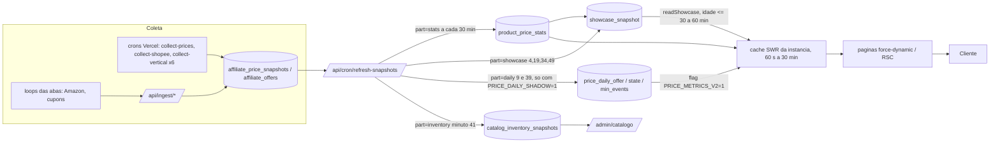
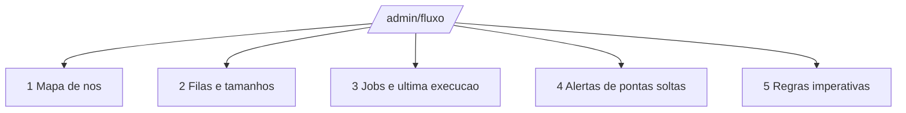

# Fluxo Mestre, capítulo 5: front, admin e camada de leitura

Data-base: 2026-11-12 (commit a304476 e árvore de trabalho atual). Escopo: só leitura do código; nada foi alterado, nenhum cron, loop ou aba foi tocado. Onde não houve confirmação, está escrito **NÃO VERIFICADO**.

Leitura prévia do Next 16 (`node_modules/next/dist/docs`): `08-caching.md` (modelo Cache Components, `cacheComponents: true`), `caching-without-cache-components.md`, `09-revalidating.md` e `authentication.md`. Fatos que mandam aqui:

- `next.config.ts` **não** liga `cacheComponents`. O projeto está no modelo anterior; `use cache` e `updateTag` não são usados.
- O `src/app/layout.tsx` lê `cookies()` e `headers()`. Por isso toda rota que passa por ele é renderizada por requisição, com ou sem `force-dynamic`. Não existe ISR efetivo nas páginas; o frescor vem só de cache de dados (seção 2).
- `src/proxy.ts` (nome novo do middleware no Next 16) só renova sessão e barra `/admin` sem cookie `sb-*-auth-token`. A autorização real é `requireAdmin`.
- O guia de autenticação do Next avisa: layouts não re-renderizam na navegação (renderização parcial), então checagem só no layout não basta. Isso pesa na seção 5.

---

## 1. Mapa de páginas e rotas

Legenda de fonte: **SWR** = cache em memória por instância (`src/lib/cache/swr.ts`), **SNAP** = tabela `showcase_snapshot`/`product_price_stats` escrita pelo cron, **VIVO** = consulta direta ao banco na requisição.

### 1.1 Públicas

| Rota | Lê de | Frescor / cache | Observação |
|---|---|---|---|
| `/` | `getPublicMetrics` (SNAP, 1 h), `homeSearchCached` (SNAP, 1 h; SWR 10 min), notícias (SWR 60 s), enquete (VIVO), faixas Plus | revalida 60 s a 10 min; SNAP vale até 30 a 60 min | `force-dynamic` |
| `/ofertas` | `rankedOfferListCached` + `rankFeaturedOfferIdsCached` (SNAP 30 min, SWR 60 s), `getOfferListingMetrics` (estatística V1, SWR 60 s) | até ~30 min atrás do banco | sem `force-dynamic` explícito, dinâmica pelo layout |
| `/black-friday` | `listRankedOffers` (mesmo SNAP de `/ofertas`) + `getOfferListingMetrics` + `FaixasPlusHome` | queda "nas últimas 24 h" calculada na hora sobre ranking com até 30 min | `force-dynamic`; seção some com menos de 3 itens (`MIN_SHELF`) |
| `/tabela-de-precos` | `priceTableDataCached` (SNAP 30 min, SWR 60 s a 30 min) | até ~30 min | `force-dynamic` |
| `/ofertas/[slug]` (produto) | cabeçalho/selo: estatística V1 (`product_price_stats`, `direct`) ou V2 (`price_daily_state`) conforme flag; lojas hoje (SWR 60 s), cupons (SWR 120 s), sinopse (900 s), histórico 3M (300 s) | 60 s nos blocos vivos | ver pontas soltas P2 e P3 |
| `/api/produtos/[id]/grafico` e `/lojas` | gráfico V2 e lojas hoje | CDN `s-maxage=60, swr=120` | fora do `proxy` de propósito (sem cookie, cacheável) |
| `/monitoramento`, `/monitoramento/comparar/[id]`, `/monitoramento/altas-e-baixas` | `price-history`, `price-watches`, estatística batch | VIVO + SWR 60 s | lista pessoal exige login |
| `/mercado/[vertical]` e `[slug]` (lojas Plus) | `departamento.ts`: `indiceTiposCache` (SWR 120 s, stale 15 min), listagem VIVO; estado da loja vem de flag no banco | até ~2 min; estado do departamento em cache de processo (TTL **NÃO VERIFICADO**) | `force-dynamic`; loja `admin` só aparece para admin |
| `/plus` | `getLojasPlus` (`store_sections` + `resumoDepartamentos`), `getGruposWhatsapp`, tipos principais (SWR 120 s) | ~2 min | falha vira "em montagem" |
| Faixas Plus (home, `/black-friday`) | `getDestaquesPlus` (SWR 120 s, stale 15 min, **sem SNAP**) | ~2 min; instância fria calcula ao vivo | sem selo, sem média |
| `/pesquisa` (busca) e `/api/search*` | `search-products.ts` (SWR 60 s a 600 s) | CDN `s-maxage` 60 a 300 s | |
| `/noticias`, `/noticias/[slug]` | tabela de notícias (VIVO) | por requisição | só com fonte registrada |
| `/hype-zone/*`, `/leiloes`, `/conta/*`, `/carrinho` | tabelas próprias (VIVO), login | por requisição | |
| `/ranking` | nenhuma | n/a | página honesta "sem ranking" (correto) |
| `/inteligencia-gamer` | **lista escrita à mão no componente** (`INTEL_ITEMS`) | nunca atualiza | ver P1 |
| `/sobre`, `/contatos`, `/termos`, `/privacidade` | `getPublicMetrics` (sobre/contatos) | SNAP 1 h | |
| `/go/[slug]`, `/go/noticia/[slug]` | redirecionamento de saída (links de loja) | n/a | |

### 1.2 Admin (todas sob `src/app/admin/layout.tsx`, `force-dynamic`, `requireAdmin`)

| Rota | Lê de | Frescor |
|---|---|---|
| `/admin` | `admin-metrics.ts` (VIVO) | no carregamento |
| `/admin/catalogo` | `catalogo-inventario.ts` (VIVO, agregados) + `catalog_inventory_snapshots` (evolução diária) | número ao vivo; série atualizada 1x/h (`part=inventory`, upsert 1 linha por loja por dia) |
| `/admin/catalogo-revisao` | fila de revisão do porteiro | no carregamento; **fora do menu** |
| `/admin/mensagens` | `group_messages` (fila), `group-overview`, `group-plan`, `agulha-health` (`offer_coupon_reads`, `coupon_items`) | no carregamento, sem auto-refresh |
| `/admin/ofertas`, `/novo`, `/[id]` | ofertas e mestres | no carregamento |
| `/admin/cupons`, `/cupons-campanha`, `/cupons/novo` | cupons | no carregamento |
| `/admin/redes`, `/usuarios`, `/carrinhos`, `/colecionadores`, `/pesquisa`, `/noticias*`, `/data-science` | tabelas próprias | no carregamento |
| `/api/admin/{search-offers,card,cartao,catalogo/export}` | idem | checam `admin` ou `super_admin` na própria rota (verificado) |

Menu admin: `src/components/layout/admin-nav-links.tsx` (13 itens).

---

## 2. Do banco ao cliente

Quem invalida e quando:

| Camada | Escritor | Cadência (vercel.json) | Teto de idade na leitura | Invalidação manual |
|---|---|---|---|---|
| `product_price_stats` | `refreshProductStats` (só vertical Games; recalcula quem tem mais de 10 min) | `*/30` | n/a (a tela lê a linha pronta) | `?part=stats&force=1` com `CRON_SECRET` |
| `showcase_snapshot` | `refreshShowcase` (usa as estatísticas prontas) | minutos 4-59/15 | 30 min (ranking, tabela, contadores), 60 min (métricas públicas, busca da home) | `?part=showcase&force=1` |
| `price_daily_*` (base V2) | `refreshPriceDaily` + gancho da coleta | minutos 9 e 39 | n/a | só roda com `PRICE_DAILY_SHADOW=1` |
| `catalog_inventory_snapshots` | `gravarSnapshotInventario` | minuto 41 | n/a | `?part=inventory` |
| Cache SWR | a própria leitura (single-flight) | n/a | 60 s a 30 min fresco; vencido serve o último valor bom até `maxStaleSeconds` | **nenhuma**: não há `revalidateTag`/`revalidatePath` nas queries de preço; só reinício ou nova instância |

Tempo estimado do preço novo até o cliente (pior caso, soma das camadas; **estimativa por leitura de código, não medida**):

1. Coleta grava a cotação: cadência do job (5 min nos crons ML/Shopee; 15 min por vertical Plus; 2 h na Amazon assistida).
2. Estatística V1 recalculada: até 30 min.
3. Showcase: até 15 min depois (e depende da estatística já pronta).
4. SWR da instância: até 60 s (listas) ou 10 min (busca da home).
5. Conclusão: lista e ranking de `/ofertas` e `/black-friday` podem estar de 30 a 50 min atrás do banco. A página de produto com V2 ligada fica a ~1 min do banco, mas a base V2 só avança se o job `daily` estiver ligado (P3). Faixas Plus: ~2 min.

Falha do cron: após 30 min sem refresh, `readShowcase` devolve `null` e a página cai em cálculo ao vivo (instância fria pode esperar até 40 s no caso de `publicMetricsCached`). Isso é fallback honesto (nunca inventa número), mas é o ponto onde a latência explode (P6).

---

## 3. Regras imperativas do front

| # | Regra | Como o código a cumpre hoje | Como checar |
|---|---|---|---|
| R1 | **Média única**: selo, gráfico e cabeçalho do produto usam a MESMA média (oferta-dia, ADR 0004; mudança do menor preço sempre registrada com horário, valor e loja) | Lista usa estatística V1; produto usa V1 ou V2 por flag; gráfico é só V2 | Abrir o mesmo produto na lista e na página, comparar três números. Divergência = bug (ver P2) |
| R2 | **Sem dado fake ou sintético** | Falha de leitura devolve vazio/"em montagem"; `/ranking` assume ausência | `INTEL_ITEMS` viola (P1) |
| R3 | **Lojas Plus aparecem como "plus"**: nome "Espaço Geek Plus", rótulo da loja, sem selo nem média até 27/11 (média pública só Games) | `LOJAS_PLUS`, `FaixasPlusHome` sem selo; `refreshProductStats` só Games | Plus nunca mostra "abaixo da média" |
| R4 | **Concorrência real**: menor preço = oferta ativa mais barata no momento; sem estoque cai para a próxima | `listRankedOffers`, `getLojasHoje`, quarentena de preço | oferta inativa nunca fica no topo |
| R5 | **Link de loja sem a palavra "afiliado"** na interface do cliente; aviso de comissão usa `CommissionNotice` (texto aprovado) | `commission-notice.tsx` | `grep -ri afiliad` em `src/app/(shop)`, `(detalhe)`, `src/components` fora de admin |
| R6 | **Uma imagem, um lugar** (`public/images/`) | Varredura de `src/` pelos caminhos literais `/images/...`: só `og-cover.png` repetido (metadado, 2 usos) | refazer o `grep` antes de cada tela; imagens vindas de dado/DB: **NÃO VERIFICADO** |
| R7 | **Cantos retos** (sem `rounded-*` nas telas novas) | `admin/catalogo` segue; `/ranking` usa `rounded-full` no ícone (resíduo antigo, baixa) | revisar com `padrao-visual-egeek` |
| R8 | **Frescor visível**: preço mostra "verificado há X" (`VerificadoHa`) e data do snapshot quando for o caso | `VerificadoHa` nas faixas Plus | toda página nova mostra de quando é o dado |
| R9 | Só produto novo e em linha (retrô, usado e fora de linha fora das médias; Open Box fora) | filtros do porteiro | n/a no front |
| R10 | Falha nunca vira zero: erro é "indisponível", não `0` | `catch` devolve `[]`/null com mensagem | em páginas novas, distinguir "sem dado" de "zero" |

---

## 4. Padrão para páginas admin de estado ao vivo e especificação de `/admin/fluxo`

### 4.1 Padrão

1. Arquivo `src/app/admin/<pagina>/page.tsx`, `export const dynamic = 'force-dynamic'` e **`await requireAdmin()` dentro da própria página** (não só no layout; ver P5).
2. Dados: função em `src/server/queries/` só de leitura, **SQL agregado (poucas consultas, sem N+1)**, com `withTimeout` e `try/catch` por bloco. Um bloco que falha mostra "indisponível agora" sem derrubar os demais.
3. Cada bloco mostra `consultado em HH:MM:SS` (instante do servidor) e a idade do dado de origem.
4. Atualização: página renderizada no servidor + componente cliente fino que faz `router.refresh()` a cada 30 s (pausa com a aba oculta). Sem WebSocket. Nada de polling a rotas públicas.
5. Nunca expor segredo, token, `meta` bruto longo nem texto de erro completo; usar `error_kinds` e `stopped_because`.
6. Visual: cantos retos, tokens `--color-*`, tabelas no formato de `admin/catalogo` (`wrap`/`headRow`/`bodyRow`), nenhum emoji, sem imagem decorativa nova.
7. Zero escrita. Ações (pausar, reprocessar) ficam fora desta página; entram depois como Server Actions guardadas.

### 4.2 `/admin/fluxo` (especificação, **não implementada**)

Menu: item "Fluxo" em `admin-nav-links.tsx` (ícone `Workflow`). Rota extra de leitura opcional: `GET /api/admin/fluxo` (JSON com os mesmos blocos, checagem `admin` ou `super_admin` na rota, como `/api/admin/catalogo/export`).

| Bloco | Conteúdo | Fonte | Atualização |
|---|---|---|---|
| 1. Mapa de nós | Diagrama fixo do fluxo (coleta ML, Shopee, Amazon assistida, cupons, Plus por vertical, snapshots, front, Telegram). Cada nó com cor: verde (última execução ok dentro da cadência esperada), âmbar (atrasado até 2x), vermelho (atrasado mais de 2x ou `error`), cinza (sem dado ou flag desligada). Sem inventar estado: nó sem fonte fica cinza com o motivo | `collector_runs` + tabela de cadências esperadas (derivada de `vercel.json` e `src/lib/collector-runs/slo.ts`) | 30 s |
| 2. Filas e tamanhos | Fila de mensagens por `status` (`proposta`, `retida`, `aprovada`, `proposta_auto`, `simulada`, `enviando`) e idade do item mais antigo; fila de classificação (`identity_review_items` pendentes, regras aprendidas, auto-resolvidos); dúvidas Amazon/Shopee de cobertura; ofertas devidas por rede (`due_total`, `oldest_due_age_s` da última execução); fila de revisão do porteiro; fila de revalidação de cupom e saúde da agulha (`agulha-health`) | `group_messages`, `identity_review_items`, `collector_runs`, `offer_coupon_reads`, `coupon_items`, `master_products.attributes.catalogGate` | 30 s |
| 3. Jobs e última execução | Uma linha por `job` e `network`: último `started_at`, duração, `status`, `checked`, `errors`, `rate_limited`, `budget_exhausted`, `stopped_because`, `oldest_due_age_s`; contagem de execuções `running` abandonadas (mesma regra de `isAbandoned`); linha extra para cada `refresh-snapshots:<part>` com idade do dado em `product_price_stats`, `showcase_snapshot` (chave mais antiga), `price_daily_state` e `catalog_inventory_snapshots` | `collector_runs` (últimas 24 h, agrupado por job), `MAX(computed_at)` das tabelas de snapshot | 30 s |
| 4. Alertas de pontas soltas | Regras computadas na hora, cada uma com severidade, valor medido e link para a tela de correção: (a) snapshot de vitrine mais velho que 45 min; (b) estatística V1 mais velha que 60 min; (c) `PRICE_DAILY_SHADOW` ou `PRICE_METRICS_V2` desligadas enquanto a outra está ligada; (d) job sem execução em mais de 2x a cadência (reaproveitar `evalDeadMan` de `health-eval.ts`); (e) `COLLECTOR_RUNS` desligada (tabela vazia vira alerta, não zero); (f) mestre duplicado por título+plataforma; (g) oferta ativa sem checagem há mais de N horas; (h) masters `platform = 'unknown'`; (i) fila de mensagens com item `enviando` preso | consultas leves sobre as tabelas acima; reaproveita `runCollectorHealth` em modo leitura | 30 s |
| 5. Regras imperativas | A tabela R1 a R10 deste capítulo, cada regra com um verificador automático quando houver (duplicata, plataforma desconhecida, oferta inativa no topo) e "verificação manual" quando não houver | código + consultas | na carga |

Critérios de aceite: abre só para admin (testar com usuário comum e sem sessão); com `collector_runs` vazia mostra "sem dado" e não zero; tempo de resposta menor que 2 s com a base atual (~7,5 mil masters, ~16 mil ofertas); nenhuma consulta sem índice em `collector_runs (job, network, started_at DESC)`; QA real no navegador antes de concluir.

Dependências: DBA (índices e plano das consultas), Engenheiro de Coleta (tabela de cadências esperadas), SRE (limiares de alerta, já existentes em `slo.ts`).

---

## 5. Pontas soltas

Severidade: **Alta** = viola regra inegociável ou mostra dado errado ao cliente; **Média** = pode divergir ou falhar sem aviso; **Baixa** = higiene.

| ID | Ponta solta | Evidência | Sev. | Correção proposta |
|---|---|---|---|---|
| P1 | `/inteligencia-gamer` publica 8+ "estudos" escritos à mão no componente (títulos, autores "Felipe Santos", "Mariana Costa", datas de julho, resumos com afirmações de mercado), sem fonte, no menu principal (`app-header.tsx`) e na home | `src/app/(shop)/inteligencia-gamer/page.tsx` (`INTEL_ITEMS`) | **Alta** (regra "sem dado fake"; mesmo erro que a auditoria de 2026-10-30 já tirou do `/ranking`) | Trocar pela tabela de notícias/artigos reais (já filtrada por fonte) ou tirar do menu e mostrar "em breve" até haver conteúdo. Decisão editorial é do dono; revisão do `editor-noticias`. Existência real dos autores: **NÃO VERIFICADO** |
| P2 | Duas bases de média convivem: listas, `/ofertas`, `/black-friday` e selo de listagem usam estatística V1 (`product_price_stats`); o topo e o gráfico da página de produto usam V2 (`price_daily_state`) só se `PRICE_METRICS_V2=1` | `ofertas/[slug]/page.tsx` linhas 102 a 153; `price-metrics-config.ts`; `.env.example` linha 99 | **Alta** se a flag estiver ligada sem a V1 convergir (viola "selo, gráfico e cabeçalho usam a MESMA média"); **Média** se desligada | Verificar valor das flags na Vercel (**NÃO VERIFICADO**). Teste de paridade: para uma amostra de produtos, comparar `avg_cents` de V1 e V2; só ligar V2 se a divergência for nula ou explicada. Longo prazo: uma única fonte (ADR 0004) |
| P3 | O cron `part=daily` está no `vercel.json`, mas só executa com `PRICE_DAILY_SHADOW=1`; desligado, devolve `skipped` e o V2 lê dias velhos | `refresh-snapshots/route.ts` linhas 38 a 42 | **Média** | Alerta no bloco 4 do `/admin/fluxo` (flag descasada: V2 ligada e daily desligada). Estado real da flag: **NÃO VERIFICADO** |
| P4 | Frescor encadeado: coleta, depois estatística (30 min), depois showcase (15 min), depois SWR: lista pode estar 30 a 50 min atrás; nenhuma invalidação sob demanda (zero `revalidateTag`) | seção 2 | **Média** | Declarar a janela na UI ("preços verificados até HH:MM", usando `computedAt` do snapshot que `readShowcase` já devolve); se o dono quiser menos, subir a cadência de `stats` para 15 min depois de checar custo no banco (Pro/Micro) |
| P5 | Proteção das páginas admin depende só do layout em 6 páginas: `admin/catalogo`, `cupons/novo`, `noticias/novo`, `noticias/[id]`, `ofertas/novo`, `ofertas/[id]` (as demais chamam `requireAdmin` também na página). O Next avisa que layouts não re-checam em navegação parcial. As Server Actions estão guardadas (todas as de escrita com `requireAdmin`/`assertAdmin`/`getCurrentProfile`, conferido por contagem; leitura do corpo de cada uma: **NÃO VERIFICADO**) | `grep requireAdmin` por página; `authentication.md` linha 1350 | **Média** (a leitura de `/admin/catalogo` expõe a base inteira de produtos e preços) | Adicionar `await requireAdmin()` no topo das 6 páginas. Colocar a checagem também dentro de `queries/catalogo-inventario.ts` não é necessário, mas a página de dados deve ter |
| P6 | Se o cron de snapshot falhar por mais de 30 min, `/ofertas`, `/tabela-de-precos` e `/` caem em cálculo ao vivo (frio até 40 s, pool do banco) | `snapshot-store.ts`, `public-metrics.ts` | **Média** | Alerta de idade de snapshot (bloco 4); manter fallback; o alerta `collector-health` já existe, estender para `refresh-snapshots:*` (hoje avalia só `collect-prices`, `collect-shopee`, `amazon-assistida`) |
| P7 | Não há tela administrativa de `collector_runs` nem de filas num só lugar; o estado vive no Telegram (`collector-health`, só com `COLLECTOR_ALERTS=1` e chat definido, **NÃO VERIFICADO**) e no painel de mensagens | busca por `collector_runs` em `.tsx`: só dois painéis | **Média** | Implementar `/admin/fluxo` (seção 4) |
| P8 | `collector_runs` só é gravada com `COLLECTOR_RUNS=1`; desligada, a tabela fica vazia e qualquer tela baseada nela mostraria nada | `startCollectorRun`, `.env.example` linha 69 | **Média** | Tela deve tratar tabela vazia como alerta; confirmar valor na Vercel (**NÃO VERIFICADO**) |
| P9 | `/entrar` oferece ao visitante a opção "Afiliado" (botão, questionário) | `src/app/entrar/page.tsx` linhas 166 a 380 | **Média** (regra: nunca usar a palavra "afiliado" na interface do cliente; o próprio `commission-notice.tsx` registra isso) | Decisão do dono: renomear para "Divulgador" (a palavra que `/sobre` já usa) e manter o valor interno `afiliado`. Não alterar o valor do enum sem migração |
| P10 | `curation.ts` e `auction.ts` testam `role !== 'admin'` (excluem `super_admin`); o resto do projeto aceita os dois | `curation.ts` 160, 292; `auction.ts` 209, 258 | **Baixa** | Padronizar num helper `isAdminRole` (já existe em `shell-viewer`) |
| P11 | `/admin/catalogo-revisao` existe e não está no menu | `admin-nav-links.tsx` | **Baixa** | Incluir no menu ou documentar como acesso por link |
| P12 | `public/loops/*.js` servidos com `Access-Control-Allow-Origin: *`; código público por desenho (sem credencial, conforme comentário do `next.config.ts`) | `next.config.ts` | **Baixa** | Revisar a cada mudança que nenhum token, chat id ou segredo entre nos arquivos (as alterações em andamento em `amazon-assistida.js` entram nessa revisão); conteúdo dos arquivos atuais: **NÃO VERIFICADO** |
| P13 | `/api/monitoramento/price-history` e `/search` sem autenticação; `/api/search/insights` cacheável no CDN | grep de auth nas rotas | **Baixa** (dados de preço são públicos; confirmar que não devolvem dado de usuário) | Conferir resposta; conteúdo: **NÃO VERIFICADO** |
| P14 | Faixas Plus (`getDestaquesPlus`) e tipos Plus usam só SWR em memória, sem snapshot persistido: instância fria na Vercel recalcula 6 consultas ao vivo na home | `plus-destaques.ts`, `plus-tipos.ts` | **Baixa** hoje, **Média** quando as lojas Plus crescerem | Persistir como as demais (`createPersistedQuery`) e incluir no `refreshShowcase` |
| P15 | Estado do departamento Plus (`aberta`) vem de flag no banco com cache de processo; o tempo até uma abertura/fechamento aparecer ao cliente não foi lido | `server/departamentos.ts` | **Baixa** | Ler o TTL e documentar; para fechar loja com urgência, definir procedimento |
| P16 | Resíduos visuais: `rounded-full` no ícone de `/ranking` e possíveis outros fora do padrão de cantos retos | `ranking/page.tsx` | **Baixa** | Varredura de `rounded-` nas telas públicas na próxima revisão visual |

---

## Relatório curto

- Mapeadas 30 rotas públicas e 18 páginas admin com fonte e frescor; o site é 100% dinâmico (layout raiz lê cookies, `cacheComponents` desligado), com cache SWR em memória mais snapshots no banco; **não existe invalidação sob demanda**.
- Pior caso de espera do preço novo até o cliente em listas: 30 a 50 min (estimado).
- Pontas soltas mais graves: P1 (página de inteligência com conteúdo escrito à mão, quebra "sem dado fake"), P2 (duas bases de média; depende do valor de `PRICE_METRICS_V2`, **NÃO VERIFICADO**), P5 (6 páginas admin protegidas só pelo layout).
- `/admin/fluxo` especificado em 5 blocos, sem implementação. Nenhuma Server Action ou rota `/api/admin` sem guarda foi encontrada; rotas `cron` usam `CRON_SECRET` e `ingest` usa token dedicado com kill-switch (verificado por leitura dos cabeçalhos, não por chamada).
- Não foi rodado typecheck, build nem navegador (capítulo só documental).
