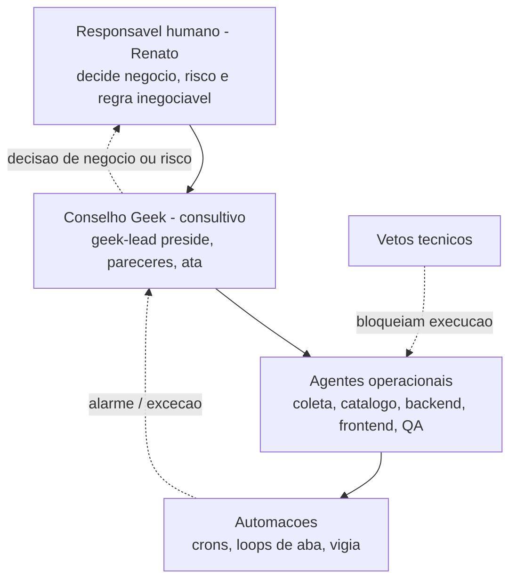
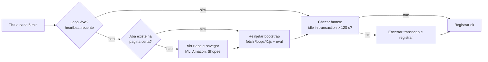

# Fluxo Mestre, capítulo 6: orquestração, observabilidade, hierarquia e governança

Data-base: 2026-11-12. Autor do parecer: engenheiro-infra-sre (Conselho Geek). Este capítulo aprofunda e amarra `docs/plano-convivencia-frentes.md`; não altera código, crons nem loops.

Legenda de confiança: **[LIDO]** confirmado em arquivo desta data; **[MEMÓRIA]** vem da memória/atas do projeto, não reconferido; **NÃO VERIFICADO** não confirmado.

---

## 1. Mapa mestre de cadência (60 minutos)

### 1.1 Fonte: `vercel.json` (19 crons) [LIDO]

| Job (rota `/api/cron/...`) | Expressão | Minutos da hora | `maxDuration` |
|---|---|---|---|
| group-messages | `* * * * *` | todos (00..59) | 60 s |
| collect-prices | `*/5 * * * *` | 0,5,10,...,55 | 200 s |
| collect-shopee | `*/5 * * * *` | 0,5,10,...,55 | 300 s |
| refresh-snapshots?part=stats | `*/30` | 0, 30 | 300 s |
| collector-health | `*/30` | 0, 30 | 60 s |
| refresh-snapshots?part=showcase | `4-59/15` | 4, 19, 34, 49 | 300 s |
| refresh-snapshots?part=daily | `9-59/30` | 9, 39 | 300 s |
| refresh-snapshots?part=inventory | `41 * * * *` | 41 | 300 s |
| discover-products (meli, maxNew=10) | `17 * * * *` | 17 | 120 s |
| collect-vertical v=tecnologia | `1-59/15` | 1, 16, 31, 46 | 300 s |
| collect-vertical v=eletrodomesticos | `3-59/15` | 3, 18, 33, 48 | 300 s |
| collect-vertical v=eletroeletronicos | `6-59/15` | 6, 21, 36, 51 | 300 s |
| collect-vertical v=esporte | `8-59/15` | 8, 23, 38, 53 | 300 s |
| collect-vertical v=livros | `11-59/15` | 11, 26, 41, 56 | 300 s |
| collect-vertical v=impressao3d | `13-59/15` | 13, 28, 43, 58 | 300 s |
| semear-vertical?apply=1 | `7-57/20` | 7, 27, 47 | 60 s |
| fila-classificacao | `13,43` | 13, 43 | 60 s |
| fila-api-oficial?apply=1&limit=10 | `8,28,48` | 8, 28, 48 | 60 s |
| notify-price-drops | `0 11 * * *` | 1x/dia, 11:00 UTC | 60 s |

Rotas em `src/app/api/cron/` que **não** estão no `vercel.json` (sem agendador visto): `cobertura-shopee`, `ampliar-amostra-shopee`, `discover-shopee-esporte`, `import-shopee-conversions`, `loja-teste`. Quem os dispara hoje: NÃO VERIFICADO (pode ser pg_cron/pg_net externo, loop de aba ou manual). `import-shopee-conversions` já constava como "sem agendamento" no inventário de 2026-11-01.

### 1.2 Linha do tempo de 60 minutos

Notação: G = group-messages (roda em TODO minuto, omitido da tabela); P = collect-prices; S = collect-shopee; ST = refresh stats; H = collector-health; SC = showcase; D = daily; INV = inventory; DISC = discover; V-x = collect-vertical; SEM = semear; FC = fila-classificacao; FA = fila-api-oficial.

| Min | Jobs (além de G) | | Min | Jobs (além de G) | | Min | Jobs (além de G) |
|---|---|---|---|---|---|---|---|
| 00 | **P, S, ST, H** (4 pesados) | | 20 | P, S | | 40 | P, S |
| 01 | V-tecnologia | | 21 | V-eletroeletrônicos | | 41 | V-livros + **INV** |
| 02 | (livre) | | 22 | (livre) | | 42 | (livre) |
| 03 | V-eletrodomésticos | | 23 | V-esporte | | 43 | V-impressao3d + **FC** |
| 04 | SC | | 24 | (livre) | | 44 | (livre) |
| 05 | P, S | | 25 | P, S | | 45 | P, S |
| 06 | V-eletroeletrônicos | | 26 | V-livros | | 46 | V-tecnologia |
| 07 | SEM | | 27 | SEM | | 47 | SEM |
| 08 | V-esporte + **FA** | | 28 | V-impressao3d + **FA** | | 48 | V-eletrodomésticos + **FA** |
| 09 | D | | 29 | (livre) | | 49 | SC |
| 10 | P, S | | 30 | **P, S, ST, H** (4 pesados) | | 50 | P, S |
| 11 | V-livros | | 31 | V-tecnologia | | 51 | V-eletroeletrônicos |
| 12 | (livre) | | 32 | (livre) | | 52 | (livre) |
| 13 | V-impressao3d + **FC** | | 33 | V-eletrodomésticos | | 53 | V-esporte |
| 14 | (livre) | | 34 | SC | | 54 | (livre) |
| 15 | P, S | | 35 | P, S | | 55 | P, S |
| 16 | V-tecnologia | | 36 | V-eletroeletrônicos | | 56 | V-livros |
| 17 | DISC | | 37 | (livre) | | 57 | (livre) |
| 18 | V-eletrodomésticos | | 38 | V-esporte | | 58 | V-impressao3d |
| 19 | SC | | 39 | D | | 59 | (livre) |

```mermaid
gantt
    title Hora tipo (minutos 0 a 59), jobs por faixa
    dateFormat  X
    axisFormat  %s
    section Pesados fixos
    P + S (a cada 5)        :0, 1
    ST + H (0 e 30)         :30, 1
    section Verticais (15 min)
    tecnologia (1,16,31,46) :1, 1
    eletrodomesticos (3,...):3, 1
    eletroeletronicos (6,...):6, 1
    esporte (8,...)          :8, 1
    livros (11,...)          :11, 1
    impressao3d (13,...)     :13, 1
    section Fila e semeadura
    SEM (7,27,47)            :7, 1
    FA (8,28,48)             :8, 1
    FC (13,43)               :13, 1
    section Snapshots
    SC (4,19,34,49)          :4, 1
    D (9,39)                 :9, 1
    INV (41)                 :41, 1
    DISC (17)                :17, 1
```

### 1.3 Colisões reais (mesmo minuto)

| # | Minuto(s) | Jobs | Gravidade | Leitura |
|---|---|---|---|---|
| C1 | 00 e 30 | collect-prices + collect-shopee + refresh stats + collector-health (+ group-messages) | **Alta** | Quatro rotas de até 300 s no mesmo instante, sobre o Supabase Micro. É o pior minuto do relógio; coincide com o pico de transações presas relatado. O `collector-health` ainda lê o estado que os outros três estão gravando. |
| C2 | 8, 28, 48 | collect-vertical (esporte / impressao3d / eletrodomésticos) + fila-api-oficial (consome cota ML) | Média | Vertical Plus e fila de links oficiais disputam banco e cota ML no mesmo minuto. |
| C3 | 13, 43 | collect-vertical impressao3d + fila-classificacao | Média | Classificação grava identidade enquanto a vertical lê/grava ofertas. |
| C4 | 41 | collect-vertical livros + refresh inventory | Baixa a média | Inventário faz varredura ampla de leitura no mesmo minuto de uma coleta. |
| C5 | 11:00 UTC (08:00 em Brasília) | notify-price-drops + C1 (minuto 0) | Baixa | Uma vez por dia; empilha um quinto job no pior minuto. |
| C6 | `*/5` vs. duração | collect-shopee tem `maxDuration` 300 s e roda a cada 300 s | Média | Execuções consecutivas podem sobrepor; collect-prices (200 s) tem folga. Existe lock/idempotência por oferta? NÃO VERIFICADO. |
| C7 | 0..5 e 30..35 | `refresh stats` (até 300 s) ainda pode estar rodando quando `showcase` entra no minuto 4/34 | Média | Sobreposição por duração, não por minuto. |
| C8 | todo minuto | group-messages (60 s) concorre com TODOS os demais | Alta (estrutural) | O job de maior prioridade (envio) compartilha banco com tudo; é o que "vai a 60 s" em hora de pico. |

Não há colisão de minuto entre os `*/5` (0,5,...) e as verticais (nenhuma cai em múltiplo de 5); o desenho de 2026-11-12 funcionou nisso. [LIDO, conferido por cálculo]

### 1.4 Proposta de reescalonamento (para a próxima ata; não aplicada)

| Mudança | Efeito |
|---|---|
| `refresh stats` de `*/30` para `2,32` e `collector-health` de `*/30` para `12,42` (minutos hoje livres) | Esvazia o minuto 0/30: ficam só P + S. |
| `collect-shopee` de `*/5` para `2-59/5` (2,7,12,...) | Separa P de S; P e S nunca no mesmo minuto. Verificar que 2,7,12,... não bate com verticais: 3,6,8,11,13 vizinhos, sem igualdade. |
| `fila-api-oficial` de `8,28,48` para `12,32,52` (minutos livres; 9/29/49 colidem com daily e showcase, 10/30/50 com P) | Tira a fila de links do minuto da vertical. |
| `fila-classificacao` de `13,43` para `14,44` (livres) | Separa da impressao3d. |
| `inventory` de 41 para 42 (livre) | Separa de livros. |

Qualquer mudança entra por script com `JSON.parse`/`JSON.stringify` (ver §6, incidente 1) e ata do Conselho (porte médio).

---

## 2. Hierarquia e regras de decisão

### 2.1 Quem decide o quê

| Decisão | Quem decide | Quem opina | Registro |
|---|---|---|---|
| Regra de negócio, modelo, fonte de dado, nova loja, mudança de preço/média pública | Responsável humano | Conselho (mesa fixa + tema) | Ata + ADR |
| Mudança de cron, orçamento de cota, flag de produção, deploy com risco (porte grande) | Responsável humano, com recomendação do Conselho | infra-sre, dba, backend, qa, seguranca-db | Ata + este capítulo |
| Ajuste leve (texto, bug evidente) | `geek-lead` aciona 1 a 3 membros | membros relevantes | Ata de uma linha |
| Execução técnica dentro de decisão já registrada | Agente operacional | n/a | Commit, log em `docs/backups/` |
| Pausar/retomar flag de degradação (§3) | **Operador/infra-sre pode pausar sozinho** (reversível); religar também; consolidar em ata depois | Conselho | Log da pausa + motivo |
| Aprovar em lote o reversível | Dono já deu aprovação ampla com backup e log [MEMÓRIA] | n/a | `docs/backups/*.ndjson` + log |

### 2.2 Escalonamento

| Nível | Gatilho | Ação | Prazo |
|---|---|---|---|
| N0 | Job com `status` parcial/erro isolado | Vigia reinicia no próximo ciclo; nada a fazer | automático |
| N1 | Mesmo job falha em 3 ciclos seguidos, ou 429 do ML ≥ 2% na hora | Degradar pela escada do §3; infra-sre registra | até 15 min |
| N2 | Transação presa >120 s não resolvida pelo vigia, group-messages ≥ 45 s por 3 execuções, ou envio parado | Pausar frentes de prioridade 4 a 6; abrir incidente na ata do dia | até 30 min |
| N3 | Dado público possivelmente errado (preço, média, selo), segredo exposto, perda de dado, vercel.json quebrado em produção | Reverter (§5), avisar o responsável humano, incidente com lição (§6) | imediato |

### 2.3 Quando o dono PRECISA decidir (não resolver sozinho)

1. Qualquer mudança que altere o que o público vê como verdade (média, selo, exclusão de ofertas, janela de dados).
2. Tirar uma loja ou fonte do ar por mais de um dia, ou adicionar loja nova.
3. Gasto novo (upgrade de plano Supabase/Vercel, novo serviço).
4. Rotação de segredo que derrube canal em uso (Telegram, afiliados), por causa da janela fora do ar.
5. Qualquer exceção às regras inegociáveis (nunca há autorização implícita).
6. Divergência entre membros do Conselho que a réplica não resolveu.

Fora disso o dono não deve ser acordado: degradação reversível, reinício de loop, reescalonamento de minuto com ata e rollback são decisão operacional.

### 2.4 Regra de ouro e vetos

**Regra de ouro: dado real.** Nada de dado fake, sintético, interpolado ou preenchido (AGENTS.md). Sob pressão (job atrasado, gráfico com buraco) a resposta é mostrar o buraco ou o `last_seen`, jamais preencher.

| Veto | Quem pode vetar | Efeito |
|---|---|---|
| Dado fake/sintético; scraping; mais de um master para o mesmo jogo; imagem repetida | Qualquer membro, `qa-verificador` e `geek-lead` obrigatoriamente | Bloqueia a entrega; sem override do Conselho (só o responsável pode reabrir a regra, por ADR) |
| Segredo em resposta, log, doc ou repositório | `seguranca-db`, `engenheiro-infra-sre` | Bloqueia commit/publicação |
| Deploy sem `vercel.json` validado, sem typecheck/build | `qa-verificador`, `engenheiro-infra-sre` | Bloqueia push |
| Escrita em produção sem backup/rollback | `dba-postgres`, `qa-verificador` | Bloqueia apply |
| Coleta fora de API oficial | `integrador-apis` | Bloqueia; código legado de scraping é dívida declarada |

Conselho é consultivo: o veto de agente bloqueia a **execução** até o responsável decidir; não substitui a decisão dele.

---

## 3. Prioridades entre frentes e política de degradação

### 3.1 Ordem de prioridade (herda o plano de convivência §2.2)

| Prio | Frente | Por quê |
|---|---|---|
| 1 | Envio de mensagens (group-messages) e confirmação de preço de oferta com gatilho | Entrega a promessa ao público; falha aqui é visível e perde receita |
| 2 | Cupons (leitura na fonte + validade) | Perecem em horas |
| 3 | Refresh de ofertas já vistas (collect-prices, collect-shopee, verticais) | Mantém o preço real |
| 4 | Descoberta e semeadura (discover, semear, fila-api-oficial) | Pode esperar folga de cota |
| 5 | Médias/estado diário, inventário, snapshots (stats, showcase, daily, inventory) | Derivado; recalcula depois |
| 6 | Relatórios, coberturas amplas, classificação em massa, notify-price-drops | Pode atrasar horas |

### 3.2 Escada de degradação (o que pausa primeiro)

| Sintoma | Passo 1 (primeiro a pausar) | Passo 2 | Passo 3 (último recurso) | Nunca pausar |
|---|---|---|---|---|
| **429 do ML ≥ 2%** | semear-vertical, discover, fila-api-oficial (`limit` menor) | leitura de página/cupom de item; recuo exponencial por classe | collect-prices só dos itens com gatilho | envio de mensagens; confirmação de preço de quem tem gatilho |
| **Banco lento / group-messages ≥ 45 s / transação presa** | snapshots inventory e daily; cobertura e ampliação Shopee; fila de classificação | collect-vertical das lojas Plus, uma vertical por vez; showcase | collect-shopee/collect-prices com `limit` reduzido | group-messages (reduzir o que o job lê, não o job) |
| **Erro de ingestão em loop de aba** | recuo comum por origem; aba segue | vigia reinjeta | vigia reabre a aba | os demais loops (não parar o laço todo por um 429) |
| **Cota de IO do Supabase** | desligar frentes 5 e 6 por kill switch (§5) | espaçar verticais de 15 para 30 min (um commit no vercel.json) | upgrade de plano (decisão do dono, §2.3) | n/a |

Regra: pausar **a classe** que estourou, nunca a frente inteira; retomada automática quando o recuo expira. Em consonância com "loops nunca param": pausa é recuo com retomada, não parada.

---

## 4. Observabilidade

### 4.1 Fontes

| Fonte | Estado | Observação |
|---|---|---|
| `collector_runs` (migration 0025, `src/server/collector/collector-runs.ts`) | Grava **somente** com `COLLECTOR_RUNS=1` [LIDO no código]. Se o flag está ligado em produção: NÃO VERIFICADO (as atas e CUPOM_NA_AGULHA tratam o job `group-messages` como logado, o que sugere que sim). | Base para todas as métricas abaixo. |
| `collector-health` (cron */30) | Roda; **alerta só envia** com `COLLECTOR_ALERTS=1` + destino de alerta definido; do contrário é dry-run (`src/server/observability/collector-health.ts`) [LIDO]. Se está ligado em produção: NÃO VERIFICADO. | O cabeçalho da rota ainda diz "NÃO está no vercel.json", desatualizado. |
| `/admin/mensagens`, `/admin/catalogo` | Painéis ao vivo | Cupom 24 h, pool, histórico diário |
| Logs Vercel (`console.error` das rotas) | Retenção curta do plano; NÃO VERIFICADO quanto tempo | Sem agregação |
| Vigia de 5 min (sessão do operador, memória `loops-nunca-param`) | Roda **na sessão do Claude Code**, não em infraestrutura | Ver §4.4 e ponta P1 |

### 4.2 O que medir por hora

| Métrica | Fonte | Alvo / alarme |
|---|---|---|
| Execuções ok / parcial / erro por job | `collector_runs` | Erro ≥ 2 seguidos = N1 |
| Atraso do último ok por job | `collector_runs` | > 2x o intervalo do job = alarme |
| Duração p50/p95 do group-messages | `collector_runs.meta` | **SLO < 45 s**; ≥ 55 s = N2 |
| Mensagens com gatilho: enviadas x perdidas por confirmação atrasada | `group-messages` meta | **0 perdidas** |
| 429 por origem (ML, Shopee, Amazon) / chamadas | meta dos coletores | **SLO ML < 2%** |
| Transações `idle in transaction` > 120 s | `pg_stat_activity` (hoje checada pelo vigia) | **SLO zero**; qualquer uma = encerrar e registrar |
| Linhas gravadas por job | meta | Detectar regravação do igual (regra "escrita enxuta") |
| Conexões em uso / 60 do pooler | Supabase | > 80% = N1 |
| Frescor: idade do preço mostrado de ofertas com gatilho | consulta SQL | Referência: confirmação em até 40 min (Amazon) |
| Cupom: ativos, barrados por motivo (`cupomBarradas`), enviados | meta group-messages | Barrado por motivo desconhecido = revisar regra |

### 4.3 SLOs

| SLO | Alvo | Janela | Como se mede | Orçamento de erro |
|---|---|---|---|---|
| Duração de group-messages | p95 < 45 s | 24 h | `collector_runs` | 5% das execuções podem exceder |
| Transação presa | zero > 120 s | contínuo | `pg_stat_activity` por minuto | zero (a presa é encerrada, mas conta como violação) |
| 429 do Mercado Livre | < 2% das chamadas | 1 h móvel | meta dos coletores | 2% |
| Mensagem com gatilho perdida por atraso de confirmação | 0 | 24 h | log do ciclo | zero |
| Disponibilidade do site público | NÃO VERIFICADO (sem sonda externa; ver P3) | 30 d | n/a | n/a |

### 4.4 Como o vigia age

Regras do vigia: nunca espera o dono reabrir aba; reinjeta só quando `/loops/*.js` mudou ou o loop não responde; erro de rede, 429, 5xx, login e captcha viram pausa com recuo, jamais parada; só `stop()` do operador para. Limite honesto: recarregar a aba mata o loop até o próximo tick (até 5 min de lacuna). [MEMÓRIA]

---

## 5. Kill switches e reversão

Todos lidos do ambiente do servidor (Vercel). Mudança de variável de ambiente exige novo deploy/redeploy para valer: NÃO VERIFICADO se as rotas relêem a cada requisição (as constantes de módulo abaixo são lidas na carga do módulo).

| Flag | Padrão (ligado) | Para desligar | Efeito de desligar | Onde [LIDO] | Reversão |
|---|---|---|---|---|---|
| `GROUP_ACHADO` | ligado | `off` | Para o gatilho "Achado" nas mensagens | `src/server/messaging/group-offers.ts` | religar (apagar ou outro valor) e redeploy |
| `GROUP_CUPOM` | ligado | `off` | Para todo o gatilho de cupom | `src/server/messaging/coupon-offers.ts` | idem |
| `FILA_AUTO_OBVIO` | ligado | `off` | Desliga o porteiro automático do óbvio; tudo vai à fila do dono (acumula revisão) | `src/server/identity-queue/queue.ts`, `actions/fila-classificacao.ts` | idem |
| `AVG_EXCLUDED_DISABLED` | desligado | `1` | Desativa a exclusão de ofertas na média pública (**muda dado público**; só com decisão do dono) | `src/server/queries/public-offers.ts` | voltar ao valor anterior; conferir selo/média |
| `PLUS_APROVACAO_RELAXADA` | ligado | `0` | Volta a aprovação estrita no nicho | `src/lib/catalog/aprovacao-nicho.ts` | idem |
| `AMAZON_ID_FLEX` | ligado | `off` | Volta à identidade Amazon rígida | `src/lib/affiliate/amazon-identity.ts` | idem |
| `PLUS_ESCOPO_VITRINE` | ligado | `0` | Desativa o escopo de vitrine | `src/lib/catalog/escopo-compra.ts` | idem |
| `PLUS_CADENCIA_CAMADAS` | ligado | `0` | Volta ao intervalo único de coleta Plus (mais carga no banco) | `src/lib/catalog/vertical/queue.ts` | idem |
| `COLLECTOR_RUNS` | NÃO VERIFICADO em produção | `1` liga | Registra execuções | `src/server/collector/collector-runs.ts` | desligar |
| `COLLECTOR_ALERTS` + destino de alerta | desligado por padrão | `1` | Envia alertas de saúde | `collector-health.ts` | desligar |

Notas: (a) cada flag é lida como `=== 'off'` ou `!== '0'`, ou seja, **valores de digitação errada deixam o recurso ligado** (falha para o lado ativo; para `AVG_EXCLUDED_DISABLED` é o inverso, o padrão é seguro); (b) registrar toda virada de flag com data, motivo e quem; (c) não há flag para parar crons individualmente: o único caminho é editar `vercel.json` (§6.1).

### 5.1 Reversão de deploy e dados

| Camada | Procedimento | Gate |
|---|---|---|
| Código | Reverter o commit (`git revert`), push em `main`, conferir `vercel ls` Ready + site 200 | `vercel.json` validado antes do push |
| Cron | Reaplicar a versão anterior do `vercel.json` (git); crons da Vercel só mudam com deploy | `node -e "JSON.parse(...)"` |
| Dado | `docs/backups/*.ndjson` + log JSON de cada aplicação em lote (`aplicar-*`); rollback por script com `--rollback` | Toda escrita em massa com backup ANTES |
| Migration | Cada migration tem `.rollback.sql` ao lado (padrão em `drizzle/migrations`) | Rodar rollback só com backup e decisão registrada |
| Loop de aba | `stop()` do operador ou reinjeção da versão anterior de `/loops/*.js` | n/a |

---

## 6. Incidentes reais e lições

| # | Data | O que aconteceu | Causa | Lição / controle |
|---|---|---|---|---|
| 1 | 2026-11-12 | `vercel.json` publicado com JSON inválido (commit 7e177ac), corrigido em 815534e | Edição manual em arquivo de config sem validar | Editar só via script que usa `JSON.parse`/`JSON.stringify`; validar antes do push; **ainda não há trava automática** (ver P4). Impacto de crons sem rodar durante a janela: NÃO VERIFICADO |
| 2 | 2026-11-12 | Cupom elegível barrado indevidamente por regra de texto | A "agulha" barra por padrões no texto (Prime, novos usuários, primeira compra, membros, "seguir a loja": `CUPOM_NA_AGULHA.md`). O padrão amplo demais barrou cupom válido. Detalhe exato da regex: NÃO VERIFICADO (não localizado em ata) | Medir `cupomBarradas` por motivo a cada ciclo; teste automatizado com casos reais aprovados e barrados; mudança de regra de barreira entra em ata |
| 3 | 2026-07-29 | 176 masters duplicados no catálogo (ML cataloga o mesmo jogo sob dois `catalog_product_id`) | Dedup só por ID exato | Regra inegociável "um jogo, uma média"; `findExistingMasterProduct` obrigatório (AGENTS.md) |
| 4 | 2026-07-29 | Imagem repetida em várias páginas | Reuso sem busca | Regra "uma imagem, um lugar"; `grep` antes de reutilizar |
| 5 | recorrente | Transações `idle in transaction` travando o banco | Transação aberta durante chamada externa ou conexão abandonada | Vigia encerra > 120 s; regra "transação curta, nunca aberta durante chamada externa"; **atribuição à raiz: NÃO VERIFICADO** |
| 6 | recorrente | Locks de linha de coletor segurando o envio | Coletor e envio disputam as mesmas linhas | Regra "mensagens primeiro" (coletor não segura lock que o envio precisa); `FOR UPDATE SKIP LOCKED` no claim de envios; advisory lock transacional na geração da fila (`pg_try_advisory_xact_lock`) e no recálculo por produto, [LIDO]. Cobertura em todos os coletores: NÃO VERIFICADO |
| 7 | recorrente | Loop do Chrome parou por rede (5 h), cupom parou por 429, aba recarregada matou loops | Loops terminavam por erro | Regra "loops nunca param" + vigia + "aba fechada = abrir de novo" [MEMÓRIA] |
| 8 | NÃO VERIFICADO | Duplicidade de migração | Numeração: hoje **não há números duplicados** em `drizzle/migrations`, mas há **lacuna em 0039** (vai de 0038 a 0040) [LIDO]. Se a duplicidade ocorreu em outra época ou branch: NÃO VERIFICADO | Verificação de numeração única e sequencial antes do commit (ver P6) |
| 9 | 2026-11-12 | Banco sobrecarregado com coletas Plus a cada 10 min (cbdca7c), aliviado para 15 min (7e177ac, f27a8a0) | Plano Supabase Micro com IO limitado | Carga nova entra por ata com orçamento; medir antes e depois (§4) |

---

## 7. Pontas soltas de governança e operação

| ID | Ponta solta | Severidade | Evidência | Correção recomendada |
|---|---|---|---|---|
| P1 | **Vigia roda só na sessão do operador (CronCreate local).** Fechar a sessão ou o computador para o vigia, os loops de aba e a limpeza de transações | **Alta** | Memória `loops-nunca-param` [MEMÓRIA] | Mover a limpeza de transações presas para cron do servidor (Vercel/pg_cron, `idle in transaction > 120 s`); manter só reinjeção de aba no operador; userscript/extensão para loops. Decisão do dono sobre custo |
| P2 | **Alarme sem destinatário comprovado**: `collector-health` só envia com `COLLECTOR_ALERTS=1` e destino configurado; senão é dry-run. Alarme que ninguém recebe é igual a nenhum | **Alta** | `collector-health.ts` [LIDO]; ligação em produção NÃO VERIFICADO | Confirmar flags e destino (chat privado do dono); teste de disparo mensal; incluir alarmes de SLO do §4.3 |
| P3 | **Sem sonda externa de disponibilidade** do site/crons; só se sabe que caiu por olhar | Média | Nenhuma sonda localizada; NÃO VERIFICADO | Monitor externo simples (uptime) nos endpoints públicos e heartbeat dos crons críticos |
| P4 | **Sem CI**: não existe `.github/workflows`; nada barra `vercel.json` inválido, typecheck ou build antes do push | **Alta** | Diretório ausente [LIDO]; incidente 1 | Hook pre-push local mínimo (JSON.parse do vercel.json + typecheck) e workflow de CI; branch protegida |
| P5 | **Ausência de testes**: um único `*.test.ts` (`collector-runs.test.ts`) no repositório; demais verificações são scripts `test-*.ts` manuais | Média | `find` [LIDO] | Suíte mínima para regras inegociáveis (dedup, média por oferta-dia, agulha de cupom, auth de cron) rodando no CI |
| P6 | **Numeração de migrations com lacuna (0039) e sem trava** | Baixa | `ls drizzle/migrations` [LIDO] | Script de checagem (sequencial, único, par `.rollback.sql`) no pre-push; documentar 0039 como intencional ou ocupado |
| P7 | **Jobs sem timeout/guarda de sobreposição**: collect-shopee `maxDuration` 300 s com intervalo 300 s; nenhum job declara orçamento interno de tempo uniforme, nem lock "já está rodando" visível; `fila-classificacao` usa `budgetMs` próprio (20 s) como exemplo isolado | Média | `maxDuration` [LIDO]; lock por job: NÃO VERIFICADO | `budgetMs` em todos os coletores (parar de forma limpa a 80% do `maxDuration`); advisory lock por job para pular ciclo se o anterior vive |
| P8 | **Autenticação do cron aceita `?key=<segredo>` na query**: o segredo pode aparecer em logs de acesso/proxy/histórico | **Média** | `cron-auth.ts` [LIDO]; ata de 2026-11-10 já recomenda "só Bearer" | Migrar o job pg_net legado para Bearer e remover o `?key=`. Comparação com `===` simples (não tempo constante): risco baixo, corrigir junto |
| P9 | **Segredos**: `.env.local` ignorado pelo git [LIDO] e auditoria de 2026-10-31 sem vazamento no repositório. Pontos abertos: rotação periódica, quem tem acesso ao painel Vercel/Supabase, e o artefato untracked `--out` na raiz (15 KB; conteúdo não vazou chave nas linhas vistas, mas deve ser removido ou ignorado) | Média | relatório QA de 2026-10-31 [LIDO]; `--out` [LIDO] | Apagar/ignorar `--out`, `build.log`, `.next-start.log`, `.next-perf*/` (untracked); calendário de rotação; nunca colar segredo em resposta ou ata |
| P10 | **Rotas agendáveis fora do `vercel.json`** (`cobertura-shopee`, `ampliar-amostra-shopee`, `discover-shopee-esporte`, `import-shopee-conversions`, `loja-teste`): quem as dispara é desconhecido; `import-shopee-conversions` alimenta a métrica de receita | Média | Inventário 2026-11-01 e listagem [LIDO]; agendador: NÃO VERIFICADO | Inventariar o agendador real; ou agendar no `vercel.json` em minuto livre (§1.4), ou documentar como manual |
| P11 | **Colisão C1 (minuto 0/30)** sem tratar | Alta | §1.3 | Aplicar §1.4 por ata |
| P12 | **Cabeçalho desatualizado** em `collector-health/route.ts` (diz que não está no vercel.json) e `maxDuration` 60 do group-messages igual ao SLO de 45 s: margem de 15 s | Baixa | [LIDO] | Atualizar comentário; alarme em 40 s |
| P13 | **Orçamento único do ML ainda é proposta** (plano §7): cada rota consome cota por conta própria; sem painel | Média | plano-convivencia §7 [LIDO] | Contador por classe em `collector_runs.meta` + painel no `/admin` |
| P14 | **Repositório com muitos arquivos untracked** (agents/*.md, backups, builds), risco de commit cruzado entre agentes em paralelo | Baixa | git status [LIDO] | Regra do plano §5 (commitar só os próprios arquivos); `.gitignore` para builds e logs |

## 8. Decisões que este capítulo pede ao responsável

1. Aprovar o reescalonamento do §1.4 (porte médio, via ata).
2. Confirmar que `COLLECTOR_RUNS=1` e `COLLECTOR_ALERTS=1` com destino de alerta estão ligados em produção, e ligar o que faltar (P2).
3. Autorizar a limpeza de transações presas em cron de servidor (P1) e o CI mínimo (P4).
4. Remover o `?key=` da autenticação do cron após migrar o job legado (P8).

---

## Adendo de 2026-11-12 (noite), conferido contra o código

- `vercel.json` passou de 19 para **21 entradas**: `cobertura-shopee` (`22,52`) e `aprovacao-auto` (`12-52/10`, lote 60). Os minutos 22 e 52 têm agora `cobertura-shopee` e `aprovacao-auto` juntos (FM-50). A proposta de reescalonamento do §1.4 continua não aplicada; esta atualização não tocou o arquivo.
- **Incidentes do dia** (detalhe na seção 7 do `FLUXO_MESTRE.md`): envio parado de ~11:00 a ~13:40 UTC por detecção acima do orçamento (d63cf1f, e500e95); starvation da fila de envio (423f42b, 94a64b5), que originou a R-46; `vercel.json` inválido em 7e177ac, corrigido em 815534e.
- **SLOs novos** (seção 12): enviadas por hora (60 ou mais), régua em produção (0 termo banido, 0 mensagem fora das lojas liberadas, degrau 1 até 1/3), `aprovacao-auto` e `cobertura-shopee` (erro < 2%, 10030 = 0 por 7 dias).
